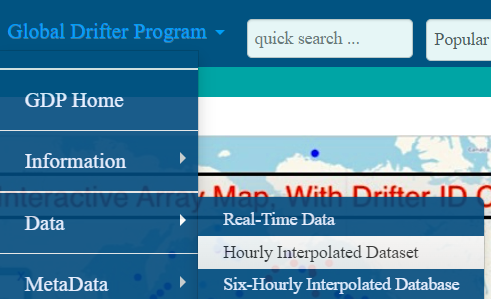
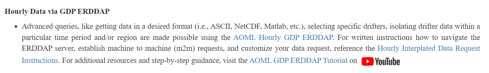
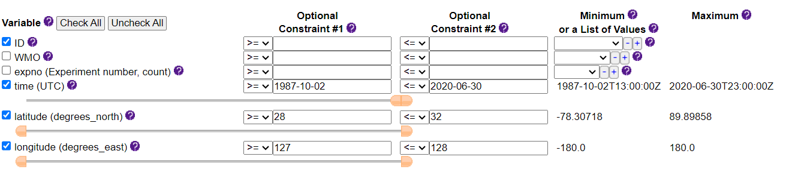
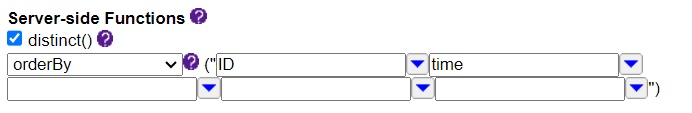
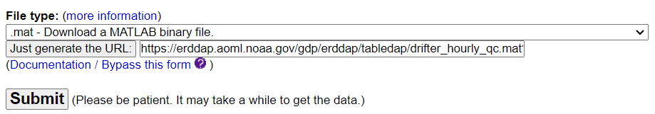

# :material-download-box-outline: How to download GDP data <span class="date">[2026.01.02]</span>

How to obtain hourly (or 6-hourly) interpolated drifter data from the Global Drifter Program through the AOML ERDDAP server,
and how to read the result in MATLAB.

## 1. Find the hourly data page

Start from the GDP homepage: [GDP (NOAA AOML)](https://www.aoml.noaa.gov/phod/gdp/index.php).
To download the **Hourly Interpolated Data**, use the toolbar at the top of the page, or go directly to
[Hourly Interpolated Data](https://www.aoml.noaa.gov/phod/gdp/hourly_data.php).

<figure markdown="span">
  { loading=lazy }
  <figcaption>GDP homepage: the toolbar leading to the hourly data</figcaption>
</figure>

Scroll down until you reach the paragraph below.

<figure markdown="span">
  { loading=lazy }
  <figcaption>Paragraph with the ERDDAP data link and the PDF guide</figcaption>
</figure>

- The [first link](https://erddap.aoml.noaa.gov/gdp/erddap/tabledap/drifter_hourly_qc.html) opens the ERDDAP data access form for the hourly interpolated data.
- The [second link](https://www.aoml.noaa.gov/phod/gdp/images/ERDDAP_Hourly_Interpolated_Data.pdf) is a PDF that explains how to use that form.

!!! tip "6-hourly data"
    For the 6-hour interpolated data use
    [ERDDAP: Global Drifter Program, 6 Hour Interpolated QC Drifter Data](https://erddap.aoml.noaa.gov/gdp/erddap/tabledap/drifter_6hour_qc.html).

## 2. Fill in the ERDDAP form

The PDF above covers everything, but the basic procedure is summarized here.

<figure markdown="span">
  { loading=lazy }
  <figcaption>ERDDAP data access form for the hourly drifter data</figcaption>
</figure>

1. Click **Uncheck All** to reset the options.
2. Select the basic variables **ID, WMO, time, latitude, longitude, sst, ve, vn, drogue_lost_date, drogue_center_depth**, plus any others you need.
3. In **time**, enter the period you want, as in the figure above.
4. In **latitude** and **longitude**, enter the bounds of your study area, as in the figure above.
5. Scroll down to **Server-side Functions**, which control how the downloaded data are sorted.
   Tick **distinct**, select **orderBy**, and sort by **ID, time** (or any order you prefer).

    <figure markdown="span">
      { loading=lazy }
      <figcaption>Server-side Functions: distinct and orderBy (ID, time)</figcaption>
    </figure>

6. Choose the **file type**. CSV, **mat**, **NC** and others are available; pick whichever is easiest for you to handle
   (I prefer mat or NC). Then click **Submit** to download.

    <figure markdown="span">
      { loading=lazy }
      <figcaption>File type selection; mat is chosen here</figcaption>
    </figure>

    The **URL** button builds a direct download link for the same request, which is convenient for sharing an identical dataset with others.

## 3. Read the mat file in MATLAB

The mat file holds a structure, so use dot notation:

```matlab title="Plot drifter trajectories from the downloaded mat file"
%% Drifter Trajectory

clc; clear; close all;
load drifter_hourly_qc_7b2b_639d_848a.mat ; % change mat filename!!!

d = drifter_hourly_qc; % rename for easier dot notation usage
id = double(unique(string(d.ID))); d.ID = double(string(d.ID));
    % variable id contains all Drifter IDs passing through study area
d.latitude = double(d.latitude); d.longitude = double(d.longitude); % type conversion

% time : seconds since 1970.01.01
d.time = datetime(1970,01,01,00,00,00) + seconds(d.time); % convert to datetime type

figure(1); hold on;
for i = 1:length(id)
    k = d.ID == id(i);
    plot(d.longitude(k), d.latitude(k)) % dot notation
end

clear drifter_hourly_qc;
```

## Dataset citation

!!! quote "Cite the dataset when you use it in a publication"
    Elipot, Shane; Sykulski, Adam; Lumpkin, Rick; Centurioni, Luca; Pazos, Mayra (2022).
    Hourly location, current velocity, and temperature collected from Global Drifter Program drifters world-wide. [indicate subset used].
    NOAA National Centers for Environmental Information. Dataset. [https://doi.org/10.25921/x46c-3620](https://doi.org/10.25921/x46c-3620). Accessed [date].

## Full dataset from NOAA NCEI

!!! info "Hourly dataset version 2.00"
    The hourly dataset version 2.00 is officially available from NOAA NCEI:
    [AOML-GDP-1HR landing page](https://www.ncei.noaa.gov/access/metadata/landing-page/bin/iso?id=gov.noaa.nodc:AOML-GDP-1HR).

    On that page, open the "Lineage" tab, follow "Output Datasets", then "data", then "0-data", and finally "gdp_v2.00.nc" to download through your browser.
    Alternatively, use this [direct link](https://www.nodc.noaa.gov/archive/arc0199/0248584/1.1/data/0-data/) to the NetCDF file (about **12 GB**).

    The dataset is distributed as a [single NetCDF file containing contiguous ragged arrays](https://cfconventions.org/cf-conventions/cf-conventions.html#_contiguous_ragged_array_representation),
    one for each data variable, together with all metadata.
    To get started, see the [Jupyter Notebook on GitHub](https://github.com/Cloud-Drift/gdp-get-started) with simple usage examples.
