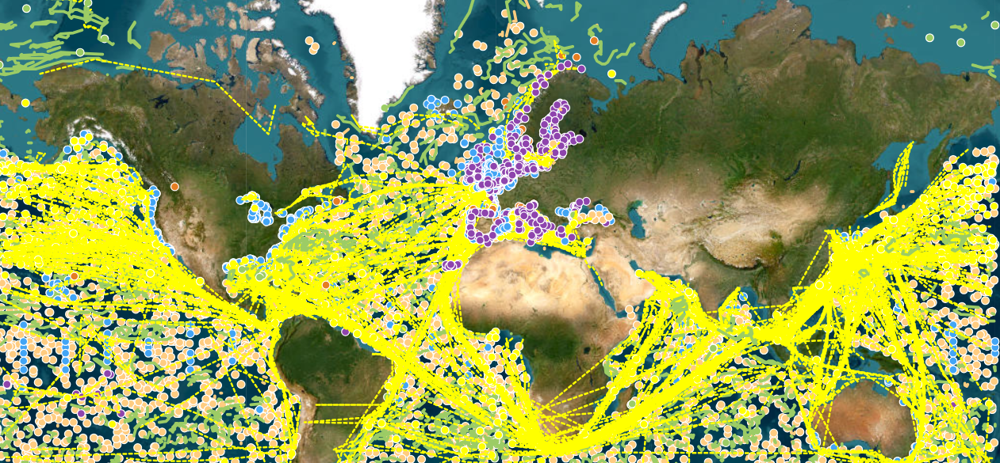

# :material-ferry: 현장 관측 [2026.03.28]

현장 관측 자료를 관측 플랫폼별로 정리했습니다. 카드를 누르면 해당 플랫폼의 자료 목록이 열립니다.
이 관측 자료로 만든 격자 수온·염분 product는 별도 페이지에 모아 두었습니다.

## 플랫폼별

-   :material-database-outline: **통합 아카이브**

    ---

    WOD, GTSPP, CODC, CMEMS CORA profile, Coriolis

    [:octicons-arrow-right-24: 상세 목록](archives.md)

-   :material-waves: **Argo**

    ---

    Argo profile, float 궤적 기반 유속 product

    [:octicons-arrow-right-24: 상세 목록](argo.md)

-   :material-map-marker-path: **Drifter**

    ---

    GDP 등 표층 뜰개, drifter 기반 합성 유속장, 지역 부이

    [:octicons-arrow-right-24: 상세 목록](drifter.md)

-   :material-ferry: **선박**

    ---

    반복 관측 hydrography (CCHDO, GO-SHIP, WOCE, CLIVAR), 선박 ADCP, XBT, SOOP

    [:octicons-arrow-right-24: 상세 목록](ship.md)

-   :material-anchor: **계류**

    ---

    OceanSITES, TAO/TRITON/PIRATA/RAMA, PMEL Ocean Climate Stations, NDBC

    [:octicons-arrow-right-24: 상세 목록](mooring.md)

-   :material-chart-timeline-variant: **조위 관측**

    ---

    PSMSL, GLOSS, CSIRO 해수면 자료

    [:octicons-arrow-right-24: 상세 목록](tide-gauge.md)

-   :material-grid: **격자 수온·염분 product**

    ---

    EN4, CMEMS CORA OA, MOAA GPV, CORA5, BOA-Argo, WOA 비교표

    [:octicons-arrow-right-24: 상세 목록](gridded.md)

## 기타 현장 관측 자료

-   :material-flask-outline: **탄소·화학 및 파생 자료**

    ---

    GLODAPv2, CoastDOM v1, RFROM 해양 열용량 지도, iQuam 현장 SST

    [:octicons-arrow-right-24: 상세 목록](others.md)

!!! tip "자료 찾기·모니터링"
    관측 위치를 찾고 현재 보고 중인 플랫폼을 확인할 수 있는 도구입니다.

    - [OSMC viewer](https://viz.pmel.noaa.gov/osmc/?variable=ztmp&color_by=platform_type) · [OSMC (Observing System Monitoring Center)](https://www.osmc.noaa.gov/)
    - [CMEMS In Situ dashboard (marineinsitu.eu)](http://www.marineinsitu.eu/dashboard/)
    <figure markdown="span">
      { loading=lazy }
      <figcaption>CMEMS In Situ 대시보드</figcaption>
    </figure>
    - [PMEL Data Links](https://www.pmel.noaa.gov/data-links) · [PMEL Observed Data (ERDDAP)](https://ferret.pmel.noaa.gov/pmel/erddap/info/index.html?page=1&itemsPerPage=1000) · [PMEL Observed Data (LAS)](https://ferret.pmel.noaa.gov/pmel/las/)
