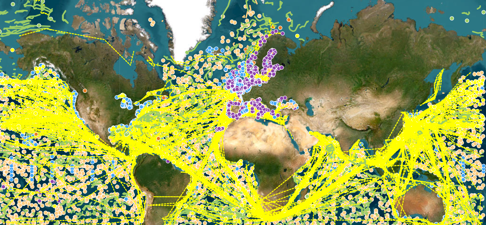

# :material-ferry: In Situ [2026.03.28]

Field observations grouped by platform. Pick a card to open the dataset list for that platform;
gridded temperature and salinity products built from these observations are collected on their own page.

## By platform

-   :material-database-outline: **Multi-platform archives**

    ---

    WOD, GTSPP, CODC, CMEMS CORA profiles, Coriolis

    [:octicons-arrow-right-24: Details](archives.md)

-   :material-waves: **Argo**

    ---

    Argo profiles, float-based velocity products

    [:octicons-arrow-right-24: Details](argo.md)

-   :material-map-marker-path: **Drifter**

    ---

    GDP and other surface drifters, drifter-based current syntheses, regional buoys

    [:octicons-arrow-right-24: Details](drifter.md)

-   :material-ferry: **Ship**

    ---

    Repeat hydrography (CCHDO, GO-SHIP, WOCE, CLIVAR), shipboard ADCP, XBT, SOOP

    [:octicons-arrow-right-24: Details](ship.md)

-   :material-anchor: **Mooring**

    ---

    OceanSITES, TAO/TRITON/PIRATA/RAMA, PMEL Ocean Climate Stations, NDBC

    [:octicons-arrow-right-24: Details](mooring.md)

-   :material-chart-timeline-variant: **Tide gauge**

    ---

    PSMSL, GLOSS, CSIRO sea level data

    [:octicons-arrow-right-24: Details](tide-gauge.md)

-   :material-grid: **Gridded T/S products**

    ---

    EN4, CMEMS CORA OA, MOAA GPV, CORA5, BOA-Argo, WOA: a side-by-side comparison

    [:octicons-arrow-right-24: Details](gridded.md)

## Other in situ datasets

-   :material-flask-outline: **Carbon, chemistry and derived products**

    ---

    GLODAPv2, CoastDOM v1, RFROM ocean heat content maps, iQuam in situ SST

    [:octicons-arrow-right-24: Details](others.md)

!!! tip "Find & monitor"
    Tools for locating observations and checking what is currently reporting.

    - [OSMC viewer](https://viz.pmel.noaa.gov/osmc/?variable=ztmp&color_by=platform_type) · [OSMC (Observing System Monitoring Center)](https://www.osmc.noaa.gov/)
    - [CMEMS In Situ dashboard (marineinsitu.eu)](http://www.marineinsitu.eu/dashboard/)
    <figure markdown="span">
      { loading=lazy }
      <figcaption>CMEMS In Situ dashboard</figcaption>
    </figure>
    - [PMEL Data Links](https://www.pmel.noaa.gov/data-links) · [PMEL Observed Data (ERDDAP)](https://ferret.pmel.noaa.gov/pmel/erddap/info/index.html?page=1&itemsPerPage=1000) · [PMEL Observed Data (LAS)](https://ferret.pmel.noaa.gov/pmel/las/)
