# :material-anchor: 계류 [2024.11.27]

고정 지점에서 장기간 고빈도로 관측하는 자료입니다. OceanSITES 관측망, 열대 계류 부이 배열, 국가 부이 센터를 모았습니다.

<figure markdown="span">
  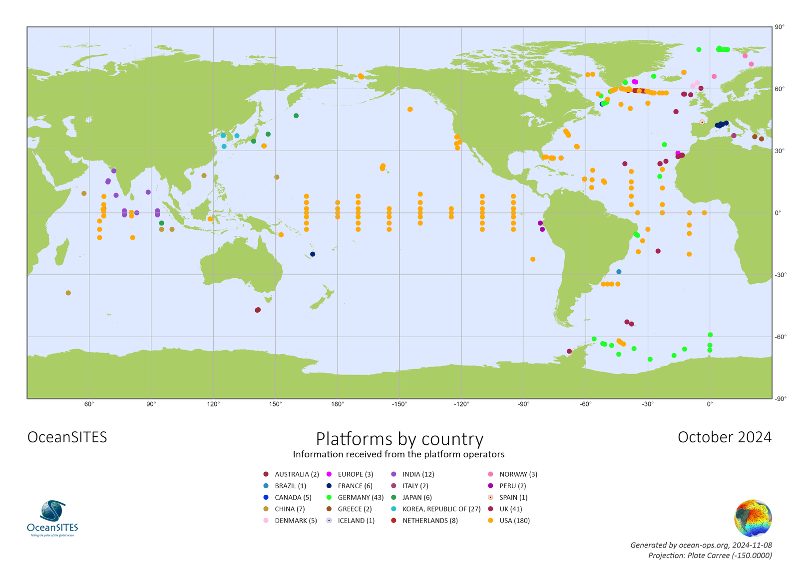{ loading=lazy }
  <figcaption>국가별 OceanSITES 관측점 (출처: OceanOPS)</figcaption>
</figure>

## OceanSITES

### OceanSITES

OceanSITES는 외양의 고정 지점에서 장기간 고빈도로 관측한 고품질 자료를 수집·제공하고 활용을 촉진하는 것을 목표로 합니다.

[:octicons-link-external-24: oceansites.org](http://www.oceansites.org/) (사이트가 없어진 것으로 보입니다) 
[:octicons-download-24: 자료 카탈로그: CORIOLIS-OCEANSITES-GDAC-OBS (TRITON, RAMA, PIRATA, KEO 등)](http://tds0.ifremer.fr/thredds/CORIOLIS-OCEANSITES-GDAC-OBS/CORIOLIS-OCEANSITES-GDAC-OBS.html)

### OceanOPS

OceanSITES 관측망 현황판입니다. 지점을 클릭한 뒤 Details 페이지에서 **Data access**로 들어갑니다.

[:octicons-link-external-24: OceanOPS: OceanSITES board](https://www.ocean-ops.org/board/?t=oceansites#)

<figure markdown="span">
  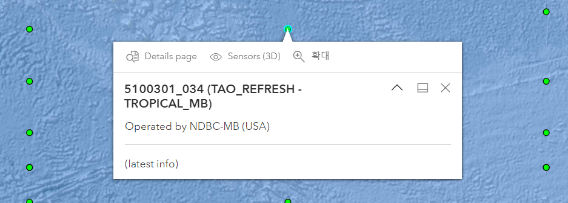{ loading=lazy }
  <figcaption>OceanOPS 현황판</figcaption>
</figure>
<figure markdown="span">
  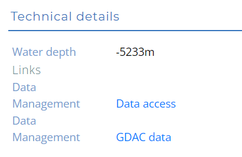{ loading=lazy }
  <figcaption>Details 페이지와 Data access</figcaption>
</figure>

## Global Tropical Moored Buoy Array

### TAO / TRITON / PIRATA / RAMA

태평양(TAO/TRITON), 대서양(PIRATA), 인도양(RAMA)의 열대 계류 부이 배열입니다. NOAA PMEL에서 제공합니다.

[:octicons-download-24: GTMBA 자료 다운로드 (PMEL)](https://www.pmel.noaa.gov/tao/drupal/disdel/) 
[:octicons-link-external-24: TAO 기후값](https://www.pmel.noaa.gov/tao/clim/clim.html) 
[:octicons-link-external-24: TAO 용어 설명 (realtime data access help)](https://www.pmel.noaa.gov/tao/drupal/disdel/help/help_terminology_f.html) 
[:octicons-link-external-24: GTMBA display (PMEL)](http://www.pmel.noaa.gov/tao/jsdisplay/)

<figure markdown="span">
  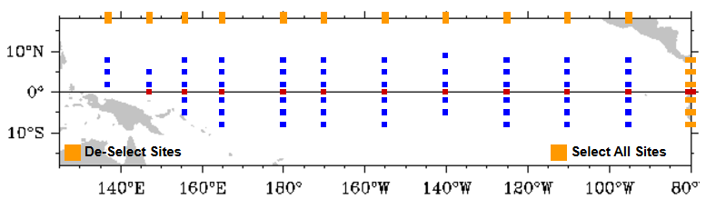{ loading=lazy }
  <figcaption>TAO / TRITON</figcaption>
</figure>
<figure markdown="span">
  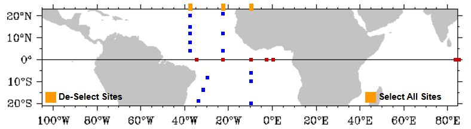{ loading=lazy }
  <figcaption>PIRATA</figcaption>
</figure>
<figure markdown="span">
  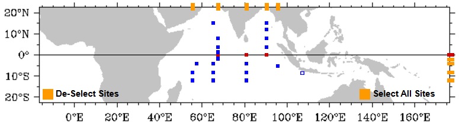{ loading=lazy }
  <figcaption>RAMA</figcaption>
</figure>

관련 자료: [French PIRATA cruises: acoustic data (SEANOE)](https://www.seanoe.org/data/00602/71379/)

## National Data Buoy Center (NOAA NDBC)

### NDBC

실시간·과거 부이 관측 자료를 제공하며, TAO/TRITON과 DART 쓰나미 부이 배열도 포함합니다.

[:octicons-link-external-24: NDBC observations](https://www.ndbc.noaa.gov/obs.shtml) 
[:octicons-download-24: NDBC THREDDS server](https://dods.ndbc.noaa.gov/thredds/catalog.html)

<figure markdown="span">
  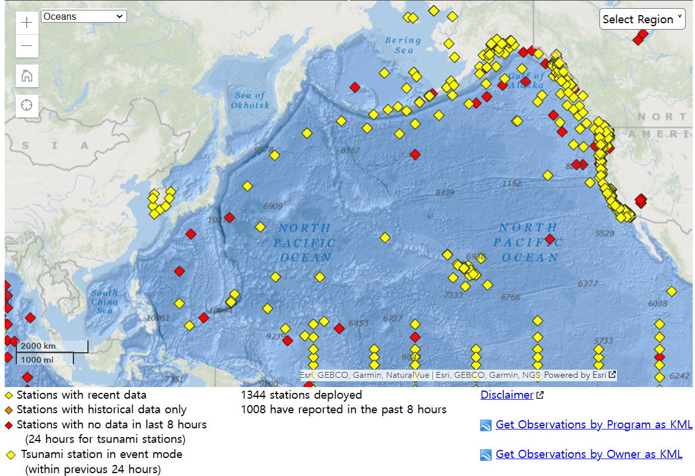{ loading=lazy }
  <figcaption>NDBC 관측 지도</figcaption>
</figure>

=== "TAO / TRITON"

    **NDBC의 TAO 자료 다운로드**

    - 지도, 관측점, 기간으로 검색

    [:octicons-download-24: TAO data download (search map)](https://tao.ndbc.noaa.gov/tao/data_download/search_map.shtml)

    <figure markdown="span">
      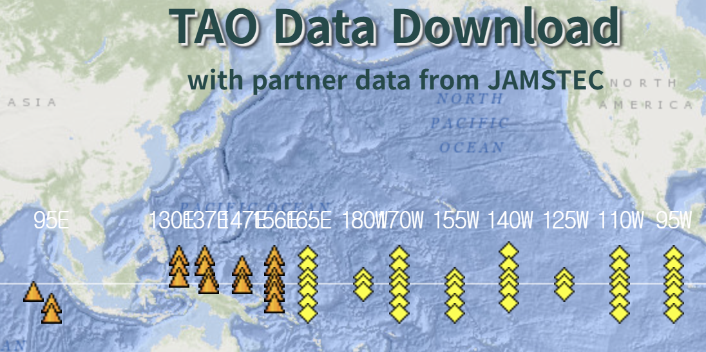{ loading=lazy }
      <figcaption>TAO 검색 지도</figcaption>
    </figure>

=== "DART"

    **Deep-ocean Assessment and Reporting of Tsunamis**

    - 쓰나미 관측 부이 네트워크

    [:octicons-link-external-24: DART stations (NDBC)](https://www.ndbc.noaa.gov/obs.shtml?lat=13&lon=-173&zoom=2&pgm=tsunami)

    <figure markdown="span">
      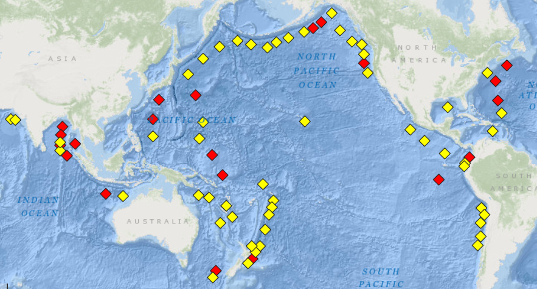{ loading=lazy }
      <figcaption>DART 관측점</figcaption>
    </figure>

=== "IOOS"

    **Integrated Ocean Observing System**

    - 미국 연안 관측 시스템의 지역별 자료 포털

    [:octicons-link-external-24: IOOS regional data portals](https://ioos.noaa.gov/data/regional-data-portals/)

    <figure markdown="span">
      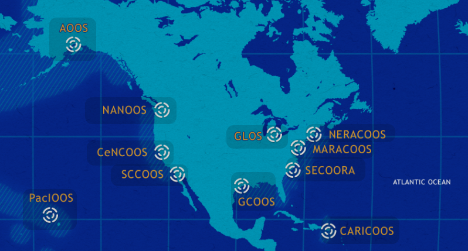{ loading=lazy }
      <figcaption>IOOS 지역 포털</figcaption>
    </figure>

## PMEL 관측 시스템

-   **Ocean Climate Stations (OCS)**

    ---

    PMEL 표층 계류 KEO, Papa, ARC

    [:octicons-link-external-24: Ocean Climate Stations](http://www.pmel.noaa.gov/ocs/data-overview)

    <figure markdown="span">
      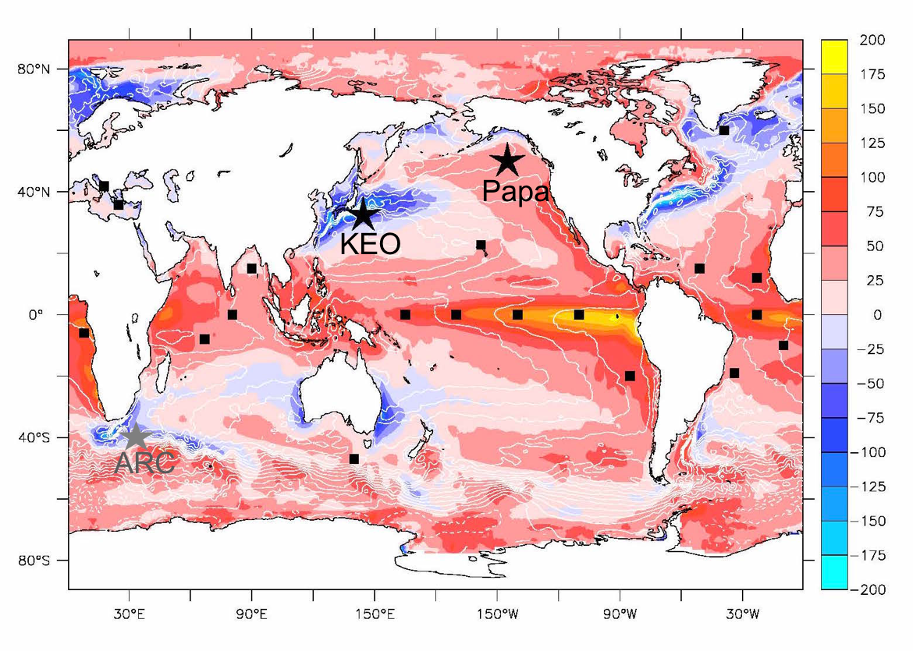{ loading=lazy }
      <figcaption>PMEL Ocean Climate Stations</figcaption>
    </figure>

-   **EcoFOCI**

    ---

    Ecosystems and Fisheries-Oceanography Coordinated Investigations (베링해, 알래스카만)

    [:octicons-link-external-24: EcoFOCI data](http://www.ecofoci.noaa.gov/efoci_data.shtml)

