# :material-anchor: Mooring [2024.11.27]

Long-term, high-frequency observations at fixed locations: the OceanSITES network, the tropical moored buoy arrays and national buoy centers.

<figure markdown="span">
  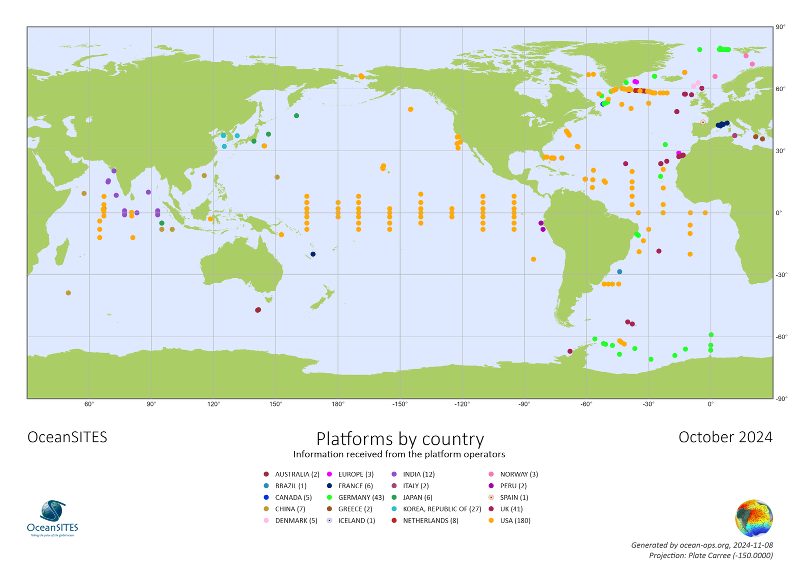{ loading=lazy }
  <figcaption>OceanSITES sites by country (source: OceanOPS)</figcaption>
</figure>

## OceanSITES

### OceanSITES

The mission of OceanSITES is to collect, deliver and promote the use of high-quality data from long-term, high-frequency observations at fixed locations in the open ocean.

[:octicons-link-external-24: oceansites.org](http://www.oceansites.org/) (the site appears to be offline) 
[:octicons-download-24: Data catalog: CORIOLIS-OCEANSITES-GDAC-OBS (TRITON, RAMA, PIRATA, KEO, etc.)](http://tds0.ifremer.fr/thredds/CORIOLIS-OCEANSITES-GDAC-OBS/CORIOLIS-OCEANSITES-GDAC-OBS.html)

### OceanOPS

Status board of the OceanSITES network. Click a point, open its details page, then **Data access**.

[:octicons-link-external-24: OceanOPS: OceanSITES board](https://www.ocean-ops.org/board/?t=oceansites#)

<figure markdown="span">
  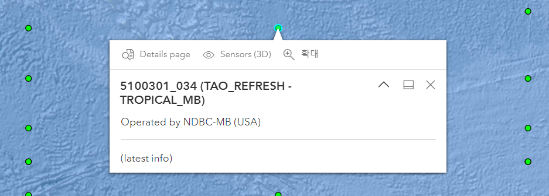{ loading=lazy }
  <figcaption>OceanOPS board</figcaption>
</figure>
<figure markdown="span">
  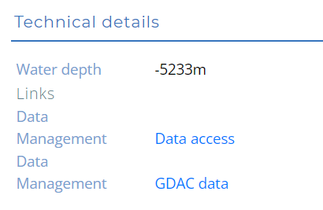{ loading=lazy }
  <figcaption>Details page and data access</figcaption>
</figure>

## Global Tropical Moored Buoy Array

### TAO / TRITON / PIRATA / RAMA

Tropical moored buoy arrays in the Pacific (TAO/TRITON), Atlantic (PIRATA) and Indian Ocean (RAMA), served by NOAA PMEL.

[:octicons-download-24: GTMBA data delivery (PMEL)](https://www.pmel.noaa.gov/tao/drupal/disdel/) 
[:octicons-link-external-24: TAO climatologies](https://www.pmel.noaa.gov/tao/clim/clim.html) 
[:octicons-link-external-24: TAO terminology (realtime data access help)](https://www.pmel.noaa.gov/tao/drupal/disdel/help/help_terminology_f.html) 
[:octicons-link-external-24: GTMBA display (PMEL)](http://www.pmel.noaa.gov/tao/jsdisplay/)

<figure markdown="span">
  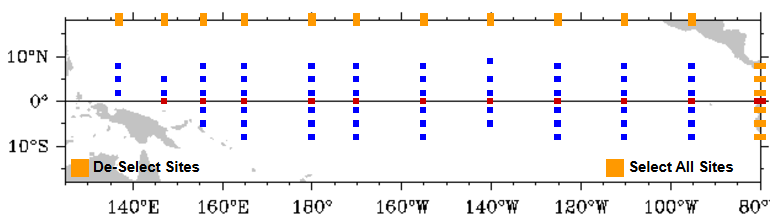{ loading=lazy }
  <figcaption>TAO / TRITON</figcaption>
</figure>
<figure markdown="span">
  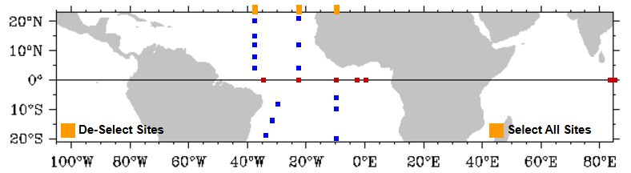{ loading=lazy }
  <figcaption>PIRATA</figcaption>
</figure>
<figure markdown="span">
  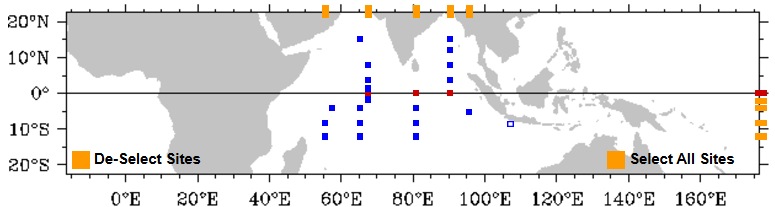{ loading=lazy }
  <figcaption>RAMA</figcaption>
</figure>

Related: [French PIRATA cruises: acoustic data (SEANOE)](https://www.seanoe.org/data/00602/71379/)

## National Data Buoy Center (NOAA NDBC)

### NDBC

Real-time and historical buoy observations, including the TAO/TRITON and DART tsunami arrays.

[:octicons-link-external-24: NDBC observations](https://www.ndbc.noaa.gov/obs.shtml) 
[:octicons-download-24: NDBC THREDDS server](https://dods.ndbc.noaa.gov/thredds/catalog.html)

<figure markdown="span">
  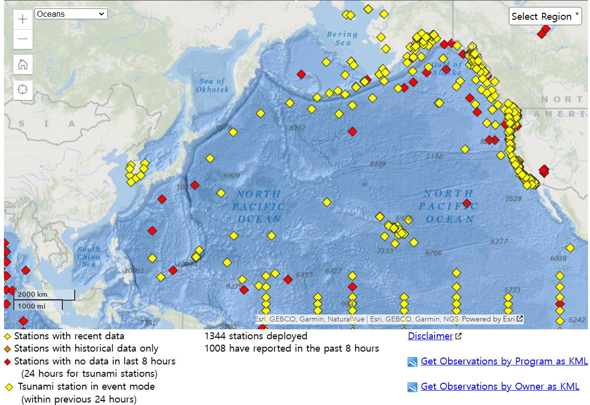{ loading=lazy }
  <figcaption>NDBC observations map</figcaption>
</figure>

=== "TAO / TRITON"

    **TAO data download at NDBC**

    - Search by map, station or period

    [:octicons-download-24: TAO data download (search map)](https://tao.ndbc.noaa.gov/tao/data_download/search_map.shtml)

    <figure markdown="span">
      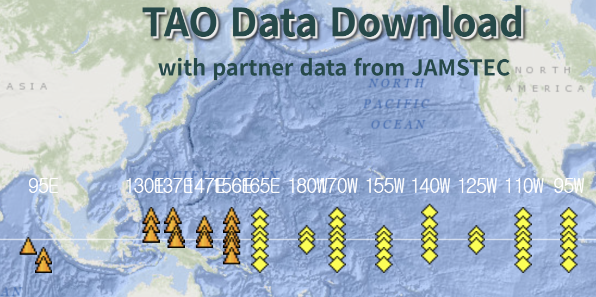{ loading=lazy }
      <figcaption>TAO search map</figcaption>
    </figure>

=== "DART"

    **Deep-ocean Assessment and Reporting of Tsunamis**

    - Tsunami buoy network

    [:octicons-link-external-24: DART stations (NDBC)](https://www.ndbc.noaa.gov/obs.shtml?lat=13&lon=-173&zoom=2&pgm=tsunami)

    <figure markdown="span">
      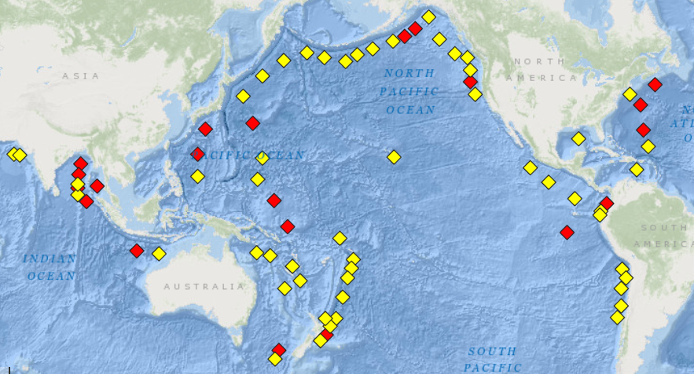{ loading=lazy }
      <figcaption>DART stations</figcaption>
    </figure>

=== "IOOS"

    **Integrated Ocean Observing System**

    - Regional data portals of the US coastal observing system

    [:octicons-link-external-24: IOOS regional data portals](https://ioos.noaa.gov/data/regional-data-portals/)

    <figure markdown="span">
      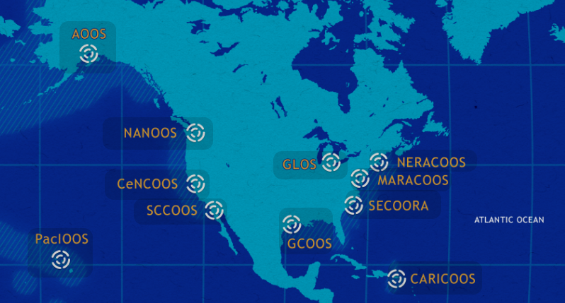{ loading=lazy }
      <figcaption>IOOS regional portals</figcaption>
    </figure>

## PMEL observing systems

-   **Ocean Climate Stations (OCS)**

    ---

    PMEL surface moorings KEO, Papa and ARC

    [:octicons-link-external-24: Ocean Climate Stations](http://www.pmel.noaa.gov/ocs/data-overview)

    <figure markdown="span">
      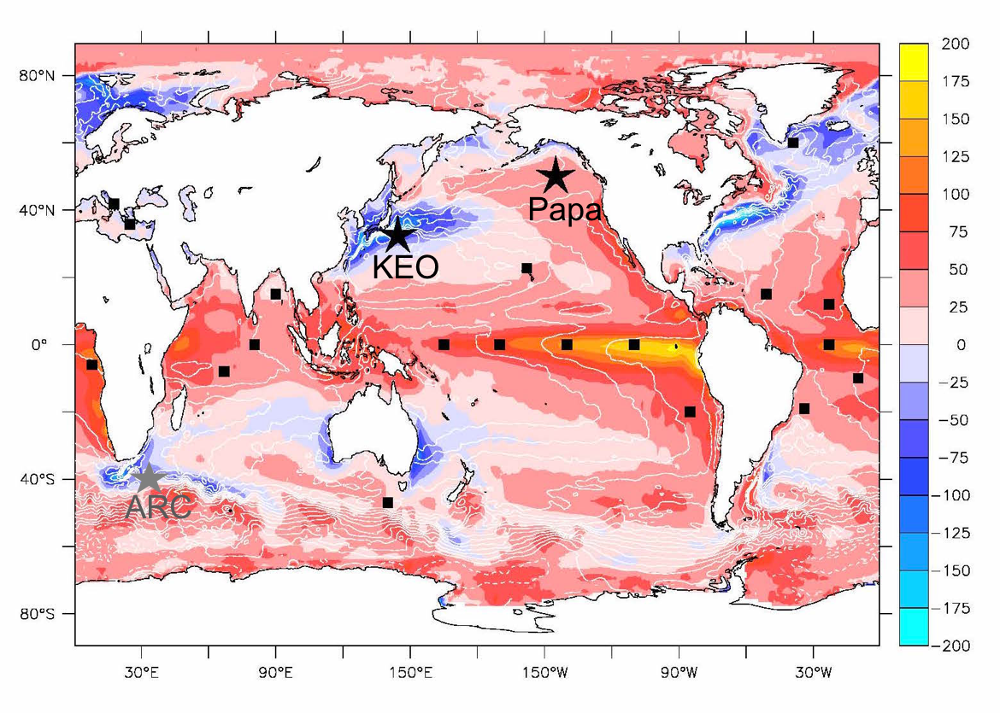{ loading=lazy }
      <figcaption>PMEL Ocean Climate Stations</figcaption>
    </figure>

-   **EcoFOCI**

    ---

    Ecosystems and Fisheries-Oceanography Coordinated Investigations (Bering Sea, Gulf of Alaska)

    [:octicons-link-external-24: EcoFOCI data](http://www.ecofoci.noaa.gov/efoci_data.shtml)

