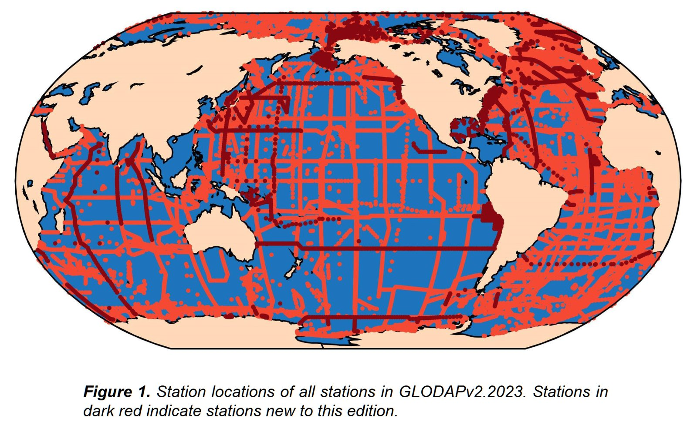

# :material-flask-outline: 기타 현장 관측 자료 [2026.03.28]

특정 플랫폼으로 묶기 어려운 현장 관측 자료입니다. 탄소·화학 합성 자료, profile에서 파생된 product, 위성 SST 검증에 쓰이는 현장 SST 아카이브를 모았습니다.
관련 주제 페이지에서 이곳으로 연결됩니다.

## 탄소·화학

-   **GLODAPv2**

    ---

    Global Ocean Data Analysis Project. 전 지구 해양 탄소·생지화학 채수 자료 합성. [영양염·탄소 순환](../../topics/nutrient-carbon.md) 페이지도 참고하세요.

    [:octicons-link-external-24: GLODAP](https://glodap.info/) 
    [:octicons-download-24: GLODAPv2.2023 (NOAA NCEI)](https://www.ncei.noaa.gov/access/ocean-carbon-acidification-data-system/oceans/GLODAPv2_2023/)

    <figure markdown="span">
      { loading=lazy }
      <figcaption>GLODAPv2</figcaption>
    </figure>

-   **Coastal DOM (CoastDOM v1)**

    ---

    연안 용존유기물(DOM) 농도 관측 전 지구 데이터베이스

    [:octicons-download-24: PANGAEA](https://doi.pangaea.de/10.1594/PANGAEA.964012) 
    [:octicons-book-24: ESSD (2024)](https://essd.copernicus.org/articles/16/1107/2024/) 
    [:octicons-link-external-24: Archimer](https://archimer.ifremer.fr/doc/00883/99506/) · [IOCCP news](https://www.ioccp.org/news/coastal-dom-database-coastdom-v1)

## 파생 자료

-   **RFROM**

    ---

    Random Forest Regression Ocean Maps (NOAA PMEL). 선택한 깊이 층에서 연직 적분한 profile **해양 열용량 아노말리(OHCA)**로 해역별 random forest를 학습시켜 만든 OHCA 지도입니다. [해수면·해양 열용량](../../processed/sea-level-ohc.md) 페이지도 참고하세요.

    [:octicons-link-external-24: RFROM](https://www.pmel.noaa.gov/rfrom/)

## SST 검증

-   **iQuam**

    ---

    In situ SST Quality Monitor (NOAA STAR). 선박, drifter, 계류, Argo의 품질 관리된 현장 SST로, 위성 SST 검증에 쓰입니다. [해수면 온도](../satellite/sst.md) 페이지도 참고하세요.

    [:octicons-link-external-24: iQuam](https://www.star.nesdis.noaa.gov/socd/sst/iquam/)

