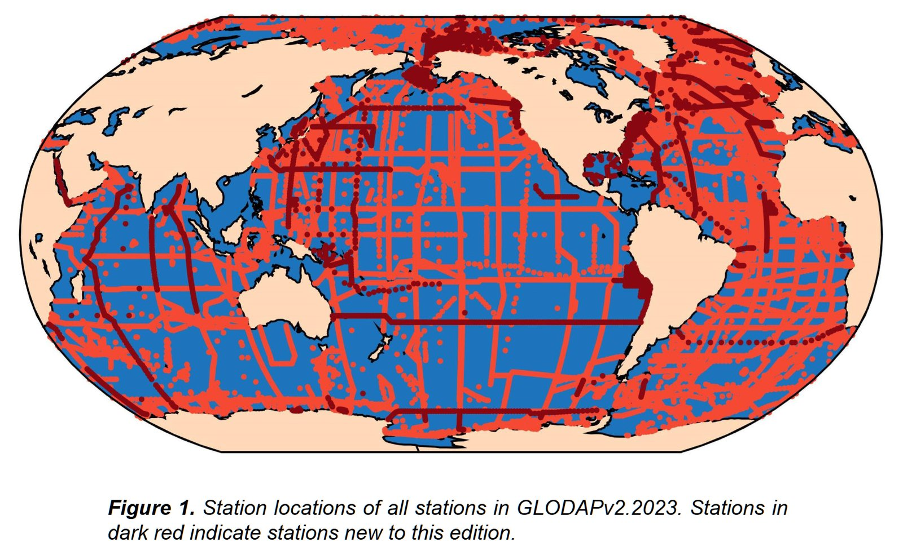

# :material-flask-outline: Other In Situ Datasets [2026.03.28]

In situ datasets that do not fit a single platform: carbon and chemistry syntheses, products derived from profiles, and the in situ SST archive used to validate satellite SST.
Related topic pages link back here.

## Carbon & chemistry

-   **GLODAPv2**

    ---

    Global Ocean Data Analysis Project: synthesis of ocean carbon and biogeochemical bottle data. See also [Nutrient & Carbon Cycle](../../topics/nutrient-carbon.md).

    [:octicons-link-external-24: GLODAP](https://glodap.info/) 
    [:octicons-download-24: GLODAPv2.2023 (NOAA NCEI)](https://www.ncei.noaa.gov/access/ocean-carbon-acidification-data-system/oceans/GLODAPv2_2023/)

    <figure markdown="span">
      { loading=lazy }
      <figcaption>GLODAPv2</figcaption>
    </figure>

-   **Coastal DOM (CoastDOM v1)**

    ---

    Global database of dissolved organic matter (DOM) concentration measurements in coastal waters

    [:octicons-download-24: PANGAEA](https://doi.pangaea.de/10.1594/PANGAEA.964012) 
    [:octicons-book-24: ESSD (2024)](https://essd.copernicus.org/articles/16/1107/2024/) 
    [:octicons-link-external-24: Archimer](https://archimer.ifremer.fr/doc/00883/99506/) · [IOCCP news](https://www.ioccp.org/news/coastal-dom-database-coastdom-v1)

## Derived products

-   **RFROM**

    ---

    Random Forest Regression Ocean Maps (NOAA PMEL). Maps of **ocean heat content anomaly (OHCA)** computed from random forests trained, basin by basin, on profile OHCA integrated over selected depth layers. See also [Sea Level & OHC](../../processed/sea-level-ohc.md).

    [:octicons-link-external-24: RFROM](https://www.pmel.noaa.gov/rfrom/)

## SST validation

-   **iQuam**

    ---

    In situ SST Quality Monitor (NOAA STAR): quality-controlled in situ SST from ships, drifters, moorings and Argo, used to validate satellite SST. See also [Sea Surface Temperature](../satellite/sst.md).

    [:octicons-link-external-24: iQuam](https://www.star.nesdis.noaa.gov/socd/sst/iquam/)

