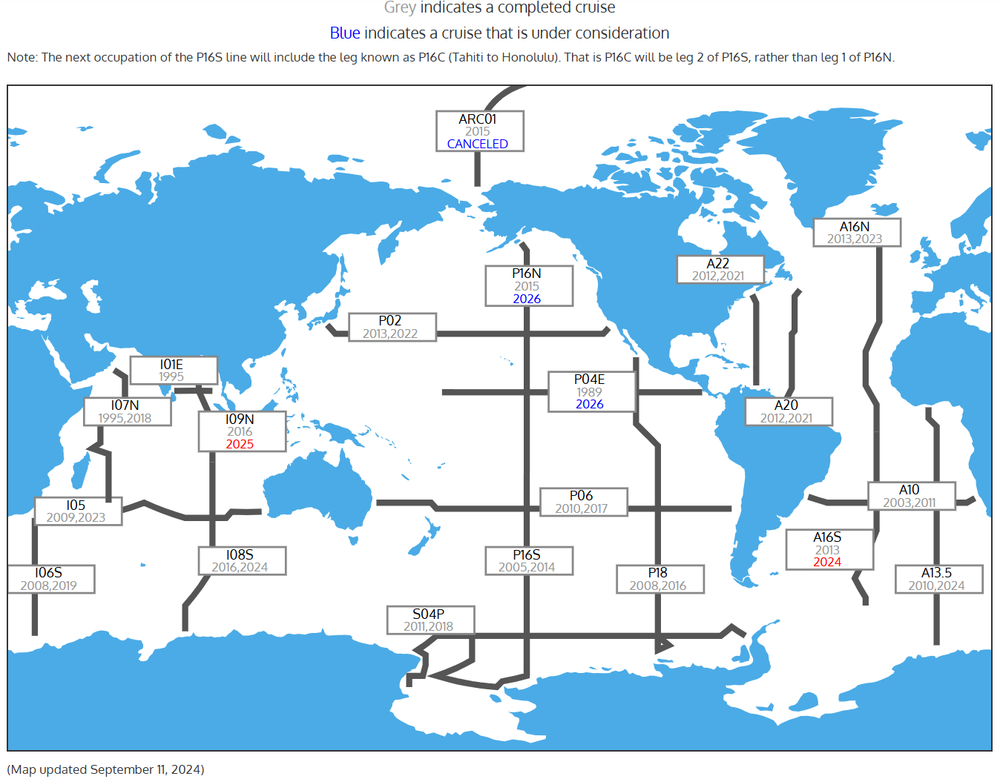
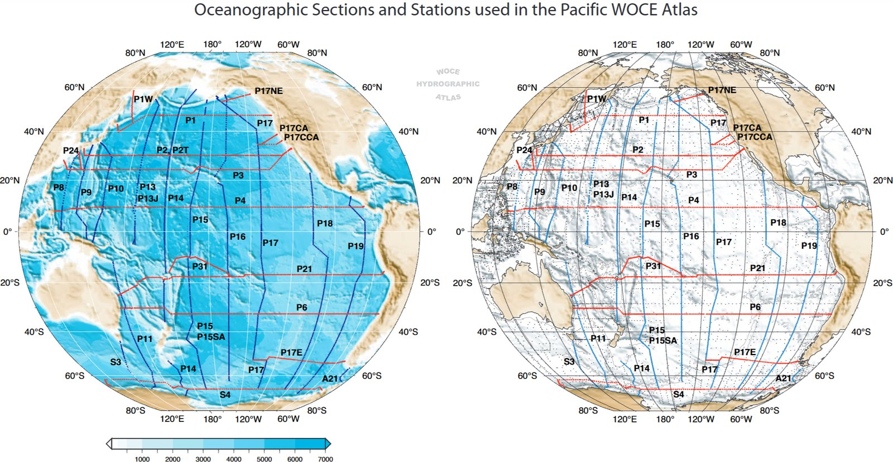
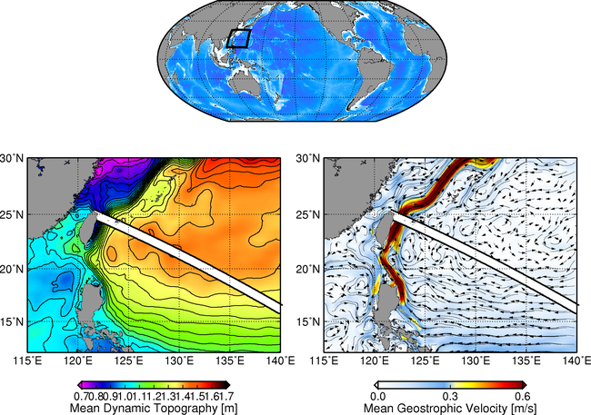
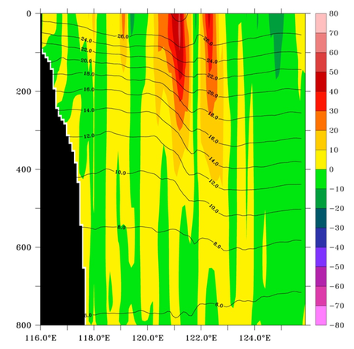
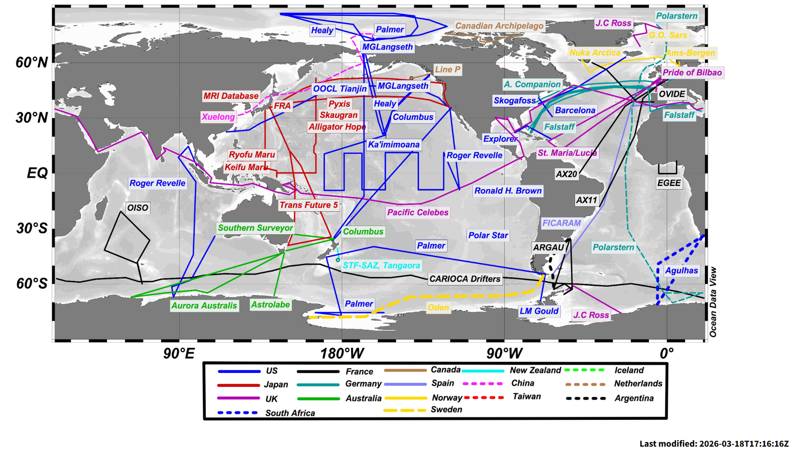

# :material-ferry: 선박 [2026.03.28]

선박 기반 관측 자료입니다. 반복 관측 hydrographic section, 선박 ADCP, 투하식 관측 장비, 기회 선박(SOOP) 자료를 모았습니다.

## 반복 관측 hydrography

### CCHDO

CLIVAR and Carbon Hydrographic Data Office. GO-SHIP, WOCE, CLIVAR 등 반복 관측 section의 CTD·채수 자료를 제공합니다(WHP-Exchange, WOCE, netCDF 형식). Argo와 OceanSITES 프로그램을 위한 공개·비공개 CTD 자료도 관리합니다.

[:octicons-download-24: CCHDO](https://cchdo.ucsd.edu/)

CCHDO에 포함된 프로그램:
[WOCE](https://cchdo.ucsd.edu/search?q=WOCE) ·
[GO-SHIP](https://cchdo.ucsd.edu/search?q=GO-SHIP) ·
[SOCCOM](https://cchdo.ucsd.edu/search?q=SOCCOM) ·
[USHYDRO](https://cchdo.ucsd.edu/search?q=USHYDRO) ·
[CARINA](https://cchdo.ucsd.edu/search?q=CARINA) ·
[DIMES](https://cchdo.ucsd.edu/search?q=DIMES) ·
[ELLETT](https://cchdo.ucsd.edu/search?q=ELLETT)

=== "GO-SHIP"

    **Global Ocean Ship-based Hydrographic Investigations Program**

    - 선택된 hydrographic section을 체계적으로 재관측하는 국제 프로그램

    [:octicons-link-external-24: US GO-SHIP hydromap](https://usgoship.ucsd.edu/hydromap/)

    <figure markdown="span">
      { loading=lazy }
      <figcaption>US GO-SHIP 관측선</figcaption>
    </figure>

=== "WOCE"

    **World Ocean Circulation Experiment**

    - 1990년대 "state of the oceans"을 보여주는 전 지구 hydrographic survey

    [:octicons-link-external-24: WOCE Atlas](http://woceatlas.ucsd.edu/) 
    [:octicons-link-external-24: eWOCE](https://www.ewoce.org/data/index.html) 
    [:octicons-mark-github-16: sea-mat/woce-tools](https://github.com/sea-mat/woce-tools/tree/master)

    <figure markdown="span">
      { loading=lazy }
      <figcaption>WOCE Atlas</figcaption>
    </figure>

=== "CLIVAR"

    **Climate and Ocean: Variability, Predictability, and Change**

    - CLIVAR 프로젝트의 자료 접근 포털

    [:octicons-link-external-24: CLIVAR data access](https://www.clivar.org/resources/data/data-access)

## 항주 관측·투하식 장비

-   **JAS ADCP**

    ---

    Joint Archive for Shipboard ADCP (UHSLC)

    [:octicons-link-external-24: JAS ADCP](https://uhslc.soest.hawaii.edu/sadcp/) 
    [:octicons-download-24: 지역별 nc 파일](https://uhslc.soest.hawaii.edu/sadcp/region.html)

-   **XBT**

    ---

    eXpendable BathyThermographs, Global Ocean Observing System의 구성 요소

    [:octicons-link-external-24: XBT Science (NOAA AOML)](https://www.aoml.noaa.gov/phod/goos/xbtscience/index.php)

    <figure markdown="span">
      { loading=lazy }
      <figcaption>평균 역학고도와 지형류 위에 표시한 XBT 관측선(흰 선)</figcaption>
    </figure>
    <figure markdown="span">
      { loading=lazy }
      <figcaption>XBT 관측선의 수온 연직 단면 (상부 800 m)</figcaption>
    </figure>

-   **SOOP**

    ---

    Ships Of Opportunity Program (VOS) 자료

    [:octicons-link-external-24: SOOP / VOS Program (NOAA NCEI)](https://www.ncei.noaa.gov/access/ocean-carbon-acidification-data-system/oceans/VOS_Program/index.html)

    <figure markdown="span">
      { loading=lazy }
      <figcaption>SOOP / VOS 프로그램</figcaption>
    </figure>

