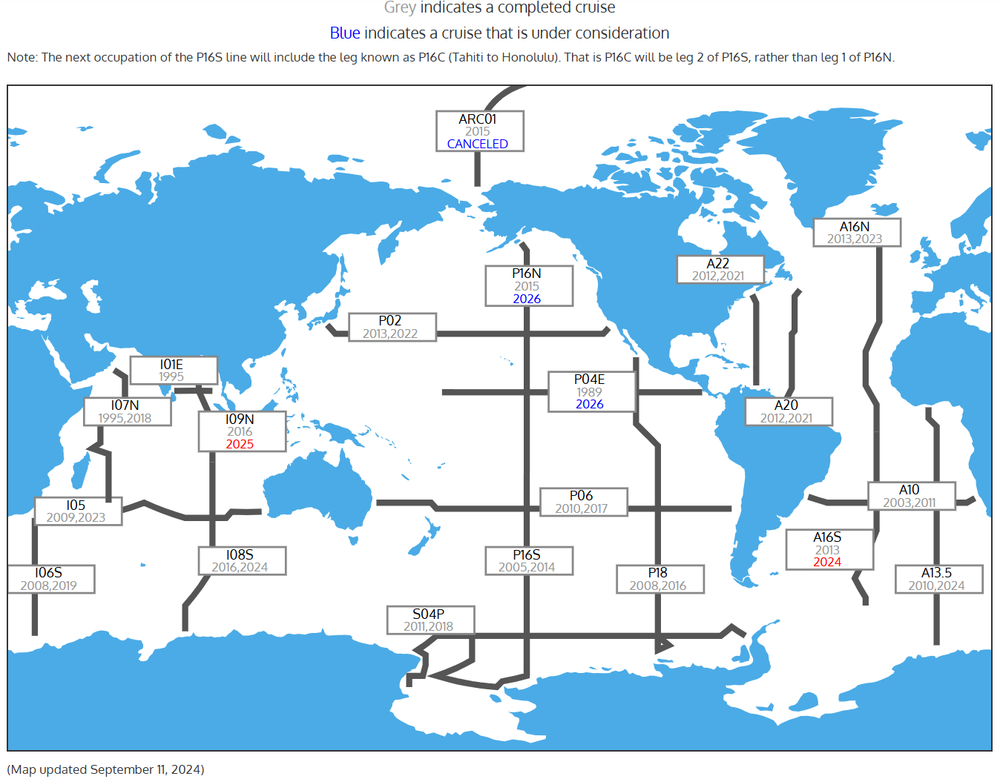
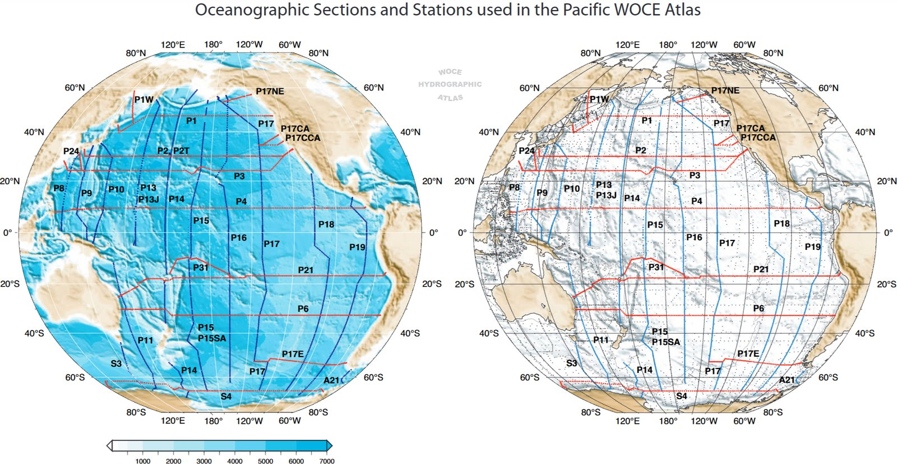
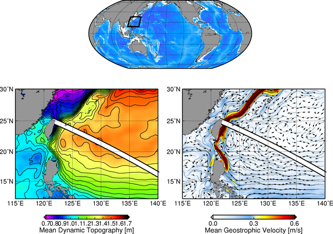
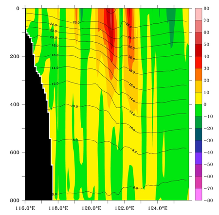
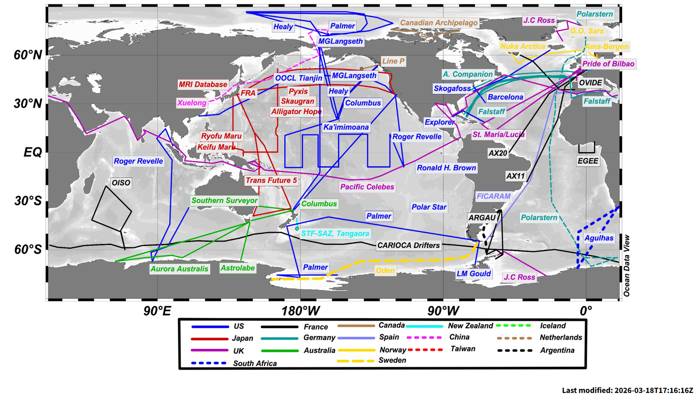

# :material-ferry: Ship [2026.03.28]

Ship-based observations: repeat hydrographic sections, shipboard ADCP, expendable probes and ships of opportunity.

## Repeat hydrography

### CCHDO

CLIVAR and Carbon Hydrographic Data Office. CTD and bottle data from the GO-SHIP, WOCE and CLIVAR repeat sections (WHP-Exchange, WOCE and netCDF formats). CCHDO also manages public and non-public CTD data for the Argo and OceanSITES programs.

[:octicons-download-24: CCHDO](https://cchdo.ucsd.edu/)

Programs on CCHDO:
[WOCE](https://cchdo.ucsd.edu/search?q=WOCE) ·
[GO-SHIP](https://cchdo.ucsd.edu/search?q=GO-SHIP) ·
[SOCCOM](https://cchdo.ucsd.edu/search?q=SOCCOM) ·
[USHYDRO](https://cchdo.ucsd.edu/search?q=USHYDRO) ·
[CARINA](https://cchdo.ucsd.edu/search?q=CARINA) ·
[DIMES](https://cchdo.ucsd.edu/search?q=DIMES) ·
[ELLETT](https://cchdo.ucsd.edu/search?q=ELLETT)

=== "GO-SHIP"

    **Global Ocean Ship-based Hydrographic Investigations Program**

    - International program that systematically reoccupies selected hydrographic sections

    [:octicons-link-external-24: US GO-SHIP hydromap](https://usgoship.ucsd.edu/hydromap/)

    <figure markdown="span">
      { loading=lazy }
      <figcaption>US GO-SHIP sections</figcaption>
    </figure>

=== "WOCE"

    **World Ocean Circulation Experiment**

    - Global hydrographic survey of the 1990s that documented the "state of the oceans"

    [:octicons-link-external-24: WOCE Atlas](http://woceatlas.ucsd.edu/) 
    [:octicons-link-external-24: eWOCE](https://www.ewoce.org/data/index.html) 
    [:octicons-mark-github-16: sea-mat/woce-tools](https://github.com/sea-mat/woce-tools/tree/master)

    <figure markdown="span">
      { loading=lazy }
      <figcaption>WOCE Atlas</figcaption>
    </figure>

=== "CLIVAR"

    **Climate and Ocean: Variability, Predictability, and Change**

    - Data access portal of the CLIVAR project

    [:octicons-link-external-24: CLIVAR data access](https://www.clivar.org/resources/data/data-access)

## Underway and expendable instruments

-   **JAS ADCP**

    ---

    Joint Archive for Shipboard ADCP (UHSLC)

    [:octicons-link-external-24: JAS ADCP](https://uhslc.soest.hawaii.edu/sadcp/) 
    [:octicons-download-24: Regional nc files](https://uhslc.soest.hawaii.edu/sadcp/region.html)

-   **XBT**

    ---

    eXpendable BathyThermographs, a component of the Global Ocean Observing System

    [:octicons-link-external-24: XBT Science (NOAA AOML)](https://www.aoml.noaa.gov/phod/goos/xbtscience/index.php)

    <figure markdown="span">
      { loading=lazy }
      <figcaption>XBT network</figcaption>
    </figure>
    <figure markdown="span">
      { loading=lazy }
      <figcaption>XBT probe</figcaption>
    </figure>

-   **SOOP**

    ---

    Ships Of Opportunity Program (VOS) data

    [:octicons-link-external-24: SOOP / VOS Program (NOAA NCEI)](https://www.ncei.noaa.gov/access/ocean-carbon-acidification-data-system/oceans/VOS_Program/index.html)

    <figure markdown="span">
      { loading=lazy }
      <figcaption>SOOP / VOS program</figcaption>
    </figure>

