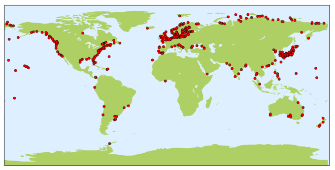
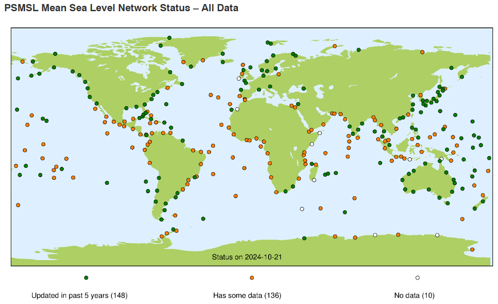

# :material-chart-timeline-variant: 조위 관측 [2026.03.28]

조위 관측소의 해수면 기록입니다. 위성 고도계와 격자 해수면 product는
[해수면·해양 열용량](../../processed/sea-level-ohc.md) 페이지를 참고하세요.

-   **PSMSL**

    ---

    Permanent Service for Mean Sea Level. 전 지구 조위 관측망의 월·연평균 해수면

    [:octicons-download-24: PSMSL data](https://psmsl.org/data/) 
    [:octicons-link-external-24: GLOSS cluster map](https://psmsl.org/products/gloss/clustermap.html)

    <figure markdown="span">
      { loading=lazy }
      <figcaption>PSMSL 관측소</figcaption>
    </figure>

-   **GLOSS**

    ---

    Global Sea Level Observing System

    [:octicons-download-24: GLOSS data](https://gloss-sealevel.org/data)

    <figure markdown="span">
      { loading=lazy }
      <figcaption>GLOSS 관측망</figcaption>
    </figure>

-   **CSIRO Sea Level Data Repository**

    ---

    CSIRO 해수면 자료 저장소

    [:octicons-download-24: CSIRO sea level data](https://www.cmar.csiro.au/sealevel/sl_data_cmar.html)

