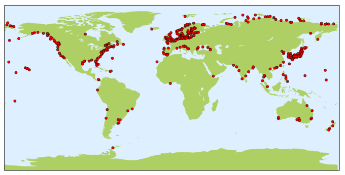
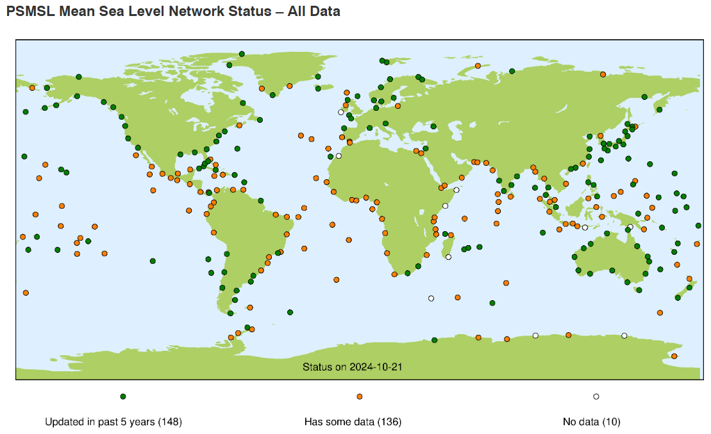

# :material-chart-timeline-variant: Tide Gauge [2026.03.28]

Sea level records from tide gauges. Satellite altimetry and gridded sea level products are on the
[Sea Level & OHC](../../processed/sea-level-ohc.md) page.

-   **PSMSL**

    ---

    Permanent Service for Mean Sea Level: monthly and annual mean sea level from the global tide gauge network

    [:octicons-download-24: PSMSL data](https://psmsl.org/data/) 
    [:octicons-link-external-24: GLOSS cluster map](https://psmsl.org/products/gloss/clustermap.html)

    <figure markdown="span">
      { loading=lazy }
      <figcaption>PSMSL stations</figcaption>
    </figure>

-   **GLOSS**

    ---

    Global Sea Level Observing System

    [:octicons-download-24: GLOSS data](https://gloss-sealevel.org/data)

    <figure markdown="span">
      { loading=lazy }
      <figcaption>GLOSS network</figcaption>
    </figure>

-   **CSIRO Sea Level Data Repository**

    ---

    Sea level datasets maintained by CSIRO

    [:octicons-download-24: CSIRO sea level data](https://www.cmar.csiro.au/sealevel/sl_data_cmar.html)

