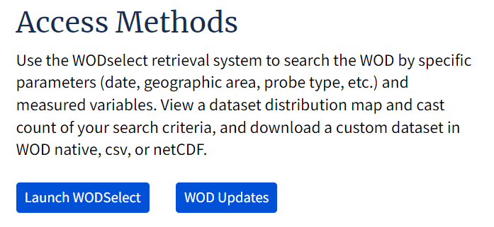
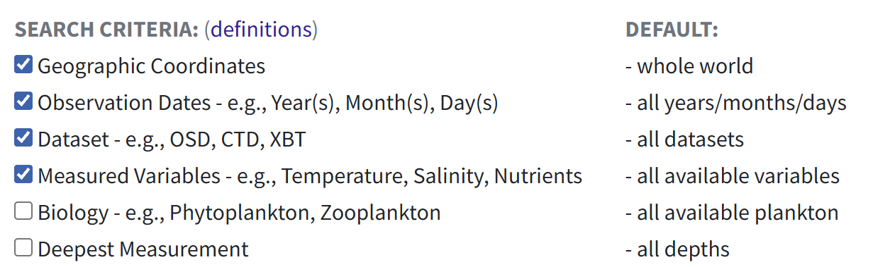
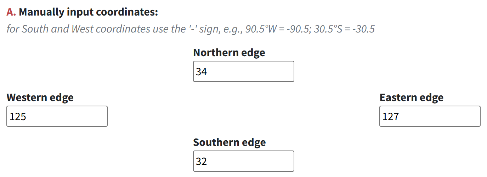
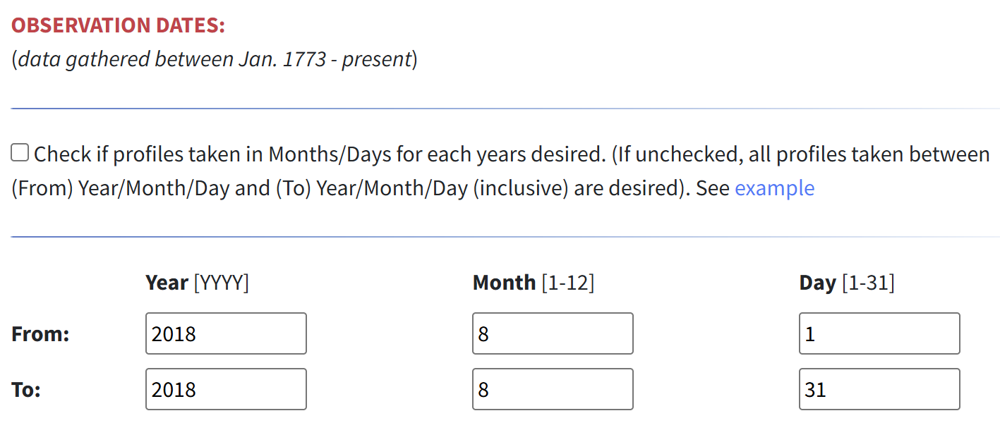
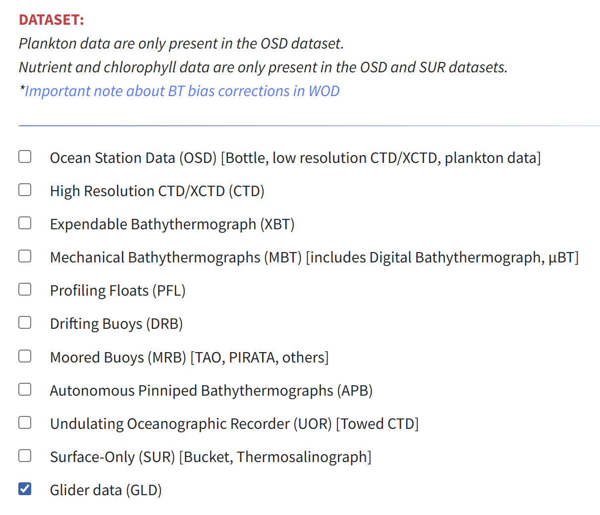
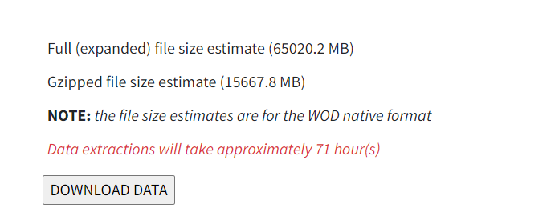
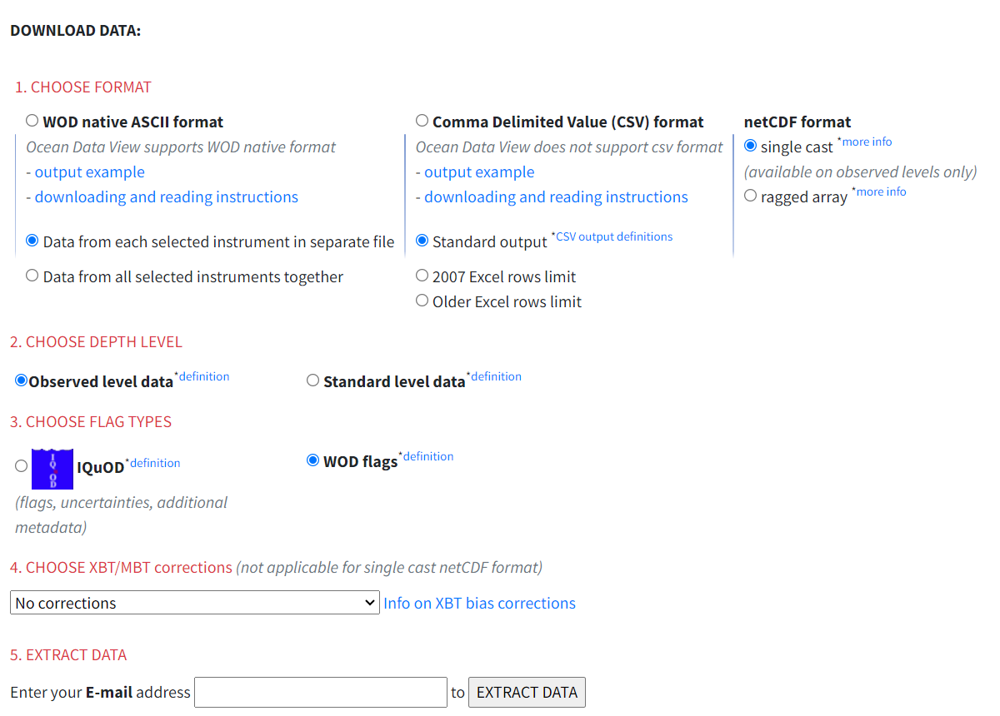
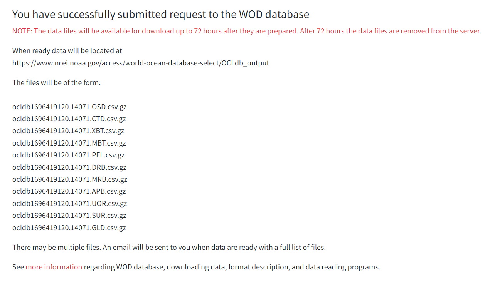
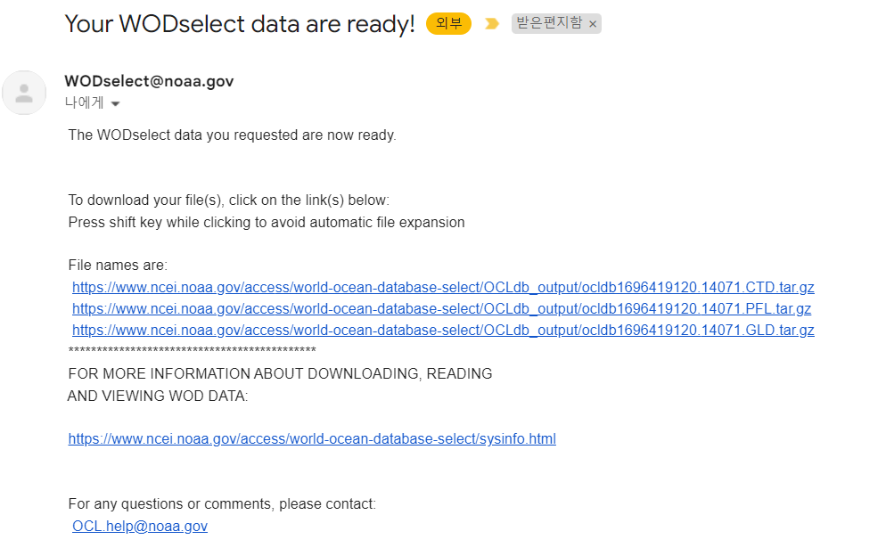

# :material-download-box-outline: WOD 다운로드 방법 <span class="date">[2024.03.02]</span>

[World Ocean Database (NOAA NCEI)](https://www.ncei.noaa.gov/products/world-ocean-database)의 WODselect 도구로 자료를 받는 순서입니다.

## 1. WODselect 열기

1. WOD product 페이지에 접속합니다.

    <figure markdown="span">
      { loading=lazy }
      <figcaption>WOD product 페이지</figcaption>
    </figure>

2. **Launch WODselect**를 클릭합니다.

    <figure markdown="span">
      { loading=lazy }
      <figcaption>Launch WODselect</figcaption>
    </figure>

## 2. 질의 만들기

3. 원하는 옵션(영역, 기간, 변수, 관측 장비)을 설정합니다.
4. **Build a query**를 클릭합니다.

    <figure markdown="span">
      { loading=lazy }
      <figcaption>Build a query (1)</figcaption>
    </figure>
    <figure markdown="span">
      { loading=lazy }
      <figcaption>Build a query (2)</figcaption>
    </figure>
    <figure markdown="span">
      { loading=lazy }
      <figcaption>Build a query (3)</figcaption>
    </figure>

## 3. 목록 확인 후 다운로드

5. **Get an Inventory**를 클릭합니다.

    <figure markdown="span">
      { loading=lazy }
      <figcaption>Get an Inventory</figcaption>
    </figure>

6. 아래와 같은 메시지가 나타납니다.

    <figure markdown="span">
      { loading=lazy }
      <figcaption>Inventory 메시지</figcaption>
    </figure>

7. 예상 소요 시간을 확인한 뒤 **Download Data**를 클릭합니다.

    <figure markdown="span">
      { loading=lazy }
      <figcaption>Download Data (1)</figcaption>
    </figure>
    <figure markdown="span">
      { loading=lazy }
      <figcaption>Download Data (2)</figcaption>
    </figure>
    <figure markdown="span">
      { loading=lazy }
      <figcaption>Download Data (3)</figcaption>
    </figure>

## Windows에서 .gz 파일 푸는 방법

`cmd`를 열고 아래 두 명령을 차례로 실행합니다. `currentfolder`에는 파일이 있는 폴더 경로를, `filename`에는 파일 이름을 넣으세요.

```bat title="cmd에서 tar.gz 풀기"
cd currentfolder
tar -xf filename.tar.gz
```
