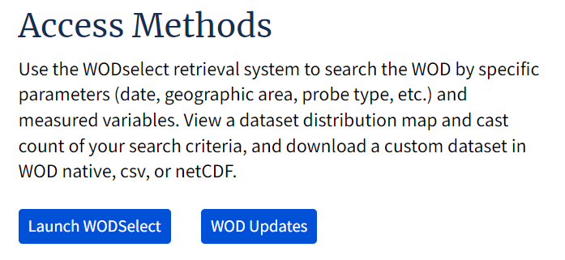
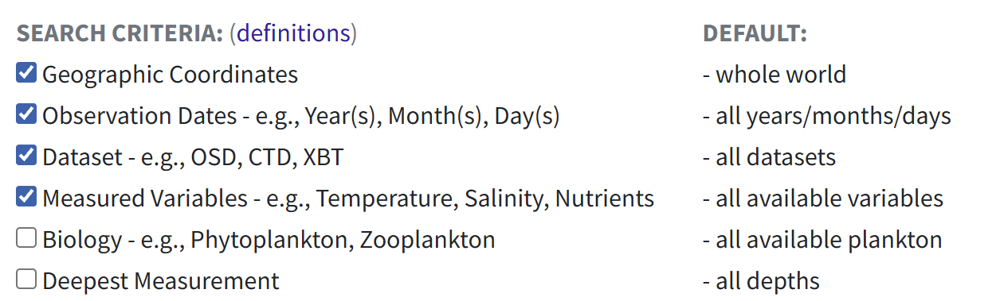
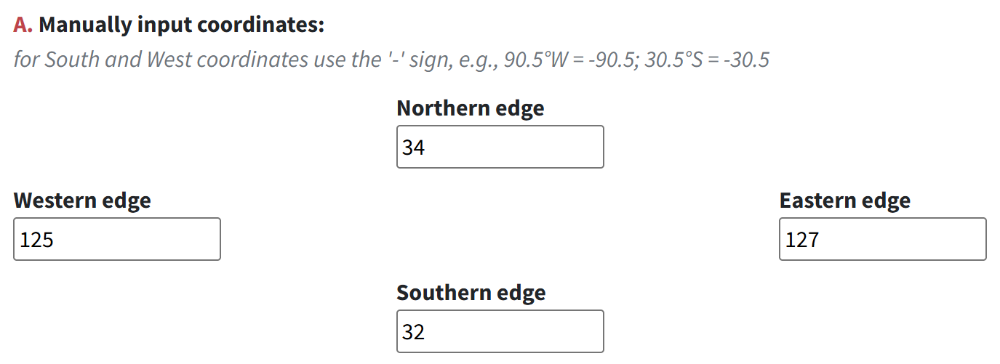
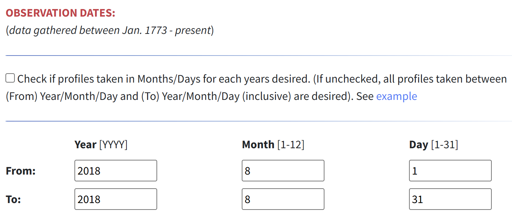
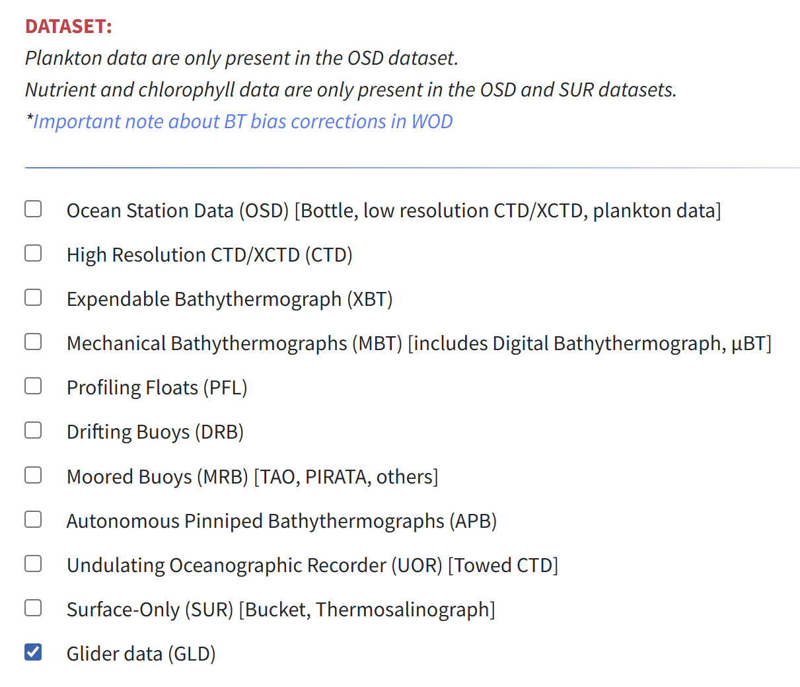
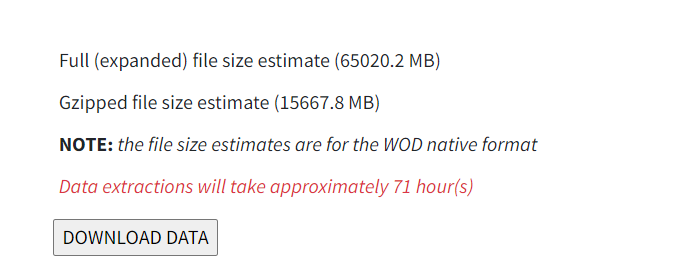
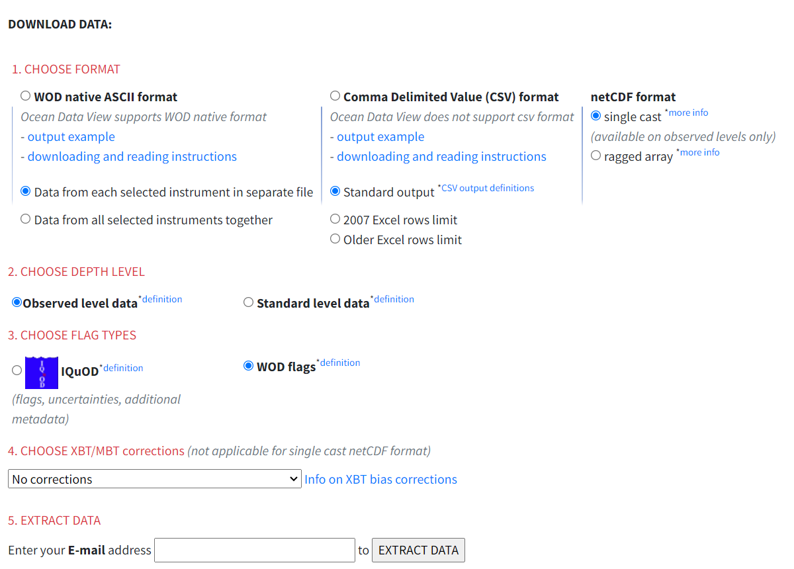
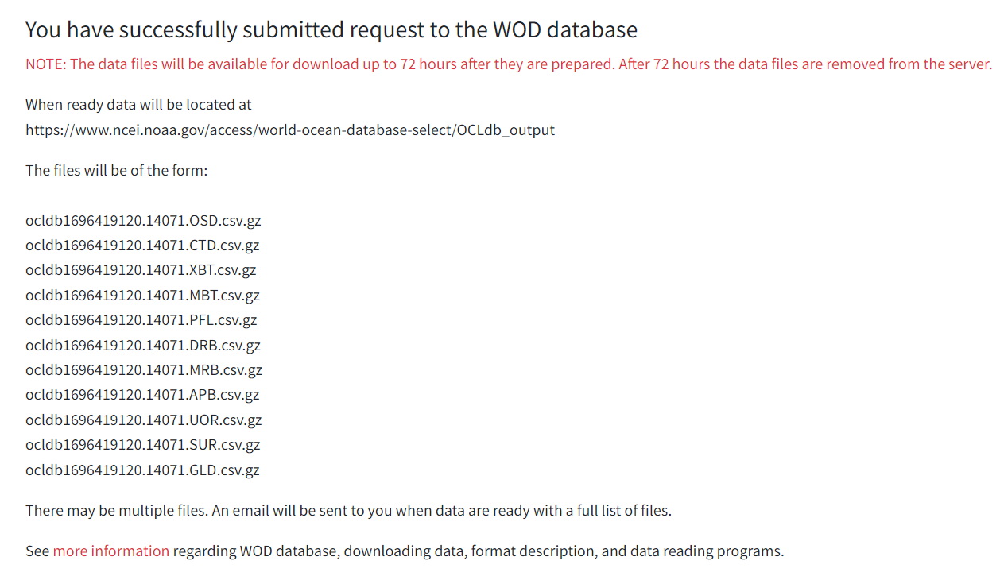
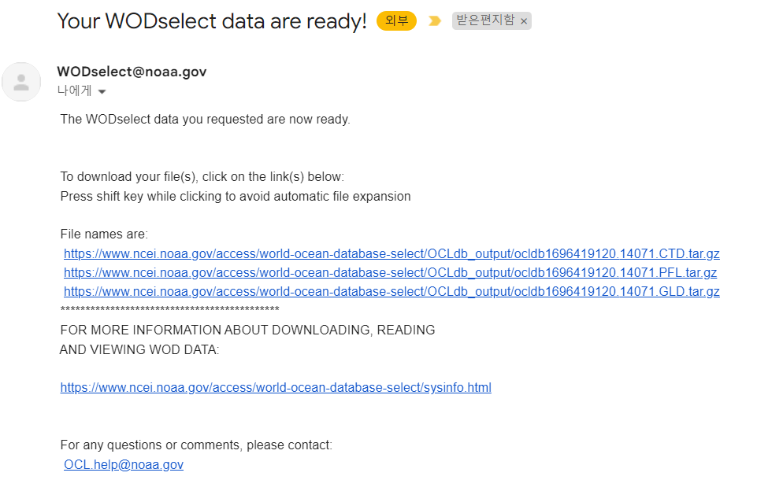

# :material-download-box-outline: How to Download WOD <span class="date">[2024.03.02]</span>

Step-by-step guide to the WODselect tool of the [World Ocean Database (NOAA NCEI)](https://www.ncei.noaa.gov/products/world-ocean-database).

## 1. Open WODselect

1. Go to the WOD product page.

    <figure markdown="span">
      { loading=lazy }
      <figcaption>WOD product page</figcaption>
    </figure>

2. Click **Launch WODselect**.

    <figure markdown="span">
      { loading=lazy }
      <figcaption>Launch WODselect</figcaption>
    </figure>

## 2. Build a query

3. Set the options you want (region, period, variables, instrument types).
4. Click **Build a query**.

    <figure markdown="span">
      { loading=lazy }
      <figcaption>Build a query (1)</figcaption>
    </figure>
    <figure markdown="span">
      { loading=lazy }
      <figcaption>Build a query (2)</figcaption>
    </figure>
    <figure markdown="span">
      { loading=lazy }
      <figcaption>Build a query (3)</figcaption>
    </figure>

## 3. Get an inventory and download

5. Click **Get an Inventory**.

    <figure markdown="span">
      { loading=lazy }
      <figcaption>Get an Inventory</figcaption>
    </figure>

6. A message like the one below appears.

    <figure markdown="span">
      { loading=lazy }
      <figcaption>Inventory message</figcaption>
    </figure>

7. Check the estimated loading time, then click **Download Data**.

    <figure markdown="span">
      { loading=lazy }
      <figcaption>Download Data (1)</figcaption>
    </figure>
    <figure markdown="span">
      { loading=lazy }
      <figcaption>Download Data (2)</figcaption>
    </figure>
    <figure markdown="span">
      { loading=lazy }
      <figcaption>Download Data (3)</figcaption>
    </figure>

## How to unzip a .gz file on Windows

Open `cmd` and run the two commands below, replacing `currentfolder` with the folder that holds the file and `filename` with the file name.

```bat title="Extract tar.gz in cmd"
cd currentfolder
tar -xf filename.tar.gz
```
