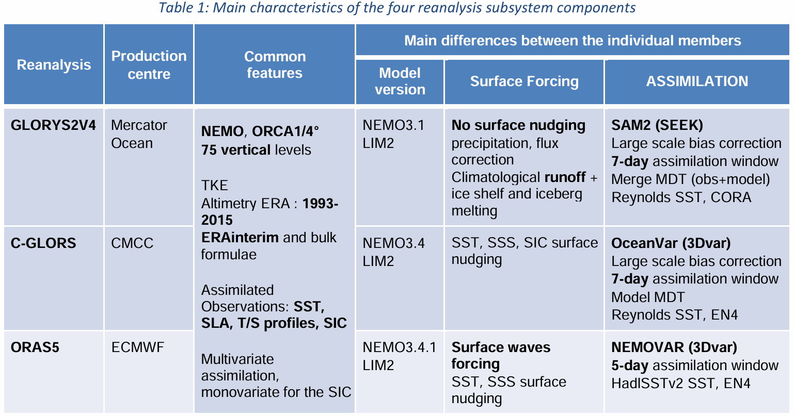

# :material-monitor: Model [2025.12.31]

How to download widely used numerical model products: reanalyses, analyses and forecasts.

!!! tip "Before using model output"
    Even without configuring and running a numerical model yourself, good research is possible with the many distributed model products.
    Which model reproduces the real ocean best differs from region to region, however, so **evaluating the product against observations
    is an essential step** before any serious analysis. Many earlier studies have done this; look them up.

    Personally I rely on **HYCOM and GLORYS**, which have high spatial and temporal resolution and assimilate observations.
    Neither GLORYS nor HYCOM includes tides, although the HYCOM ESPC product distributed since 2024-08-10 is reported to include them.

## Global reanalysis & analysis

### HYCOM

Data-assimilating global ocean model. The ESPC product includes tides from 2024-08-10 onward

[:octicons-arrow-right-24: How to download HYCOM (MATLAB: ESPC, GOFS 3.1, earlier versions)](hycom-download.md) 
[:octicons-link-external-24: Tidal Analysis of ESPC-D-V02 (HYCOM forum)](https://groups.google.com/a/hycom.org/g/forum/c/-cZVLj9f5d0)

### GLORYS12v1

0.083° · daily/monthly · 1993-01-01 – (almost) present
{ .spec }

CMEMS global reanalysis (GLOBAL_MULTIYEAR_PHY_001_030)

[:octicons-link-external-24: GLOBAL_MULTIYEAR_PHY_001_030](https://data.marine.copernicus.eu/product/GLOBAL_MULTIYEAR_PHY_001_030/description)

### GLO12v4

0.083° · hourly/daily/monthly · 2022-06-01 – forecast (+10 d)
{ .spec }

Global Ocean Physics Analysis and Forecast. Short period, but high temporal resolution and many variables

[:octicons-link-external-24: GLOBAL_ANALYSISFORECAST_PHY_001_024](https://data.marine.copernicus.eu/product/GLOBAL_ANALYSISFORECAST_PHY_001_024/description)

### GREP

0.25° · daily/monthly · 1993-01-01 – 2023-12-31
{ .spec }

Global Ocean Ensemble Physics Reanalysis. An ensemble of several models; the member products can be downloaded from the same link

[:octicons-link-external-24: GLOBAL_MULTIYEAR_PHY_ENS_001_031](https://data.marine.copernicus.eu/product/GLOBAL_MULTIYEAR_PHY_ENS_001_031/description)

<figure markdown="span">
  { loading=lazy }
  <figcaption>Table of GREP member models</figcaption>
</figure>

### ORAS5

ECMWF Ocean ReAnalysis System 5 (Climate Data Store)

[:octicons-link-external-24: CDS: reanalysis-oras5](https://cds.climate.copernicus.eu/datasets/reanalysis-oras5?tab=overview)

### NCEP GODAS

monthly · 1980-01 – recent (~2 months delay)
{ .spec }

Multi-level ocean analysis from NOAA/NCEP

[:octicons-download-24: GODAS (NOAA PSL)](https://www.psl.noaa.gov/data/gridded/data.godas.html) 
[:octicons-link-external-24: GODAS (NOAA CPC)](https://www.cpc.ncep.noaa.gov/products/GODAS/)

??? info "NCEP products (NOAA PSL)"

    | Product | Description |
    |---|---|
    | [NCEP GDAS](https://www.psl.noaa.gov/data/gridded/data.ncep.html) | NCEP's twice-daily global analysis at 2.5° resolution on pressure levels, a product of its operational forecast system |
    | [NCEP GODAS](https://www.psl.noaa.gov/data/gridded/data.godas.html) | High-resolution multi-level ocean analysis from NOAA/NCEP |
    | [NCEP NARR](https://www.psl.noaa.gov/data/gridded/data.narr.html) | High-resolution combined model and assimilated dataset, 1979 – near present, 8-times daily, daily, and monthly on a Northern Hemisphere Lambert Conformal Conic grid ([PSL NARR page](https://www.psl.noaa.gov/data/narr/)) |
    | [NCEP-NCAR Reanalysis 1](https://www.psl.noaa.gov/data/gridded/data.ncep.reanalysis.html) | 4x daily, daily, and monthly atmospheric model output, 1948 – near present ([PSL R1 page](https://www.psl.noaa.gov/data/reanalysis/reanalysis.shtml)) |
    | [NCEP/DOE Reanalysis II](https://www.psl.noaa.gov/data/gridded/data.ncep.reanalysis2.html) | Improved version of Reanalysis 1 with fixed errors and updated physical parameterizations |

### ECCO

Free-running ocean model solution fitted to observations by least squares (state estimate)

[:octicons-link-external-24: ECCO products](https://www.ecco-group.org/products.htm) 
[:octicons-download-24: ECCO V4r4 T/S monthly, llc90 (PO.DAAC)](https://podaac.jpl.nasa.gov/dataset/ECCO_L4_TEMP_SALINITY_LLC0090GRID_MONTHLY_V4R4) 
[:octicons-link-external-24: Northwest Pacific State Estimation (Scripps)](https://www.ecco.ucsd.edu/nwpac.html)

### SODA

Simple Ocean Data Assimilation

[:octicons-link-external-24: SODA (UMD)](https://soda.umd.edu/) 
[:octicons-link-external-24: Climate Data Guide: SODA](https://climatedataguide.ucar.edu/climate-data/soda-simple-ocean-data-assimilation) 
[:octicons-link-external-24: UMD AOSC physical oceanography](https://aosc.umd.edu/research/air-sea-interaction-and-physical-oceanography)

### OFES2

0.1° · 76°S–76°N · 1958-01 – 2016-12
{ .spec }

No data assimilation. 105 levels (to 7500 m), JRA55-do forcing, M2 and K1 tides included

[:octicons-link-external-24: OFES2 (JAMSTEC)](https://www.jamstec.go.jp/ofes/ofes2.html)

??? quote "OFES2 description (from a published study)"
    We mainly adopt monthly variables output from OFES2 (Sasaki et al. 2020) to examine the long-term changes of the winter circulation in the Yellow Sea.
    OFES2 assimilates no observations and provides dynamically consistent variables covering the global ocean except the polar regions (76°S‒76°N)
    with a horizontal resolution of 0.1° and spanning from January 1958 to December 2016. The bottom topography in OFES2 is constructed with partial bottom cells
    using the bathymetry dataset of 1 arc-minute global relief model of Earth's surface (ETOPO1; Amante and Eakins 2009). The number of vertical levels is 105
    with a maximum depth of 7500 m. The thickness of each layer is 5 m within the upper 100 m and increases to 300 m in the bottom layer.
    There are 20 levels within the upper 100 m and 55 levels within the upper 500 m. The 3-hourly JRA55-do atmosphere dataset is used for sea surface atmospheric forcing.
    Constant barotropic tidal currents of M2 and K1 generated by the FES2012 tidal model (Stammer et al. 2014) are used as the largest semidiurnal and diurnal tidal constituents.
    Note that tidal processes are of vital importance in shaping the three-dimensional structures of ocean circulation and ecosystem in the global shelf seas
    (Simpson and Sharples 2012; Timko et al. 2019; Wu et al. 2023a, b, 2025). Including tides and with higher horizontal and vertical resolutions,
    OFES2 could give more accurate and detailed three-dimensional responses of the water masses and circulation to climate variabilities and changes
    than other available ocean products in the Yellow Sea (Li et al. 2024).

    Source: [The poleward expansion of the Hadley Cell has weakened the winter circulation in a midlatitude semi-enclosed shelf sea over the past six decades](https://doi.org/10.1007/s00382-025-07774-w)

### BRAN2020

Bluelink ReANalysis (CSIRO)

[:octicons-download-24: TDS Catalog (NCI)](https://thredds.nci.org.au/thredds/catalog/gb6/BRAN/BRAN2020/catalog.html) 
[:octicons-link-external-24: Bluelink reanalysis](https://research.csiro.au/bluelink/global/reanalysis/)

## Regional models

### FORA-WNP30

1982–2016 · eddy-resolving
{ .spec }

4D-Var Ocean ReAnalysis for the Western North Pacific. The first eddy-resolving reanalysis of the western North Pacific over the last three decades

[:octicons-download-24: TDS Catalog (JAMSTEC)](https://www.godac.jamstec.go.jp/jagdas/catalog/fora/catalog.html) 
[:octicons-link-external-24: FORA-WNP30](https://www.godac.jamstec.go.jp/fora/e/index.html)

### JCOPE2M

1993-01-01 – present · 10.5–62°N, 108–180°E
{ .spec }

Japan Coastal Ocean Predictability Experiment. Provided by ftp after an e-mail request (Fortran binary or NetCDF)

[:octicons-link-external-24: JCOPE data distribution](https://www.jamstec.go.jp/jcope/htdocs/e/distribution/#conditions%20of%20use)

??? info "How to request JCOPE2M reanalysis data"
    Application Laboratory freely distributes JCOPE2M reanalysis data to any interested persons.
    If you accept the [conditions of data use](https://www.jamstec.go.jp/jcope/htdocs/e/distribution/#conditions%20of%20use),
    send an e-mail describing your order: time range (maximum period: 1993-01-01 – present; 2 TB+),
    spatial range (maximum: 10.5–62°N, 108–180°E), and variables (sea surface height, north-south velocity, east-west velocity,
    potential temperature, salinity, heat flux at sea surface). They will provide the URL of an ftp site for downloading your data
    (Fortran binary or NetCDF) with [a README document](https://www.jamstec.go.jp/jcope/htdocs/e/distribution/README.e.txt).

    Contact: jcope (at) jamstec.go.jp

### CORA 1.0-NWP

China Ocean ReAnalysis. Regional reanalysis of the Chinese coastal and adjacent seas

[:octicons-link-external-24: CMOC China product service](https://www.cmoc-china.cn/pages/productService.html) 
[:octicons-download-24: NMDIS data](https://mds.nmdis.org.cn/pages/dataViewDetail.html?dataSetId=48) 
[:octicons-download-24: 海洋科学大数据中心](https://msdc.qdio.ac.cn/data/metadata-special-detail?id=1465896069408837633&otherId=1465896069547249665)

??? info "References"
    - [Han et al. (2011), Adv. Atmos. Sci.](https://link.springer.com/article/10.1007/s00376-010-9184-2)
    - [ScienceDirect article](https://www.sciencedirect.com/science/article/pii/S1674283420300234#ec-research-data)
    - [Interannual to Interdecadal Variability of the Southern Yellow Sea Cold Water Mass and Establishment of "Forcing Mechanism Bridge" (JMSE)](https://www.mdpi.com/2077-1312/9/12/1316)

### Arctic: CMEMS

Arctic tidal analysis (15-min, 3 km, since 2017-12-19, 53–90°N) and the TOPAZ reanalysis and forecast

[:octicons-link-external-24: Arctic Ocean Tidal Analysis and Forecast](https://data.marine.copernicus.eu/product/ARCTIC_ANALYSISFORECAST_PHY_TIDE_002_015/description) 
[:octicons-link-external-24: TOPAZ: Arctic Ocean Physics Reanalysis](https://data.marine.copernicus.eu/product/ARCTIC_MULTIYEAR_PHY_002_003/description) 
[:octicons-link-external-24: TOPAZ: Arctic Ocean Physics Analysis and Forecast](https://data.marine.copernicus.eu/product/ARCTIC_ANALYSISFORECAST_PHY_002_001/description)

## Tide & climate models

### HRET14: baroclinic tide

Harmonic constants of sea surface height and surface currents for the M2, S2, N2, K1 and O1 internal tides (Zaron & Elipot)

[:octicons-link-external-24: BAROCLINIC_HRET14 (PO.DAAC)](https://podaac.jpl.nasa.gov/dataset/BAROCLINIC_HRET14) 
[:octicons-download-24: Files](https://cmr.earthdata.nasa.gov/virtual-directory/collections/C2935657850-POCLOUD/temporal/1993/01/01)

### CMIP6

Coupled Model Intercomparison Project Phase 6 (ESGF)

[:octicons-download-24: ESGF CMIP6](https://esgf-node.llnl.gov/projects/cmip6/)

### CESM2

Community Earth System Model version 2

[:octicons-link-external-24: CESM2 (NCAR)](https://www.cesm.ucar.edu/models/cesm2)

