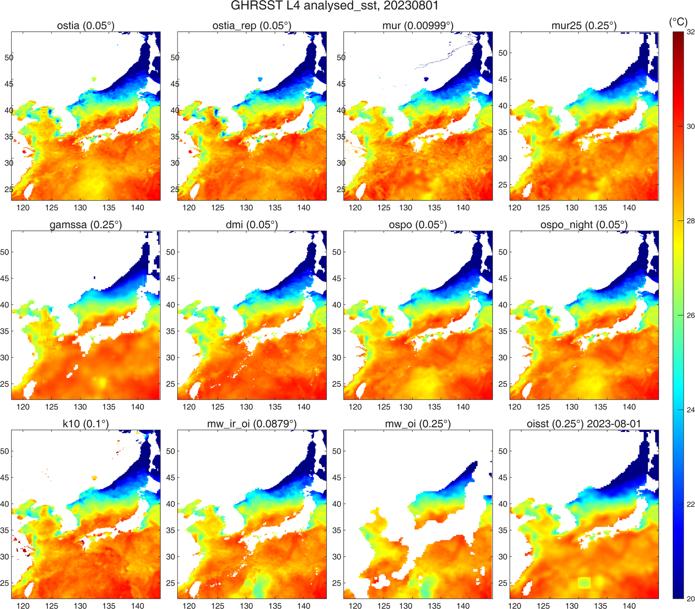
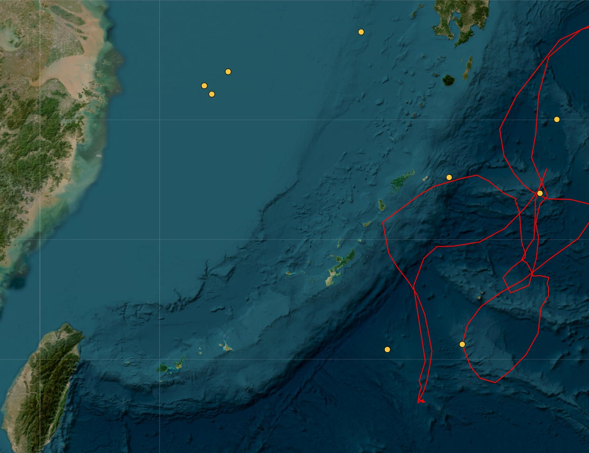
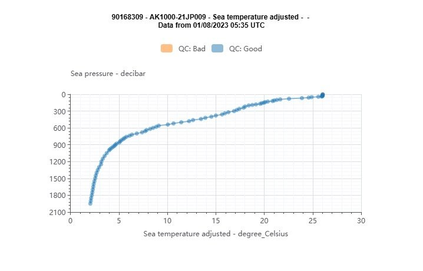
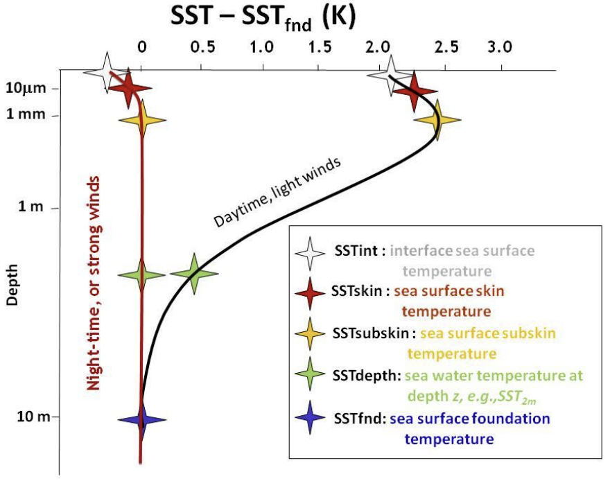
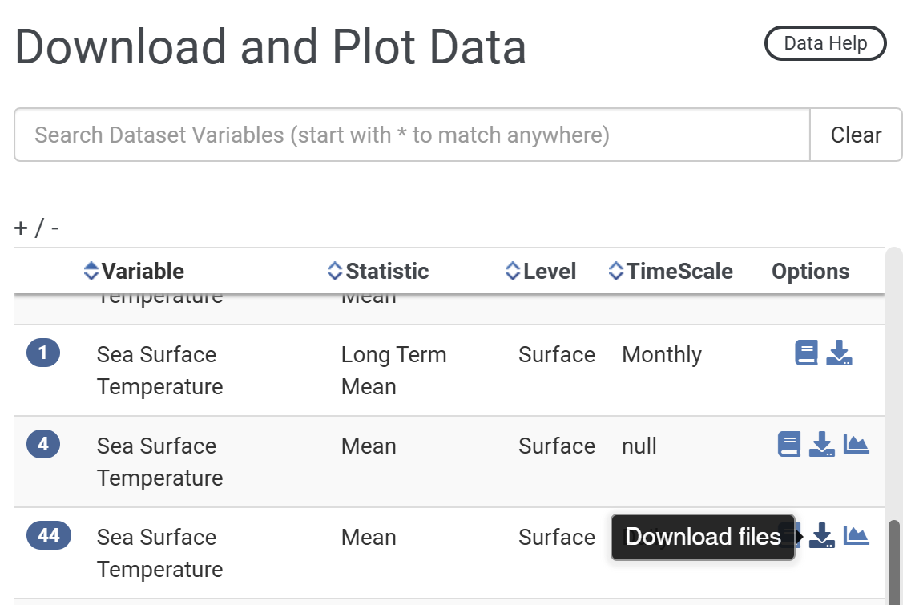
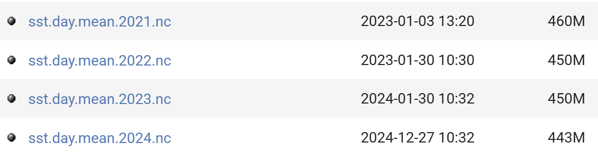

# :material-thermometer-lines: GHRSST [2026.10.29]

GHRSST 체계의 Level 4 foundation SST 분석장(OSTIA, OISST, MUR 등)과 다운로드 경로, 그리고 자료 간 비교 메모입니다.

??? info "GHRSST 관련, 방장의 생각"
    방장이 이해한 바로는, OSTIA, OISST, MUR 등 여러 SST 자료를 아울러 GHRSST project에서 관리합니다. 이 GHRSST product들은 기본적으로 두 사이트에서 다운로드할 수 있습니다.

    1. [NASA JPL PO.DAAC](https://podaac.jpl.nasa.gov/cloud-datasets)
    2. [코페르니쿠스 / CMEMS](https://data.marine.copernicus.eu/products)

    PO.DAAC 사이트에서 직접 받는 것은 매우 번거롭기 때문에, **기본적으로는 코페르니쿠스 사이트를 이용할 것을 추천합니다**. 그렇지만 코페르니쿠스에서는 한 번에 받을 수 있는 자료 용량에 제한이 있어, 장기간 넓은 해역의 자료를 받는 것은 불가능합니다.

    방장은 이러한 애로사항을 해결하기 위하여 자료를 자동으로 다운받는 [MATLAB 코드를 작성하여 공개](https://kr.mathworks.com/matlabcentral/fileexchange/173480-sst-downloader-ghrsst-l4-po-daac-and-oisst-subset-by-area-and-period)해 두었습니다. 용량이 작은 SST 자료는 코페르니쿠스에서 직접 받으면 되고, **용량이 큰 자료는 MATLAB 툴박스 코드를 이용하면 됩니다**. 참고로 이 코드가 자료를 끌어오는 곳은 PO.DAAC입니다(코페르니쿠스는 자료를 끌어올 수 있는 링크를 주지 않기 때문입니다).

    전 지구 SST 자료 중 대표적인 것으로 세 가지를 꼽을 수 있습니다.

    1. OSTIA, 해상도 0.05도
    2. OISST, 해상도 0.25도
    3. MUR, 해상도 0.01도

    이 중 OISST가 해상도가 제일 낮고 MUR이 제일 높습니다. 그러나 **해상도가 높다고 정확도까지 높은 것은 아닙니다**. 실측 자료와 위성 SST를 비교한 문헌을 보면 MUR보다 OSTIA, OISST의 정확도가 더 높게 나옵니다. 그렇지만 OISST의 낮은 해상도는 전 지구 표층 수온 분석에는 충분하더라도 국지적인 해역의 표층 수온 변화를 분석하기에는 부족합니다.
    **따라서 적절한 해상도와 정확도를 가진 OSTIA가 제일 무난합니다.**

!!! note "2026.10.29 업데이트: 12개 자료 비교"
    코드를 새로 업데이트하여, PO.DAAC에서 제공하는 GHRSST 자료 11개와 OISST를 합해 총 12개 자료를 MATLAB 스크립트 하나로 모두 다운로드할 수 있게 되었습니다.

    임의의 하루를 골라 비교해 보았는데, 예상보다 자료 간 차이가 컸습니다. 일반적으로 정확하다고 알려진 OSTIA를 기준으로 보면, OSTIA와 OSTIA Reprocessed 간에도 차이가 컸고, **MUR와 OSPO가 OSTIA와 가장 유사**하였습니다. GAMSSA는 황해에서 직선 구조가 나타나는 이상한 패턴을 보였고, OISST는 태평양 쪽에서 저수온의 사각형 격자가 튀는 이상치를 보였습니다. OISST의 다른 해역은 OSTIA와 비슷하지만 특정 격자에서 이상치가 있으므로, OISST를 사용할 때는 먼저 mapping을 해 볼 필요가 있습니다. MW는 같은 태평양 해역에서 OSTIA보다 수온을 과소추정한 반면, DMI와 K10은 과대추정하였습니다.

    <figure markdown="span">
      { loading=lazy }
      <figcaption>동아시아 연해에서 하루 동안의 SST 자료 12종 비교</figcaption>
    </figure>

    OISST 이상치 격자의 원인을 검토하기 위해 해당 위치의 Argo 존재 여부를 확인하였습니다. 아래 그림과 같이 큐슈 남쪽과 대만 동쪽에 8월 1일경 Argo가 있었습니다.

    <figure markdown="span">
      { loading=lazy }
      <figcaption>OISST 이상치 격자 부근의 Argo 위치</figcaption>
    </figure>

    해당 정점의 Argo 프로파일을 보면 표층 수온이 약 26도로, OISST 이상치 격자점의 값과 유사합니다. 이로 미루어 OISST의 이상치는 프로파일 자료를 동화하는 과정에서 생긴 것이 아닌가 추측됩니다(아닐 수도 있습니다).

    <figure markdown="span">
      { loading=lazy }
      <figcaption>2023년 8월 1일 Argo 보정 수온 프로파일 (WMO 90168309)</figcaption>
    </figure>

## GHRSST와 foundation SST

Considerable progress has been made in providing users with a single point of entry for all SST data sets. The [GHRSST services page](https://www.ghrsst.org/ghrsst-data-services/for-sst-data-users/services/) provides an overview of how to access the near real time (PO.DAAC) and the historical L2 to L4 data (NODC). Yet, the numerous GHRSST data sets, while providing users with many sources, also creates the need to integrate information and tools that allow users to make informed decisions about which data set to use.

- [:octicons-book-24: SST definitions discussion (GHRSST)](https://www.ghrsst.org/wp-content/uploads/2021/04/SSTDefinitionsDiscussion.pdf)
- [:octicons-link-external-24: PO.DAAC에서 여러 자료 검색](https://podaac.jpl.nasa.gov/cloud-datasets)

??? info "Foundation SST (SSTfnd)"
    Whereas along swath observation data essentially represent the skin or sub-skin SST, the Level 4 SST product is defined to represent the SST foundation (SSTfnd). SSTfnd is defined within GHRSST as the temperature at the base of the diurnal thermocline. It is so named because it represents the foundation temperature on which the diurnal thermocline develops during the day. SSTfnd changes only gradually along with the upper layer of the ocean, and by definition it is independent of skin SST fluctuations due to wind- and radiation-dependent diurnal stratification or skin layer response. It is therefore updated at intervals of 24 hrs. SSTfnd corresponds to the temperature of the upper mixed layer which is the part of the ocean represented by the top-most layer of grid cells in most numerical ocean models. It is never observed directly by satellites, but it comes closest to being detected by infrared and microwave radiometers during the night, when the previous day's diurnal stratification can be assumed to have decayed.

    출처: [SST_GLO_PHY_L4_NRT_010_043 (CMEMS)](https://data.marine.copernicus.eu/product/SST_GLO_PHY_L4_NRT_010_043/description)

    <figure markdown="span">
      { loading=lazy }
      <figcaption>SST의 정의: skin, sub-skin, depth, foundation SST</figcaption>
    </figure>

## 자료

### OSTIA Reprocessed (foundation SST)

0.05° · daily · CMEMS: 1981-10-01 – 2025-12-18 · PO.DAAC: 2023-12-31까지
{ .spec }

CMEMS와 PO.DAAC에서 모두 제공합니다. CMEMS는 현재 2025년 12월까지(이전에는 2022년 5월까지), PO.DAAC은 2023년 12월까지 제공합니다. [SST Downloader](https://kr.mathworks.com/matlabcentral/fileexchange/173480-sst-downloader-ghrsst-l4-po-daac-and-oisst-subset-by-area-and-period)를 사용하면 Reprocessed 자료를 2023년 말까지 받을 수 있습니다.

[:octicons-link-external-24: SST_GLO_SST_L4_REP_OBSERVATIONS_010_011 (CMEMS)](https://data.marine.copernicus.eu/product/SST_GLO_SST_L4_REP_OBSERVATIONS_010_011/description) 
[:octicons-link-external-24: OSTIA-UKMO-L4-GLOB-REP-v2.0 (PO.DAAC)](https://podaac.jpl.nasa.gov/dataset/OSTIA-UKMO-L4-GLOB-REP-v2.0)

### OSTIA Analysis (foundation SST)

0.05° · daily, monthly · CMEMS: 2024-01-17 – 2026-05-09 · PO.DAAC (GDS v2): 2006-12-31 – present
{ .spec }

Global Ocean OSTIA Sea Surface Temperature and Sea Ice Analysis. CMEMS 사이트의 User Manual > Reference에 GHRSST Data Specification(GDS 2.0, [doi:10.5281/zenodo.4700466](https://doi.org/10.5281/zenodo.4700466))이 적혀 있습니다. 즉 CMEMS의 OSTIA Analysis와 PO.DAAC의 OSTIA GDS v2는 서로 비슷한 자료인데, 같은 날의 자료를 각각 받아 확인한 결과 **값이 거의 같으나 완전히 동일하지는 않았습니다**. 원래 CMEMS는 2007~2024년을 제공하였는데, 2026년 5월 11일에 다시 확인한 결과 제공 기간이 최근으로 단축되었습니다.

PO.DAAC 자료는 GDS version 2 형식을 따르며 NRT 모드로 24시간 지연으로 매일 갱신됩니다. UKMO는 더 많은 센서와 자료를 사용한 **고품질 reprocessed OSTIA L4 SST**도 반년 주기로 생산합니다(위 항목 참고).

[:octicons-link-external-24: SST_GLO_SST_L4_NRT_OBSERVATIONS_010_001 (CMEMS)](https://data.marine.copernicus.eu/product/SST_GLO_SST_L4_NRT_OBSERVATIONS_010_001/description) 
[:octicons-link-external-24: OSTIA-UKMO-L4-GLOB-v2.0 (PO.DAAC)](https://podaac.jpl.nasa.gov/dataset/OSTIA-UKMO-L4-GLOB-v2.0)

### OISST v2.1

0.25° · daily, weekly, monthly · 1981-09 – present · 월별 장기 평균 1991–2020
{ .spec }

다중 센서 위성 자료(AVHRR, VIIRS)와 현장 관측을 결합한 고해상도 일별 OISST입니다. 다운로드 경로는 두 가지로, NCEI 제품 페이지와 NOAA PSL이 있습니다. 방장의 MATLAB 코드가 받아오는 곳은 PSL입니다.

[:octicons-link-external-24: 경로 1: Optimum Interpolation SST (NOAA NCEI)](https://www.ncei.noaa.gov/products/optimum-interpolation-sst) 
[:octicons-download-24: 경로 2: OISST v2 High Resolution (NOAA PSL)](https://psl.noaa.gov/data/gridded/data.noaa.oisst.v2.highres.html) 
[:octicons-link-external-24: AVHRR_OI-NCEI-L4-GLOB-v2.0 (PO.DAAC)](https://podaac.jpl.nasa.gov/dataset/AVHRR_OI-NCEI-L4-GLOB-v2.0)

<figure markdown="span">
  { loading=lazy }
  <figcaption>NOAA PSL OISST v2 High Resolution 페이지</figcaption>
</figure>
<figure markdown="span">
  { loading=lazy }
  <figcaption>NOAA PSL OISST v2 High Resolution 파일 목록</figcaption>
</figure>

??? info "OISST version 2.1 개선 사항 (2024.12.28 확인)"
    - See [Huang et al. 2021](https://journals.ametsoc.org/view/journals/clim/34/8/JCLI-D-20-0166.1.xml) for complete details
    - In-situ ship and buoy data changed from the National Centers for Environmental Prediction (NCEP) Traditional Alphanumeric Codes (TAC) to NCEI merged TAC + Binary Universal Form for the Representation (BUFR) of meteorological data, with large increases of buoy data included to correct satellite SST biases.
    - Argo float SST observations have been added to provide additional correction for satellite SST biases.
    - Satellite input from the Metop-A and NOAA-19 to Metop-A and Metop-B have replaced degraded satellite data.
    - Ship-buoy SST correction methods have been revised to improve accuracy.
    - The sea-ice-concentration to SST conversion method has been revised to remove warm biases in the Arctic region.

### MUR 4.1 (foundation SST)

0.01° · daily · 2002-05-31 – present
{ .spec }

[:octicons-link-external-24: MUR-JPL-L4-GLOB-v4.1 (PO.DAAC)](https://podaac.jpl.nasa.gov/dataset/MUR-JPL-L4-GLOB-v4.1)

### MUR 4.2 (foundation SST)

0.25° · daily · 2002-08-31 – present
{ .spec }

[:octicons-link-external-24: MUR25-JPL-L4-GLOB-v04.2 (PO.DAAC)](https://podaac.jpl.nasa.gov/dataset/MUR25-JPL-L4-GLOB-v04.2)

## Himawari (정지궤도)

- [:octicons-link-external-24: Himawari (JMA 기상위성센터)](https://www.data.jma.go.jp/mscweb/data/himawari/)
- [:octicons-link-external-24: Himawari-8/9 (DIAS)](https://search.diasjp.net/en/dataset/Himawari_8_9)
- [:octicons-link-external-24: Full disk 영상 (NOAA OSPO)](https://www.ospo.noaa.gov/products/imagery/fulldisk.html)
- [:octicons-link-external-24: JAXA Himawari-8/9 L2/L3 SST (skin SST), P-Tree](https://www.eorc.jaxa.jp/ptree/)

-   **Himawari-8 AHI L3C (sub-skin SST)** · 0.02° · hourly · 2019-10-16 – 2022-12-14

    ---

    GHRSST NOAA/STAR Himawari-08 AHI L3C Pacific Ocean Region SST v2.70 (GDS2)

    [:octicons-link-external-24: AHI_H08-STAR-L3C-v2.70 (PO.DAAC)](https://podaac.jpl.nasa.gov/dataset/AHI_H08-STAR-L3C-v2.70)

-   **Himawari-8 AHI L2P (sub-skin SST)** · 2 km · hourly · 2019-10-16 – 2022-12-14

    ---

    GHRSST NOAA/STAR Himawari-08 AHI L2P Pacific Ocean Region SST v2.70 (GDS2)

    [:octicons-link-external-24: AHI_H08-STAR-L2P-v2.70 (PO.DAAC)](https://podaac.jpl.nasa.gov/dataset/AHI_H08-STAR-L2P-v2.70)

