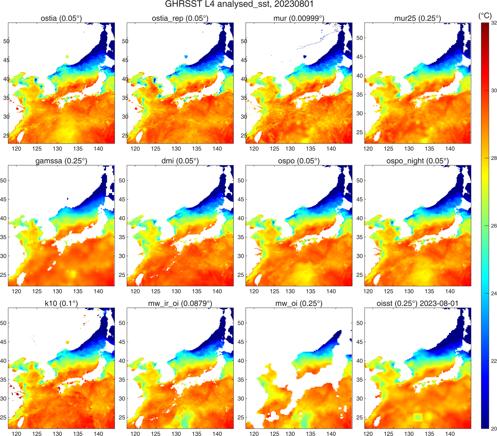
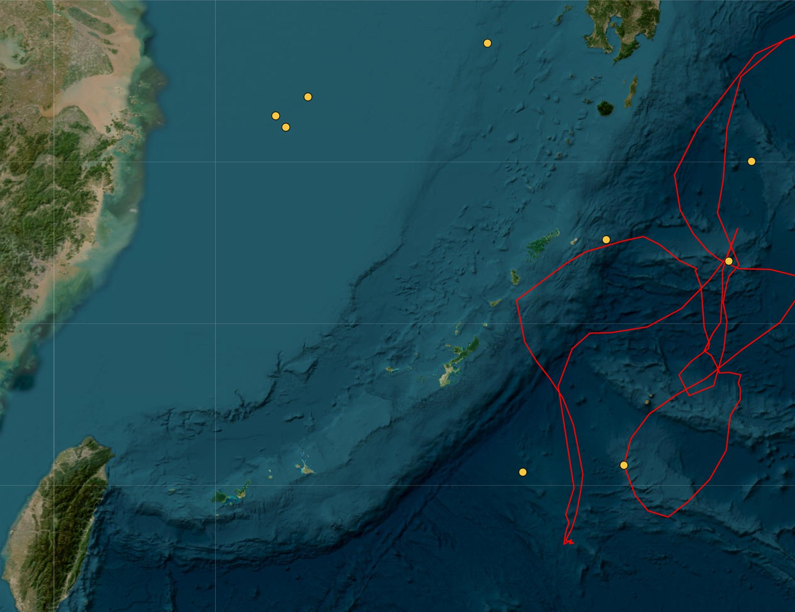
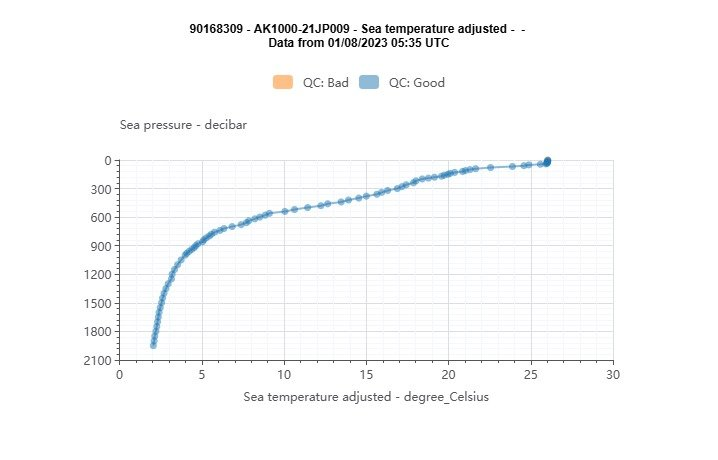
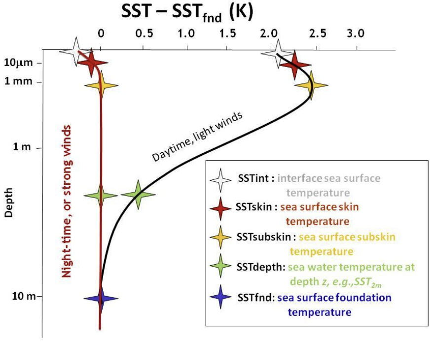
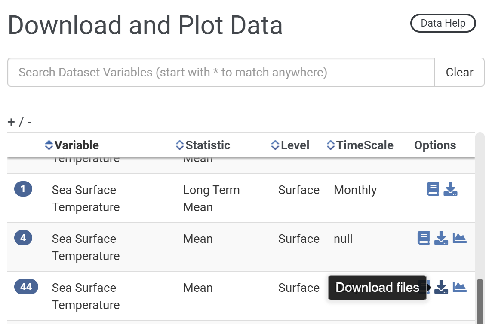
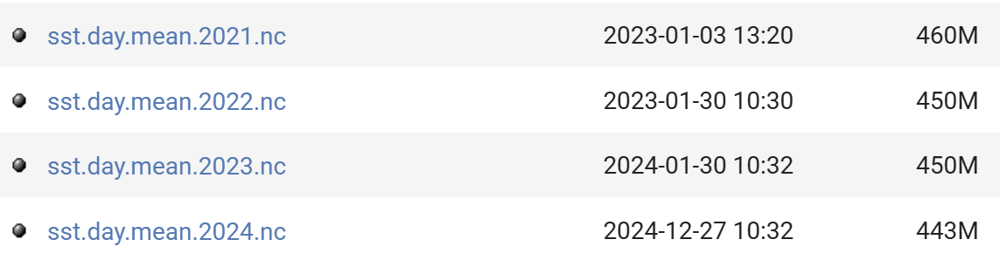

# :material-thermometer-lines: GHRSST [2026.10.29]

Level 4 foundation SST analyses in the GHRSST framework (OSTIA, OISST, MUR and others), where to download them, and notes from comparing the products.

??? info "How I think about GHRSST"
    As I understand it, the GHRSST project manages a range of SST datasets, including OSTIA, OISST and MUR. These GHRSST products can be downloaded from two main sites:

    1. [NASA JPL PO.DAAC](https://podaac.jpl.nasa.gov/cloud-datasets)
    2. [Copernicus / CMEMS](https://data.marine.copernicus.eu/products)

    Downloading directly from the PO.DAAC site is cumbersome, so **I generally recommend Copernicus**. Copernicus, however, limits the volume of each download, so long periods over large areas cannot be retrieved there.

    To get around this I wrote and published a [MATLAB script](https://kr.mathworks.com/matlabcentral/fileexchange/173480-sst-downloader-ghrsst-l4-po-daac-and-oisst-subset-by-area-and-period) that downloads the data automatically. Small SST subsets can be downloaded directly from Copernicus; **large volumes are best handled with the MATLAB toolbox**. The toolbox pulls the data from PO.DAAC, because Copernicus does not expose a link that can be fetched programmatically.

    Three global SST products stand out:

    1. OSTIA, 0.05°
    2. OISST, 0.25°
    3. MUR, 0.01°

    OISST has the coarsest resolution and MUR the finest, but **higher resolution does not mean higher accuracy**. Validation studies against in situ data report higher accuracy for OSTIA and OISST than for MUR. The coarse resolution of OISST, while adequate for global analyses, is insufficient for regional SST variability.
    **OSTIA, with moderate resolution and good accuracy, is therefore the safest choice.**

!!! note "Update 2026.10.29: comparison of 12 products"
    The download script was updated so that 11 GHRSST datasets from PO.DAAC plus OISST, 12 in total, can be downloaded with one MATLAB script.

    I compared the products for one arbitrary day, and the differences were larger than expected. Taking OSTIA, generally regarded as the most accurate, as the reference, OSTIA and OSTIA Reprocessed differed noticeably, and **MUR and OSPO were the closest to OSTIA**. GAMSSA showed odd straight-line structures in the Yellow Sea, and OISST showed cold rectangular grid cells in the Pacific. Elsewhere OISST resembles OSTIA, so mapping the field first is advisable when using OISST. MW underestimated SST relative to OSTIA in the same Pacific area, whereas DMI and K10 overestimated it.

    <figure markdown="span">
      { loading=lazy }
      <figcaption>Twelve SST products compared over the East Asian marginal seas on one day</figcaption>
    </figure>

    To look into the OISST outlier cells, I checked for Argo floats at those locations. As shown below, floats were present south of Kyushu and east of Taiwan around 1 August.

    <figure markdown="span">
      { loading=lazy }
      <figcaption>Argo float positions near the OISST outlier cells</figcaption>
    </figure>

    The Argo profile at that station shows a surface temperature near 26 °C, similar to the OISST outlier value. This suggests, though it is only a guess, that the outliers arise when the profile data are assimilated.

    <figure markdown="span">
      { loading=lazy }
      <figcaption>Argo adjusted temperature profile, 1 August 2023 (WMO 90168309)</figcaption>
    </figure>

## About GHRSST and foundation SST

Considerable progress has been made in providing users with a single point of entry for all SST data sets. The [GHRSST services page](https://www.ghrsst.org/ghrsst-data-services/for-sst-data-users/services/) provides an overview of how to access the near real time (PO.DAAC) and the historical L2 to L4 data (NODC). Yet, the numerous GHRSST data sets, while providing users with many sources, also creates the need to integrate information and tools that allow users to make informed decisions about which data set to use.

- [:octicons-book-24: SST definitions discussion (GHRSST)](https://www.ghrsst.org/wp-content/uploads/2021/04/SSTDefinitionsDiscussion.pdf)
- [:octicons-link-external-24: Search datasets on PO.DAAC](https://podaac.jpl.nasa.gov/cloud-datasets)

??? info "Foundation SST (SSTfnd)"
    Whereas along swath observation data essentially represent the skin or sub-skin SST, the Level 4 SST product is defined to represent the SST foundation (SSTfnd). SSTfnd is defined within GHRSST as the temperature at the base of the diurnal thermocline. It is so named because it represents the foundation temperature on which the diurnal thermocline develops during the day. SSTfnd changes only gradually along with the upper layer of the ocean, and by definition it is independent of skin SST fluctuations due to wind- and radiation-dependent diurnal stratification or skin layer response. It is therefore updated at intervals of 24 hrs. SSTfnd corresponds to the temperature of the upper mixed layer which is the part of the ocean represented by the top-most layer of grid cells in most numerical ocean models. It is never observed directly by satellites, but it comes closest to being detected by infrared and microwave radiometers during the night, when the previous day's diurnal stratification can be assumed to have decayed.

    Source: [SST_GLO_PHY_L4_NRT_010_043 (CMEMS)](https://data.marine.copernicus.eu/product/SST_GLO_PHY_L4_NRT_010_043/description)

    <figure markdown="span">
      { loading=lazy }
      <figcaption>SST definitions: skin, sub-skin, depth and foundation SST</figcaption>
    </figure>

## Products

### OSTIA Reprocessed (foundation SST)

0.05° · daily · 1981-10-01 – 2025-12-18 on CMEMS; to 2023-12-31 on PO.DAAC
{ .spec }

Provided by both CMEMS and PO.DAAC. CMEMS currently serves data to December 2025 (previously to May 2022); PO.DAAC serves to December 2023. With the [SST Downloader](https://kr.mathworks.com/matlabcentral/fileexchange/173480-sst-downloader-ghrsst-l4-po-daac-and-oisst-subset-by-area-and-period) the reprocessed data can be downloaded through the end of 2023.

[:octicons-link-external-24: SST_GLO_SST_L4_REP_OBSERVATIONS_010_011 (CMEMS)](https://data.marine.copernicus.eu/product/SST_GLO_SST_L4_REP_OBSERVATIONS_010_011/description) 
[:octicons-link-external-24: OSTIA-UKMO-L4-GLOB-REP-v2.0 (PO.DAAC)](https://podaac.jpl.nasa.gov/dataset/OSTIA-UKMO-L4-GLOB-REP-v2.0)

### OSTIA Analysis (foundation SST)

0.05° · daily, monthly · CMEMS: 2024-01-17 – 2026-05-09 · PO.DAAC (GDS v2): 2006-12-31 – present
{ .spec }

Global Ocean OSTIA Sea Surface Temperature and Sea Ice Analysis. The CMEMS user manual cites the GHRSST Data Specification (GDS 2.0, [doi:10.5281/zenodo.4700466](https://doi.org/10.5281/zenodo.4700466)), so the CMEMS OSTIA Analysis and the PO.DAAC OSTIA GDS v2 are closely related. Downloading the same day from both showed **nearly identical, but not exactly identical, values**. CMEMS used to serve 2007 to 2024; when checked again on 2026.05.11 the period had been shortened to recent years only.

The PO.DAAC dataset follows GDS version 2 and is updated daily with 24-hour latency in NRT mode. UKMO also produces the **higher-quality reprocessed OSTIA L4 SST using more sensors and data with a biannual latency** (see above).

[:octicons-link-external-24: SST_GLO_SST_L4_NRT_OBSERVATIONS_010_001 (CMEMS)](https://data.marine.copernicus.eu/product/SST_GLO_SST_L4_NRT_OBSERVATIONS_010_001/description) 
[:octicons-link-external-24: OSTIA-UKMO-L4-GLOB-v2.0 (PO.DAAC)](https://podaac.jpl.nasa.gov/dataset/OSTIA-UKMO-L4-GLOB-v2.0)

### OISST v2.1

0.25° · daily, weekly, monthly · 1981-09 – present · monthly long-term mean 1991–2020
{ .spec }

High-resolution daily OISST from multi-sensor satellite data (AVHRR and VIIRS) plus in situ observations. Two download routes: the NCEI product page, and NOAA PSL, which is the source used by my MATLAB script.

[:octicons-link-external-24: Route 1: Optimum Interpolation SST (NOAA NCEI)](https://www.ncei.noaa.gov/products/optimum-interpolation-sst) 
[:octicons-download-24: Route 2: OISST v2 High Resolution (NOAA PSL)](https://psl.noaa.gov/data/gridded/data.noaa.oisst.v2.highres.html) 
[:octicons-link-external-24: AVHRR_OI-NCEI-L4-GLOB-v2.0 (PO.DAAC)](https://podaac.jpl.nasa.gov/dataset/AVHRR_OI-NCEI-L4-GLOB-v2.0)

<figure markdown="span">
  { loading=lazy }
  <figcaption>NOAA PSL OISST v2 High Resolution page</figcaption>
</figure>
<figure markdown="span">
  { loading=lazy }
  <figcaption>NOAA PSL OISST v2 High Resolution file list</figcaption>
</figure>

??? info "OISST version 2.1 improvements (retrieved 2024.12.28)"
    - See [Huang et al. 2021](https://journals.ametsoc.org/view/journals/clim/34/8/JCLI-D-20-0166.1.xml) for complete details
    - In-situ ship and buoy data changed from the National Centers for Environmental Prediction (NCEP) Traditional Alphanumeric Codes (TAC) to NCEI merged TAC + Binary Universal Form for the Representation (BUFR) of meteorological data, with large increases of buoy data included to correct satellite SST biases.
    - Argo float SST observations have been added to provide additional correction for satellite SST biases.
    - Satellite input from the Metop-A and NOAA-19 to Metop-A and Metop-B have replaced degraded satellite data.
    - Ship-buoy SST correction methods have been revised to improve accuracy.
    - The sea-ice-concentration to SST conversion method has been revised to remove warm biases in the Arctic region.

### MUR 4.1 (foundation SST)

0.01° · daily · 2002-05-31 – present
{ .spec }

[:octicons-link-external-24: MUR-JPL-L4-GLOB-v4.1 (PO.DAAC)](https://podaac.jpl.nasa.gov/dataset/MUR-JPL-L4-GLOB-v4.1)

### MUR 4.2 (foundation SST)

0.25° · daily · 2002-08-31 – present
{ .spec }

[:octicons-link-external-24: MUR25-JPL-L4-GLOB-v04.2 (PO.DAAC)](https://podaac.jpl.nasa.gov/dataset/MUR25-JPL-L4-GLOB-v04.2)

## Himawari (geostationary)

- [:octicons-link-external-24: Himawari (JMA Meteorological Satellite Center)](https://www.data.jma.go.jp/mscweb/data/himawari/)
- [:octicons-link-external-24: Himawari-8/9 (DIAS)](https://search.diasjp.net/en/dataset/Himawari_8_9)
- [:octicons-link-external-24: Full disk imagery (NOAA OSPO)](https://www.ospo.noaa.gov/products/imagery/fulldisk.html)
- [:octicons-link-external-24: JAXA Himawari-8/9 L2/L3 SST (skin SST), P-Tree](https://www.eorc.jaxa.jp/ptree/)

-   **Himawari-8 AHI L3C (sub-skin SST)** · 0.02° · hourly · 2019-10-16 – 2022-12-14

    ---

    GHRSST NOAA/STAR Himawari-08 AHI L3C Pacific Ocean Region SST v2.70 (GDS2)

    [:octicons-link-external-24: AHI_H08-STAR-L3C-v2.70 (PO.DAAC)](https://podaac.jpl.nasa.gov/dataset/AHI_H08-STAR-L3C-v2.70)

-   **Himawari-8 AHI L2P (sub-skin SST)** · 2 km · hourly · 2019-10-16 – 2022-12-14

    ---

    GHRSST NOAA/STAR Himawari-08 AHI L2P Pacific Ocean Region SST v2.70 (GDS2)

    [:octicons-link-external-24: AHI_H08-STAR-L2P-v2.70 (PO.DAAC)](https://podaac.jpl.nasa.gov/dataset/AHI_H08-STAR-L2P-v2.70)

