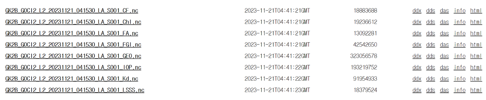

# :material-satellite-uplink: GOCI & GOCI-II <span class="date">[2026.05.11]</span>

천리안 1호(COMS)의 GOCI와 천리안 2B호(GK-2B)의 GOCI-II 정지궤도 해색 자료의 다운로드 경로와, OPeNDAP으로 받는 Python 코드입니다. 국내 배포 기관은 [Korea Satellite Centers](korea-centers.md)를 참고하세요.

## GOCI

<div class="grid cards" markdown>

-   **Earthdata 검색**

    ---

    NASA Earthdata(OB.DAAC)의 GOCI L2 OC granule

    [:octicons-link-external-24: Earthdata: GOCI L2 OC](https://search.earthdata.nasa.gov/search/granules?p=C1240264615-OB_DAAC&q=10.5067/COMS/GOCI/L2/OC/2014)

-   **wget / file search API**

    ---

    스크립트 다운로드용 NASA Ocean Color 파일 검색 API

    [:octicons-link-external-24: oceandata file_search API](https://oceandata.sci.gsfc.nasa.gov/api/file_search/)

-   **특정 날짜**

    ---

    NASA Ocean Color에서 날짜별 직접 접근

    [:octicons-download-24: oceandata direct data access](https://oceandata.sci.gsfc.nasa.gov/directdataaccess/)

</div>

## GOCI-II

<div class="grid cards" markdown>

-   **OPeNDAP**

    ---

    날짜별 GOCI-II 파일을 제공하는 NOSC OPeNDAP 서버

    [:octicons-download-24: NOSC OPeNDAP](https://nosc.go.kr/opendap/)

-   **특정 날짜**

    ---

    국가해양위성센터 포털

    [:octicons-link-external-24: NOSC](https://www.nosc.go.kr/main.do)

</div>

### Python과 OPeNDAP으로 GOCI-II 다운로드

1. 위의 NOSC OPeNDAP 링크에 접속해 원하는 nc 파일을 찾습니다.
2. `html` 옵션을 클릭합니다.
    <figure markdown="span">
      { loading=lazy }
      <figcaption>NOSC OPeNDAP: GOCI-II 파일의 html 옵션</figcaption>
    </figure>
3. `html` 주소를 아래 코드의 `url` 변수에 넣습니다.

```python title="Download a GOCI-II file with wget"
import wget
url = "http://www.nosc.go.kr/opendap/GOCI-II/2023/11/21/L2/GK2_GC2_L2_20231121_231530/GK2B_GOCI2_L2_20231121_231530_LA_S007_Chl.nc"
wget.download(url)
```
