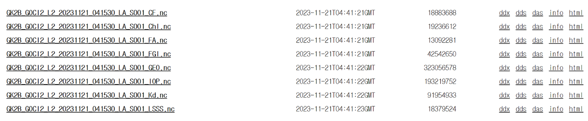

# :material-satellite-uplink: GOCI & GOCI-II <span class="date">[2026.05.11]</span>

Geostationary Ocean Color Imager data from COMS (GOCI) and GK-2B (GOCI-II): download routes and a Python snippet for OPeNDAP downloads. For the Korean distribution centers, see [Korea Satellite Centers](korea-centers.md).

## GOCI

<div class="grid cards" markdown>

-   **Earthdata search**

    ---

    GOCI L2 OC granules on NASA Earthdata (OB.DAAC)

    [:octicons-link-external-24: Earthdata: GOCI L2 OC](https://search.earthdata.nasa.gov/search/granules?p=C1240264615-OB_DAAC&q=10.5067/COMS/GOCI/L2/OC/2014)

-   **wget / file search API**

    ---

    NASA Ocean Color file search API for scripted downloads

    [:octicons-link-external-24: oceandata file_search API](https://oceandata.sci.gsfc.nasa.gov/api/file_search/)

-   **Specific date**

    ---

    Direct data access by date on NASA Ocean Color

    [:octicons-download-24: oceandata direct data access](https://oceandata.sci.gsfc.nasa.gov/directdataaccess/)

</div>

## GOCI-II

<div class="grid cards" markdown>

-   **OPeNDAP**

    ---

    NOSC OPeNDAP server with GOCI-II files by date

    [:octicons-download-24: NOSC OPeNDAP](https://nosc.go.kr/opendap/)

-   **Specific date**

    ---

    National Ocean Satellite Center portal

    [:octicons-link-external-24: NOSC](https://www.nosc.go.kr/main.do)

</div>

### Download GOCI-II with Python and OPeNDAP

1. Open the NOSC OPeNDAP link above and find the nc file you want.
2. Click the `html` option.
    <figure markdown="span">
      { loading=lazy }
      <figcaption>NOSC OPeNDAP: html option for a GOCI-II file</figcaption>
    </figure>
3. Put the `html` address into the `url` variable in the code below.

```python title="Download a GOCI-II file with wget"
import wget
url = "http://www.nosc.go.kr/opendap/GOCI-II/2023/11/21/L2/GK2_GC2_L2_20231121_231530/GK2B_GOCI2_L2_20231121_231530_LA_S007_Chl.nc"
wget.download(url)
```
