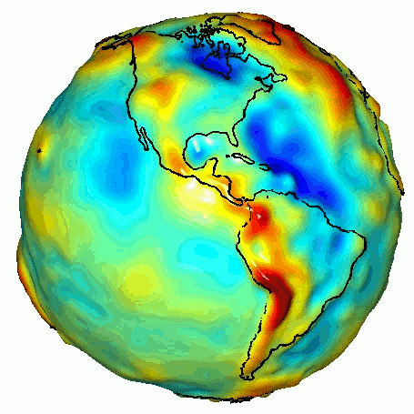
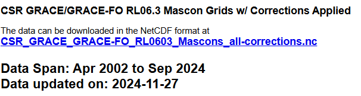
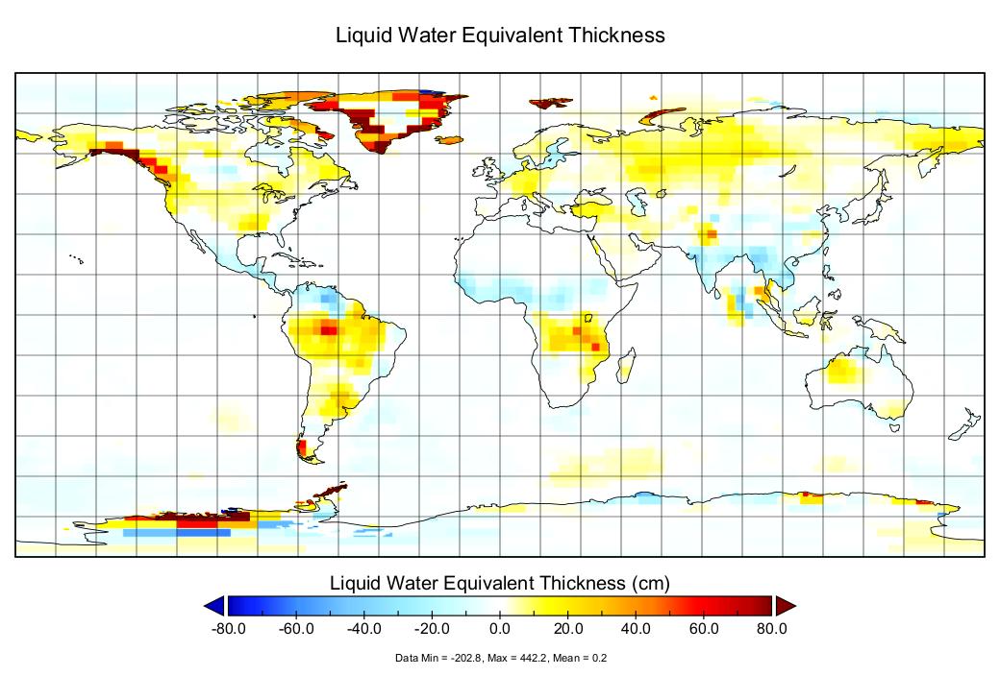

# :material-earth-arrow-down: GRACE <span class="date">[2024.12.01]</span>

Gravity Recovery and Climate Experiment(GRACE)와 GRACE Follow-On의 월별 중력장 해와 질량 집중(mascon) 자료입니다. 물 등가 두께(liquid water equivalent thickness)로 표현된 질량 변화를 제공합니다.

- [:octicons-link-external-24: GRACE Data Analysis Tool (NASA JPL)](https://grace.jpl.nasa.gov/data-analysis-tool/)

<figure markdown="span">
  { loading=lazy }
  <figcaption>GRACE 쌍둥이 위성 (NASA PIA12146)</figcaption>
</figure>

## 미션

| | GRACE | GRACE-FO |
|---|---|---|
| 발사일 | 17 March 2002 | 22 May 2018 |
| 미션 종료 선언 | 27 October 2017 | |
| 대기권 재진입 | GRACE-1: 10 March 2018, GRACE-2: 24 December 2017 | |

The GRACE and GRACE-FO RL06 solutions from CSR, JPL, and GFZ are obtained with the same data processing standards and background geophysical models (except for the tide models) but using different processing strategies and software (Bettadpur, 2018).
CSR, GFZ, and JPL process observations and ancillary data downloaded from GRACE to produce monthly [geopotential models](https://en.wikipedia.org/wiki/Geopotential_model) of Earth. Gridded products estimating changes in mass in units of liquid water equivalent thickness are available at JPL's GRACE Tellus website.

- [:octicons-book-24: GRACE 문서 (PO.DAAC)](https://podaac.jpl.nasa.gov/gravity/grace-documentation)

## Mascon 자료

<div class="model-card" markdown>

### CSR GRACE/GRACE-FO RL06.3 Mascon Solutions (RL0603)

텍사스 대학교 Center for Space Research의 질량 집중 자료. 2024.12.01 확인

[:octicons-download-24: CSR RL06 mascons](https://www2.csr.utexas.edu/grace/RL06_mascons.html)<br>
[:octicons-book-24: Reference: doi:10.1002/2016JB013007](https://doi.org/10.1002/2016JB013007)

<figure markdown="span">
  { loading=lazy }
  <figcaption>CSR RL06 mascon 다운로드 페이지</figcaption>
</figure>

??? info "time 변수 읽기"
    파일을 열어보면 `time` 변수와 `time_bounds` 변수가 따로 있습니다. 이 자료가 월평균이기 때문에, 월평균을 낸 기간(period)을 `time_bounds`에 넣어 두고, 해당 기간을 평균한 값의 대푯값 시각을 `time` 변수에 넣어 둔 것입니다.
    자료는 결국 월평균이니, 사용할 때는 간단하게 `time` 변수의 연도와 월 값을 사용하면 됩니다.

    ```matlab title="Read CSR mascon time variables"
    %% CSR GRACE/GRACE-FO RL06.3 Mascon Solutions

    clc; clear; close all;
    fnm = "D:\MATLAB_JU\CSR_GRACE_GRACE-FO_RL0603_Mascons_all-corrections.nc";
    [finfo, grace]=readnc2(fnm);

    % Unit of time variable in this NC file: 'days since 2002-01-01T00:00:00Z'
    grace.dt_range = datetime(2002, 01, 01, 00, 00, 00) + days(grace.time_bounds');
    grace.dt_aver = datetime(2002, 01, 01, 00, 00, 00) + days(grace.time);
    grace.dt_ym = datetime(grace.dt_aver, 'Format','uuuu-MM');
    ```

    참고로 이 GRACE product의 격자는 육각형(hexagonal)인 것으로 보입니다. MATLAB M_Map에서는 hexbin 격자를 제공하지 않기 때문에 시각화 결과가 다소 거칠게 나옵니다.

</div>

<div class="model-card" markdown>

### JPL GRACE Tellus mascons (RL06.3 V4)

TELLUS_GRAC-GRFO_MASCON_CRI_GRID_RL06.3_V4 · 2002-04-04 – present

[:octicons-link-external-24: 자료 페이지 (PO.DAAC)](https://podaac.jpl.nasa.gov/dataset/TELLUS_GRAC-GRFO_MASCON_CRI_GRID_RL06.3_V4)<br>
[:octicons-download-24: GRCTellus.JPL.200204_202408.GLO.RL06.3M.MSCNv04CRI.nc](https://archive.podaac.earthdata.nasa.gov/podaac-ops-cumulus-protected/TELLUS_GRAC-GRFO_MASCON_CRI_GRID_RL06.3_V4/GRCTellus.JPL.200204_202408.GLO.RL06.3M.MSCNv04CRI.nc)

<figure markdown="span">
  { loading=lazy }
  <figcaption>위 링크에서 받은 JPL mascon 파일의 물 등가 두께를 Panoply로 시각화한 결과</figcaption>
</figure>

=== "GRACE"

    **PO.DAAC 및 JPL**

    [:octicons-link-external-24: GRACE (PO.DAAC)](https://podaac.jpl.nasa.gov/grace)<br>
    [:octicons-download-24: Get data (GRACE Tellus)](https://grace.jpl.nasa.gov/data/get-data/)

=== "GRACE-FO"

    **PO.DAAC 및 JPL**

    [:octicons-link-external-24: GRACE-FO (PO.DAAC)](https://podaac.jpl.nasa.gov/GRACE-FO?tab=mission-objectives&sections=about%2Bdata)<br>
    [:octicons-download-24: GRACE-FO data](https://gracefo.jpl.nasa.gov/data/grace-fo-data/)

</div>

<div class="model-card" markdown>

### NASA GSFC mascons

Goddard Earth Sciences Division, Geodesy and Geophysics Laboratory

[:octicons-link-external-24: GSFC GRACE/GRACE-FO mascons](https://earth.gsfc.nasa.gov/geo/data/grace-mascons)

</div>

<div class="model-card" markdown>

### ESA

[:octicons-link-external-24: GRACE (ESA Earth Online)](https://earth.esa.int/eogateway/missions/grace)

</div>

<div class="model-card" markdown>

### GFZ

[:octicons-link-external-24: GravIS: Gravity Information Service](https://gravis.gfz.de/obp)<br>
[:octicons-link-external-24: GFZ GRACE products](https://www.gfz-potsdam.de/en/section/global-geomonitoring-and-gravity-field/projects/grace/grace-products)<br>
[:octicons-link-external-24: ISDC: GRACE gravity data and documentation](https://isdc.gfz-potsdam.de/grace-isdc/grace-gravity-data-and-documentation/)

GFZ ISDC의 FTP: GRACE `ftp://isdcftp.gfz-potsdam.de/grace/` · GRACE-FO `ftp://isdcftp.gfz-potsdam.de/grace-fo/`

!!! tip
    FTP 링크는 [FileZilla](https://filezilla-project.org/)로 열 수 있습니다.

</div>

## 참고

- AVISO 전 지구 평균 해수면(GMSL) 지표: `ftp://ftp.aviso.altimetry.fr/pub/oceano/AVISO/indicators/msl/`
- [Argo 격자 자료 (UCSD)](https://argo.ucsd.edu/data/argo-data-products/)
