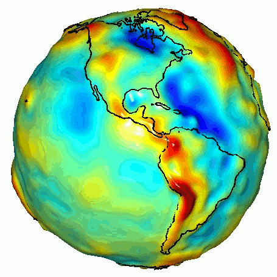
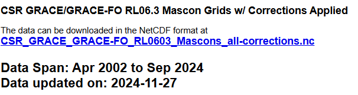
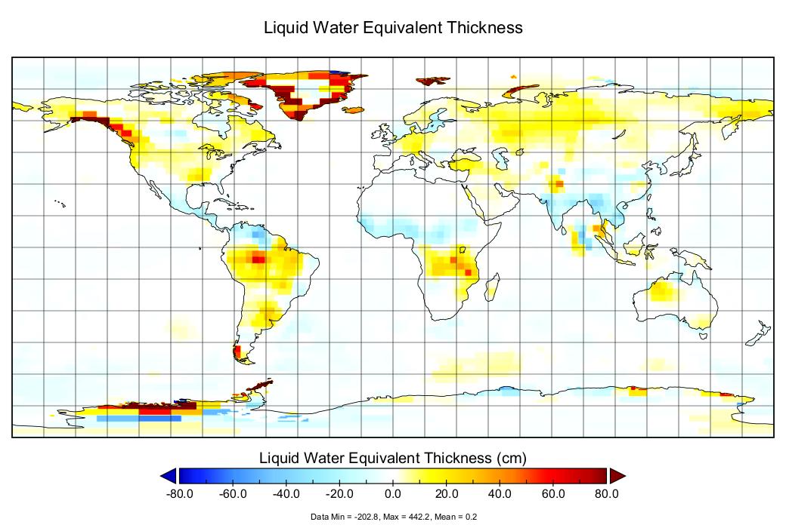

# :material-earth-arrow-down: GRACE <span class="date">[2024.12.01]</span>

Gravity Recovery and Climate Experiment (GRACE) and GRACE Follow-On: monthly gravity field solutions and mass concentration (mascon) products expressed as liquid water equivalent thickness.

- [:octicons-link-external-24: GRACE Data Analysis Tool (NASA JPL)](https://grace.jpl.nasa.gov/data-analysis-tool/)

<figure markdown="span">
  { loading=lazy }
  <figcaption>GRACE twin satellites (NASA PIA12146)</figcaption>
</figure>

## Missions

| | GRACE | GRACE-FO |
|---|---|---|
| Launch date | 17 March 2002 | 22 May 2018 |
| End of mission declared | 27 October 2017 | |
| Decay date | GRACE-1: 10 March 2018, GRACE-2: 24 December 2017 | |

The GRACE and GRACE-FO RL06 solutions from CSR, JPL, and GFZ are obtained with the same data processing standards and background geophysical models (except for the tide models) but using different processing strategies and software (Bettadpur, 2018).
CSR, GFZ, and JPL process observations and ancillary data downloaded from GRACE to produce monthly [geopotential models](https://en.wikipedia.org/wiki/Geopotential_model) of Earth. Gridded products estimating changes in mass in units of liquid water equivalent thickness are available at JPL's GRACE Tellus website.

- [:octicons-book-24: GRACE documentation (PO.DAAC)](https://podaac.jpl.nasa.gov/gravity/grace-documentation)

## Mascon products

<div class="model-card" markdown>

### CSR GRACE/GRACE-FO RL06.3 Mascon Solutions (RL0603)

Mass concentration data from the Center for Space Research, University of Texas. Retrieved on 2024.12.01

[:octicons-download-24: CSR RL06 mascons](https://www2.csr.utexas.edu/grace/RL06_mascons.html)<br>
[:octicons-book-24: Reference: doi:10.1002/2016JB013007](https://doi.org/10.1002/2016JB013007)

<figure markdown="span">
  { loading=lazy }
  <figcaption>CSR RL06 mascon download page</figcaption>
</figure>

??? info "Reading the time variables"
    The file has both a `time` variable and a `time_bounds` variable. Because the data are monthly means, `time_bounds` holds the averaging period and `time` holds the representative time of that period.
    Since the data are monthly, using the year and month of `time` is sufficient in practice.

    ```matlab title="Read CSR mascon time variables"
    %% CSR GRACE/GRACE-FO RL06.3 Mascon Solutions

    clc; clear; close all;
    fnm = "D:\MATLAB_JU\CSR_GRACE_GRACE-FO_RL0603_Mascons_all-corrections.nc";
    [finfo, grace]=readnc2(fnm);

    % Unit of time variable in this NC file: 'days since 2002-01-01T00:00:00Z'
    grace.dt_range = datetime(2002, 01, 01, 00, 00, 00) + days(grace.time_bounds');
    grace.dt_aver = datetime(2002, 01, 01, 00, 00, 00) + days(grace.time);
    grace.dt_ym = datetime(grace.dt_aver, 'Format','uuuu-MM');
    ```

    The grid of this product appears to be hexagonal. MATLAB M_Map does not provide a hexbin grid, so the visualization looks somewhat rough.

</div>

<div class="model-card" markdown>

### JPL GRACE Tellus mascons (RL06.3 V4)

TELLUS_GRAC-GRFO_MASCON_CRI_GRID_RL06.3_V4 · 2002-04-04 – present

[:octicons-link-external-24: Dataset page (PO.DAAC)](https://podaac.jpl.nasa.gov/dataset/TELLUS_GRAC-GRFO_MASCON_CRI_GRID_RL06.3_V4)<br>
[:octicons-download-24: GRCTellus.JPL.200204_202408.GLO.RL06.3M.MSCNv04CRI.nc](https://archive.podaac.earthdata.nasa.gov/podaac-ops-cumulus-protected/TELLUS_GRAC-GRFO_MASCON_CRI_GRID_RL06.3_V4/GRCTellus.JPL.200204_202408.GLO.RL06.3M.MSCNv04CRI.nc)

<figure markdown="span">
  { loading=lazy }
  <figcaption>Liquid water equivalent thickness from the JPL mascon file, visualized with Panoply</figcaption>
</figure>

=== "GRACE"

    **PO.DAAC and JPL**

    [:octicons-link-external-24: GRACE (PO.DAAC)](https://podaac.jpl.nasa.gov/grace)<br>
    [:octicons-download-24: Get data (GRACE Tellus)](https://grace.jpl.nasa.gov/data/get-data/)

=== "GRACE-FO"

    **PO.DAAC and JPL**

    [:octicons-link-external-24: GRACE-FO (PO.DAAC)](https://podaac.jpl.nasa.gov/GRACE-FO?tab=mission-objectives&sections=about%2Bdata)<br>
    [:octicons-download-24: GRACE-FO data](https://gracefo.jpl.nasa.gov/data/grace-fo-data/)

</div>

<div class="model-card" markdown>

### NASA GSFC mascons

Goddard Earth Sciences Division, Geodesy and Geophysics Laboratory

[:octicons-link-external-24: GSFC GRACE/GRACE-FO mascons](https://earth.gsfc.nasa.gov/geo/data/grace-mascons)

</div>

<div class="model-card" markdown>

### ESA

[:octicons-link-external-24: GRACE (ESA Earth Online)](https://earth.esa.int/eogateway/missions/grace)

</div>

<div class="model-card" markdown>

### GFZ

[:octicons-link-external-24: GravIS: Gravity Information Service](https://gravis.gfz.de/obp)<br>
[:octicons-link-external-24: GFZ GRACE products](https://www.gfz-potsdam.de/en/section/global-geomonitoring-and-gravity-field/projects/grace/grace-products)<br>
[:octicons-link-external-24: ISDC: GRACE gravity data and documentation](https://isdc.gfz-potsdam.de/grace-isdc/grace-gravity-data-and-documentation/)

FTP from GFZ ISDC: GRACE `ftp://isdcftp.gfz-potsdam.de/grace/` · GRACE-FO `ftp://isdcftp.gfz-potsdam.de/grace-fo/`

!!! tip
    FTP links can be opened with [FileZilla](https://filezilla-project.org/).

</div>

## Related

- AVISO global mean sea level indicator: `ftp://ftp.aviso.altimetry.fr/pub/oceano/AVISO/indicators/msl/`
- [Argo gridded data products (UCSD)](https://argo.ucsd.edu/data/argo-data-products/)
