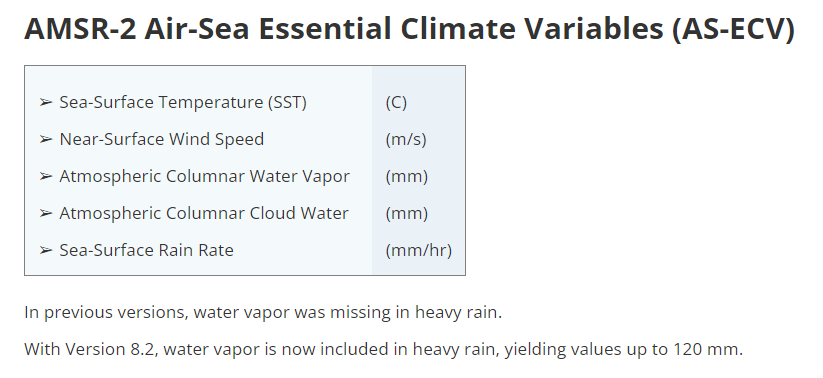

# :material-access-point: Microwave Radiometer: AMSR-2 <span class="date">[2024.10.21]</span>

AMSR-2 수동 마이크로파 해양 자료(SST, 풍속, 수증기, 구름 액체수, 강우율)입니다. Remote Sensing Systems(RSS)에서 배포하며, 다운로드와 영역 추출용 MATLAB 스크립트를 함께 정리했습니다.

- [:octicons-link-external-24: RSS AMSR 미션](https://www.remss.com/missions/amsr/)

<figure markdown="span">
  { loading=lazy }
  <figcaption>RSS 사이트의 AMSR-2 해양 자료</figcaption>
</figure>

## AMSR-2 다운로드 (daily, monthly)

RSS AMSR-2 Air-Sea Essential Climate Variables(AS-ECV) L3 v08.2 파일을 내려받는 스크립트입니다. 기간과 저장 폴더를 설정한 뒤 daily 또는 monthly 섹션을 실행하세요. 참고로 [암스]라고 편하게 발음하는 듯합니다.

??? example "MATLAB 스크립트"

    ```matlab title="Download AMSR-2 L3 v08.2 (daily, monthly)"
    %% AMSR-2 Air-Sea Essential Climate Variables (AS-ECV)
    %   Written by Jiuk Hwang. 2024.10.21

    %% Daily
    clc; clear;
    dt = datetime(2012,7,3):caldays(1):datetime(2023,12,31);

    FigFolderNm = 'D:\MATLAB_JU\RawData\2024_Remote_Sensing_RAW\AMSR';
    if ~exist(FigFolderNm, 'dir')
        mkdir(FigFolderNm);
    end

    for iyear = unique(year(dt))
        dtid = year(dt) == iyear;
        hamster = dt(dtid);
        for iday = 1:length(hamster)
            hamster2 = hamster(iday);
            link = sprintf("https://data.remss.com/amsr2/ocean/L3/v08.2/daily/%d/RSS_AMSR2_ocean_L3_daily_%s_v08.2.nc", iyear, string(hamster2));

            websave(sprintf('%s\\%s.nc', FigFolderNm, string(hamster2)), link)
        end

    end

    %% Monthly
    clc; clear;
    dt = datetime(2012,7,1):calmonths(1):datetime(2023,12,1);

    FigFolderNm = 'D:\MATLAB_JU\RawData\2024_Remote_Sensing_RAW\AMSR_month';
    if ~exist(FigFolderNm, 'dir')
        mkdir(FigFolderNm);
    end

    for iday = 1:length(dt)
        hamster = datetime(dt(iday), 'Format','uuuu-MM');
        link = sprintf("https://data.remss.com/amsr2/ocean/L3/v08.2/monthly/RSS_AMSR2_ocean_L3_monthly_%s_v08.2.nc", string(hamster));

        websave(sprintf('%s\\%s.nc', FigFolderNm, string(hamster)), link)
    end
    ```

## AMSR-2 자료를 특정 영역으로 잘라 MAT 파일로 저장

파라미터들은 주석 처리해 두었습니다. 필요한 파라미터의 주석을 해제한 다음 실행하면 됩니다. 예시는 동중국해 영역의 강우율을 추출하여 월별 파일을 하나의 MAT 파일로 묶습니다.

??? example "MATLAB 스크립트"

    ```matlab title="AMSR-2 NetCDF to regional MAT file"
    clc; clear; close all;

    fn = dir("D:\MATLAB_JU\RawData\2024_Remote_Sensing_RAW\passive_microwave_AMSR_2_monthly\*.nc");

    mla = [25 33.5];    mlo = [123.5 130];

    for wheel=7:height(fn)
        fnm = sprintf("%s/%s", fn(wheel).folder, fn(wheel).name);

        dt0 = fn(wheel).name;
        dt1 = split(dt0, {'-', '.'});
        dt2(1) = double(string(dt1{1,1}));
        dt2(2) = double(string(dt1{2,1}));
        lon = ncread(fnm, 'lon');
        lat = ncread(fnm, 'lat');
        % sst = ncread(fnm, 'SST');
        % wind = ncread(fnm, 'wind_speed_AW');
        % vapor = ncread(fnm, 'water_vapor');
        % cloud = ncread(fnm, 'cloud_liquid_water');
        rain0 = ncread(fnm, 'rain_rate');

        lonid = findnearpoint(lon, mlo);
        latid = findnearpoint(lat, mla);
        lon2 = lon(lonid(1):lonid(2));
        lat2 = lat(latid(1):latid(2));

        % sst2 = sst(lonid(1):lonid(2), latid(1):latid(2));
        % wind2 = wind(lonid(1):lonid(2), latid(1):latid(2));
        % vapor2 = vapor(lonid(1):lonid(2), latid(1):latid(2));
        % cloud2 = cloud(lonid(1):lonid(2), latid(1):latid(2));
        rain2 = rain0(lonid(1):lonid(2), latid(1):latid(2));

        rainlon = lon2;
        rainlat = lat2;
        rain(:,:,wheel) = rain2;
        raintime(wheel) = datetime(dt2(1), dt2(2), 15);
    end

    clear dt0 dt1 dt2 fn fnm lat lat2 latid lon lon2 lonid rain2 wheel;

    save Rain.mat rain rainlat rainlon raintime;


    function id = findnearpoint(base, target)
    % find nearest point of "target" from "base"
    [~, id] = min(abs(base-target));
    end
    ```
