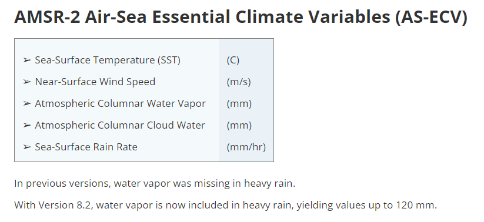

# :material-access-point: Microwave Radiometer: AMSR-2 <span class="date">[2024.10.21]</span>

Passive microwave ocean products from AMSR-2 (SST, wind speed, water vapor, cloud liquid water, rain rate), distributed by Remote Sensing Systems (RSS), with MATLAB scripts for downloading and subsetting.

- [:octicons-link-external-24: RSS AMSR missions](https://www.remss.com/missions/amsr/)

<figure markdown="span">
  { loading=lazy }
  <figcaption>AMSR-2 ocean products on the RSS site</figcaption>
</figure>

## Download AMSR-2 (daily and monthly)

The script downloads the RSS AMSR-2 Air-Sea Essential Climate Variables (AS-ECV) L3 v08.2 files. Set the date range and the destination folder, then run the daily or the monthly section. The name is usually pronounced "AMSR" as one word.

??? example "MATLAB script"

    ```matlab title="Download AMSR-2 L3 v08.2 (daily, monthly)"
    %% AMSR-2 Air-Sea Essential Climate Variables (AS-ECV)
    %   Written by Jiuk Hwang. 2024.10.21

    %% Daily
    clc; clear;
    dt = datetime(2012,7,3):caldays(1):datetime(2023,12,31);

    FigFolderNm = 'D:\MATLAB_JU\RawData\2024_Remote_Sensing_RAW\AMSR';
    if ~exist(FigFolderNm, 'dir')
        mkdir(FigFolderNm);
    end

    for iyear = unique(year(dt))
        dtid = year(dt) == iyear;
        hamster = dt(dtid);
        for iday = 1:length(hamster)
            hamster2 = hamster(iday);
            link = sprintf("https://data.remss.com/amsr2/ocean/L3/v08.2/daily/%d/RSS_AMSR2_ocean_L3_daily_%s_v08.2.nc", iyear, string(hamster2));

            websave(sprintf('%s\\%s.nc', FigFolderNm, string(hamster2)), link)
        end

    end

    %% Monthly
    clc; clear;
    dt = datetime(2012,7,1):calmonths(1):datetime(2023,12,1);

    FigFolderNm = 'D:\MATLAB_JU\RawData\2024_Remote_Sensing_RAW\AMSR_month';
    if ~exist(FigFolderNm, 'dir')
        mkdir(FigFolderNm);
    end

    for iday = 1:length(dt)
        hamster = datetime(dt(iday), 'Format','uuuu-MM');
        link = sprintf("https://data.remss.com/amsr2/ocean/L3/v08.2/monthly/RSS_AMSR2_ocean_L3_monthly_%s_v08.2.nc", string(hamster));

        websave(sprintf('%s\\%s.nc', FigFolderNm, string(hamster)), link)
    end
    ```

## Subset AMSR-2 files to a region and save as MAT

The parameters are commented out. Uncomment the ones you need and run. The example extracts rain rate for the East China Sea and stacks the monthly files in one MAT file.

??? example "MATLAB script"

    ```matlab title="AMSR-2 NetCDF to regional MAT file"
    clc; clear; close all;

    fn = dir("D:\MATLAB_JU\RawData\2024_Remote_Sensing_RAW\passive_microwave_AMSR_2_monthly\*.nc");

    mla = [25 33.5];    mlo = [123.5 130];

    for wheel=7:height(fn)
        fnm = sprintf("%s/%s", fn(wheel).folder, fn(wheel).name);

        dt0 = fn(wheel).name;
        dt1 = split(dt0, {'-', '.'});
        dt2(1) = double(string(dt1{1,1}));
        dt2(2) = double(string(dt1{2,1}));
        lon = ncread(fnm, 'lon');
        lat = ncread(fnm, 'lat');
        % sst = ncread(fnm, 'SST');
        % wind = ncread(fnm, 'wind_speed_AW');
        % vapor = ncread(fnm, 'water_vapor');
        % cloud = ncread(fnm, 'cloud_liquid_water');
        rain0 = ncread(fnm, 'rain_rate');

        lonid = findnearpoint(lon, mlo);
        latid = findnearpoint(lat, mla);
        lon2 = lon(lonid(1):lonid(2));
        lat2 = lat(latid(1):latid(2));

        % sst2 = sst(lonid(1):lonid(2), latid(1):latid(2));
        % wind2 = wind(lonid(1):lonid(2), latid(1):latid(2));
        % vapor2 = vapor(lonid(1):lonid(2), latid(1):latid(2));
        % cloud2 = cloud(lonid(1):lonid(2), latid(1):latid(2));
        rain2 = rain0(lonid(1):lonid(2), latid(1):latid(2));

        rainlon = lon2;
        rainlat = lat2;
        rain(:,:,wheel) = rain2;
        raintime(wheel) = datetime(dt2(1), dt2(2), 15);
    end

    clear dt0 dt1 dt2 fn fnm lat lat2 latid lon lon2 lonid rain2 wheel;

    save Rain.mat rain rainlat rainlon raintime;


    function id = findnearpoint(base, target)
    % find nearest point of "target" from "base"
    [~, id] = min(abs(base-target));
    end
    ```
