# :material-download-box-outline: 해색 위성 자료, 원하는 지역과 기간만 다운로드 [2024.09.28]

NASA Ocean Color의 Level 3·4 자료(Chl-a 등)에서 원하는 지역과 기간만 추출하여 받는 방법입니다. 서버에서 추출해 주기 때문에 전 지구 파일을 받는 것보다 다운로드 속도가 상당히 빠릅니다.

!!! tip "Earthdata 회원가입"
    시작하기 전에 [NASA Earthdata](https://urs.earthdata.nasa.gov/)에 회원가입할 것을 추천합니다. Earthdata는 해양 자료를 받을 때 자주 쓰게 되므로, 아직 가입하지 않았다면 이번 기회에 해 두면 좋습니다.

1. [NASA Ocean Color](https://oceandata.sci.gsfc.nasa.gov/)에 접속합니다.
    <figure markdown="span">
      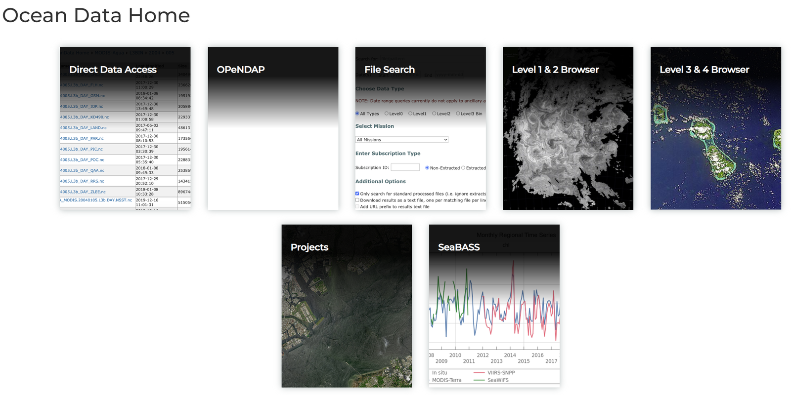{ loading=lazy }
      <figcaption>NASA Ocean Color 자료 사이트</figcaption>
    </figure>
2. `Level 3 & 4 Browser`를 클릭합니다.
    <figure markdown="span">
      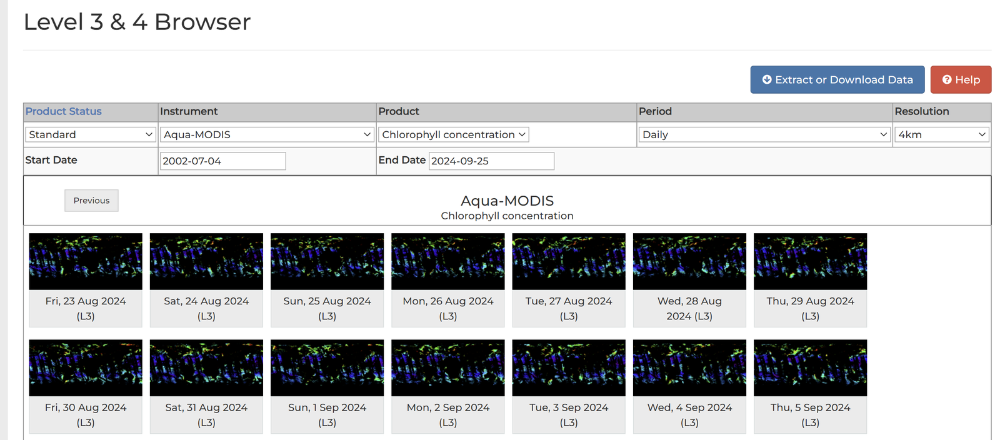{ loading=lazy }
      <figcaption>Level 3 & 4 Browser</figcaption>
    </figure>
3. Product, Period, Resolution을 원하는 대로 수정합니다. 예시에서는 Chl-a, Monthly, 4 km를 선택하였습니다. 옵션 선택을 마치면 우측 상단의 파란색 `Extract or download data` 버튼을 클릭합니다.
    <figure markdown="span">
      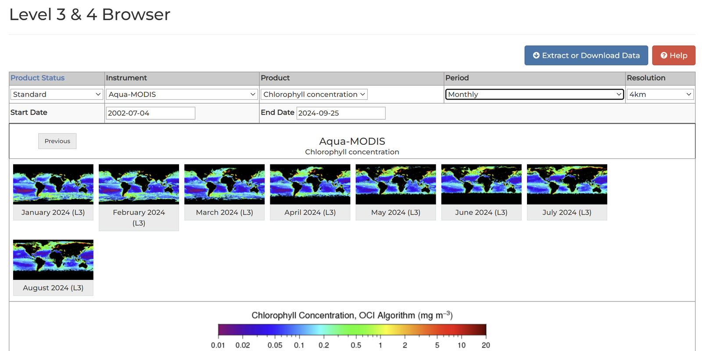{ loading=lazy }
      <figcaption>Product, Period, Resolution 선택</figcaption>
    </figure>
4. **Type** 옵션에서 `Mapped`를 클릭하고, **Data Retrieval Method**에서 download 대신 `Extract`를 클릭합니다. 그러면 원하는 지역을 선택할 수 있습니다.
    <figure markdown="span">
      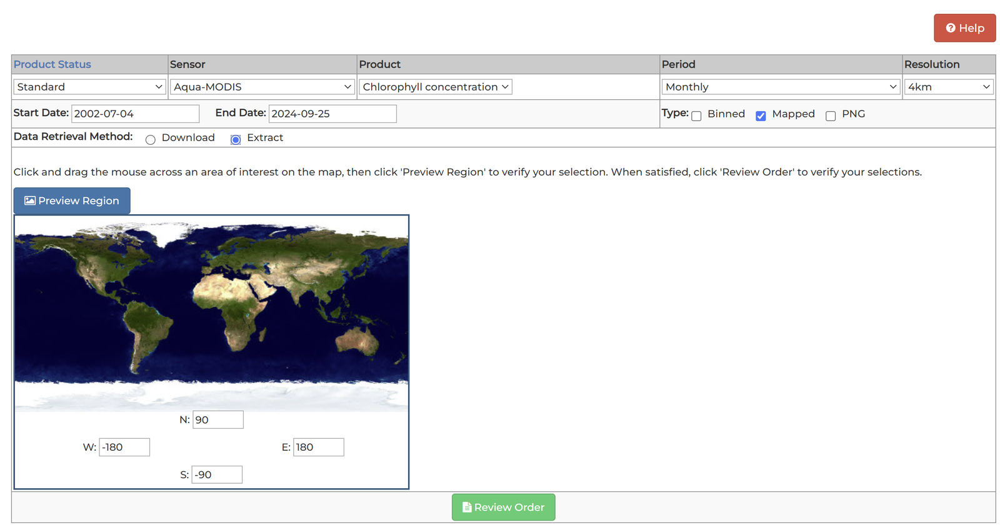{ loading=lazy }
      <figcaption>Type: Mapped, Data Retrieval Method: Extract</figcaption>
    </figure>
5. 예시에서는 동중국해 해역을 선택하였습니다. 옵션을 재확인한 후 맨 밑의 `Extract`를 클릭합니다.
    <figure markdown="span">
      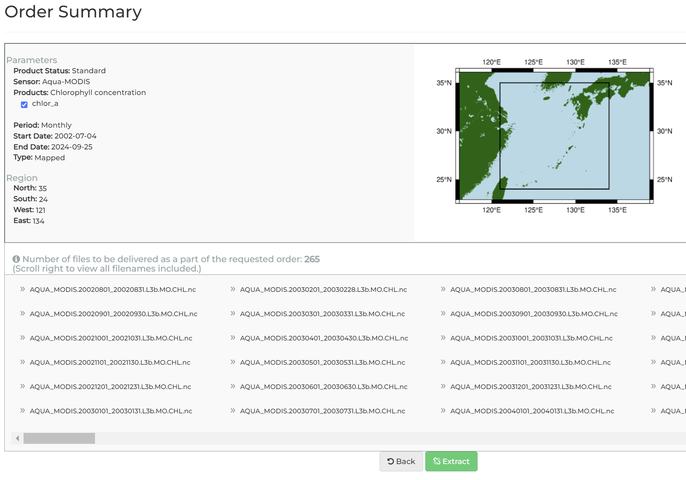{ loading=lazy }
      <figcaption>동중국해 영역 선택</figcaption>
    </figure>
6. 다음과 같은 화면이 나옵니다. Earthdata에 회원가입이 되어 있다면 첫 번째 링크로 들어가면 됩니다.
    <figure markdown="span">
      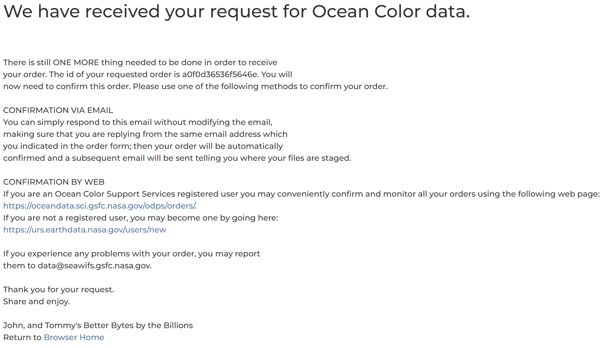{ loading=lazy }
      <figcaption>주문 확인 링크</figcaption>
    </figure>
7. Cancel과 Confirm 중 `Confirm`을 클릭합니다.
    <figure markdown="span">
      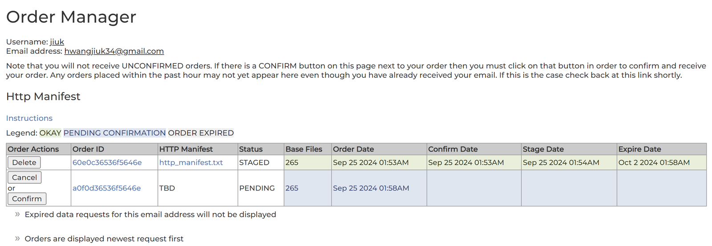{ loading=lazy }
      <figcaption>주문 확인</figcaption>
    </figure>
8. 참고로 아래와 같이 메일로도 옵니다.
    <figure markdown="span">
      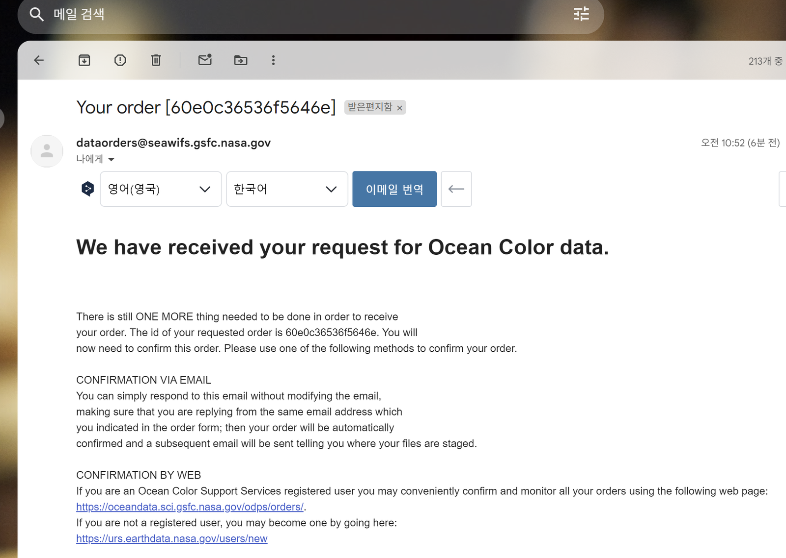{ loading=lazy }
      <figcaption>확인 메일</figcaption>
    </figure>
9. Confirm을 누르고 조금 기다리면 메일이 하나 더 옵니다. 이것이 데이터를 받을 수 있는 메일입니다.
    <figure markdown="span">
      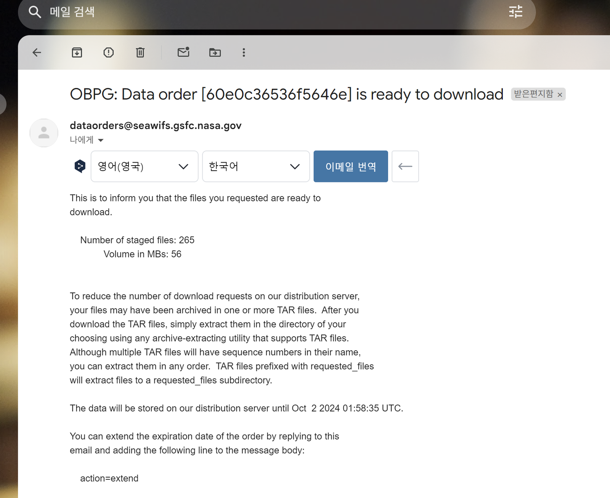{ loading=lazy }
      <figcaption>다운로드 메일</figcaption>
    </figure>
    <figure markdown="span">
      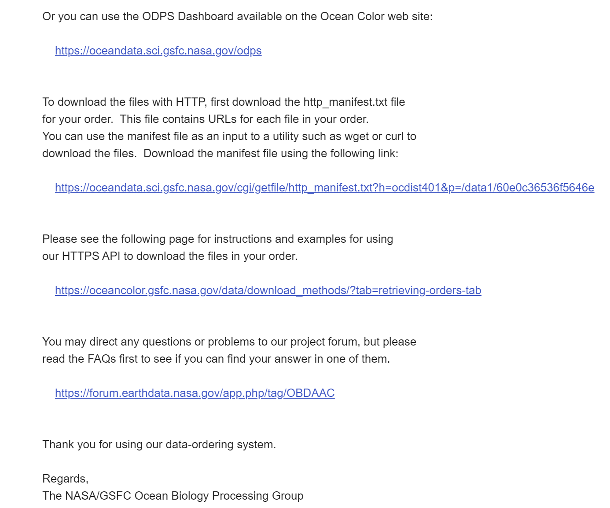{ loading=lazy }
      <figcaption>다운로드 메일의 링크</figcaption>
    </figure>
10. HTTP로 다운로드한다는 링크(왼쪽 그림의 두 번째 하이퍼링크)를 클릭하면 파일 URL이 적힌 TXT 파일이 다운로드됩니다.
    <figure markdown="span">
      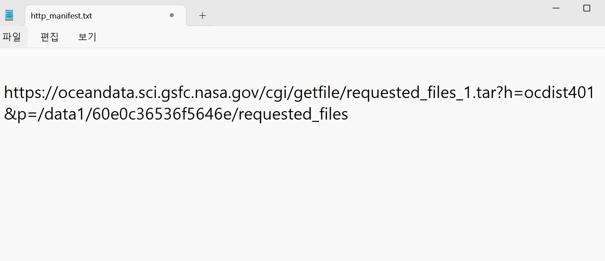{ loading=lazy }
      <figcaption>다운로드 URL이 적힌 TXT 파일</figcaption>
    </figure>
11. 이 링크를 복사해 Chrome 등의 주소창에 붙여 넣고 접속하면 자료가 다운로드됩니다.
    <figure markdown="span">
      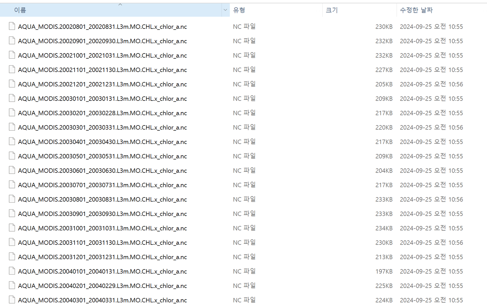{ loading=lazy }
      <figcaption>다운로드된 자료 파일</figcaption>
    </figure>
12. 예시 그림입니다.
    <figure markdown="span">
      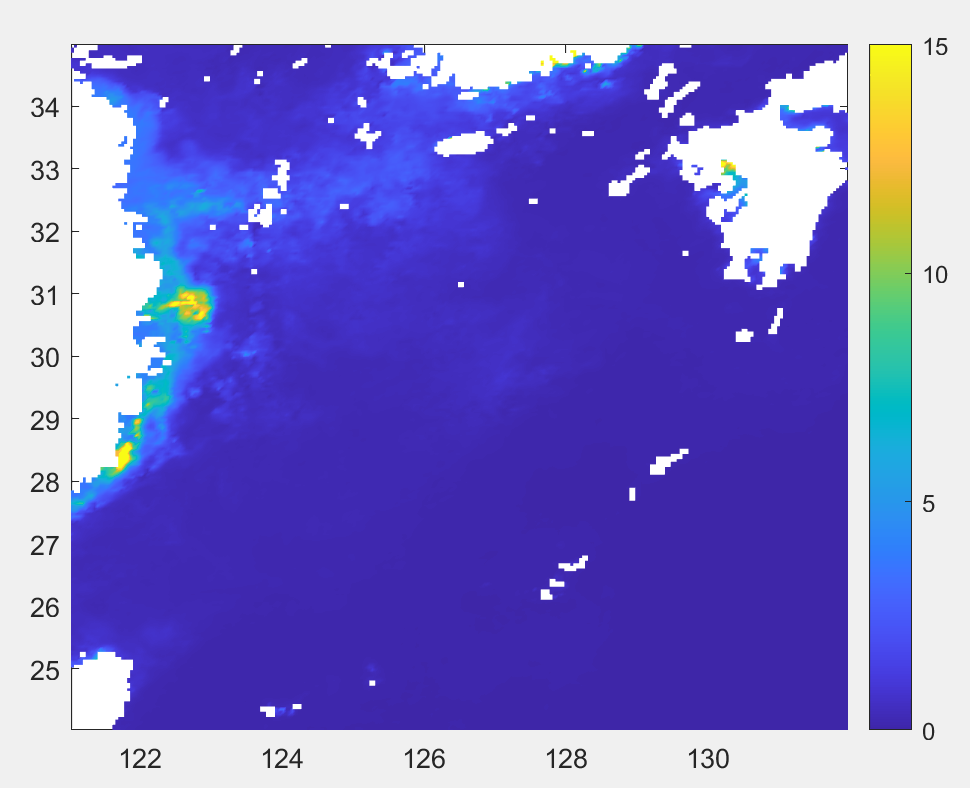{ loading=lazy }
      <figcaption>추출한 Chl-a 자료의 예시 지도</figcaption>
    </figure>
