# :material-download-box-outline: Ocean Color Download for a Specific Area and Period [2024.09.28]

How to extract only the region and period you need from NASA Ocean Color Level 3 and 4 products (Chl-a and others). The extraction runs on the server, so downloads are much faster than fetching global files.

!!! tip "Earthdata account"
    Register on [NASA Earthdata](https://urs.earthdata.nasa.gov/) before you start. Earthdata is used again and again when downloading ocean data, so it is worth creating an account now if you do not have one.

1. Open [NASA Ocean Color](https://oceandata.sci.gsfc.nasa.gov/).
    <figure markdown="span">
      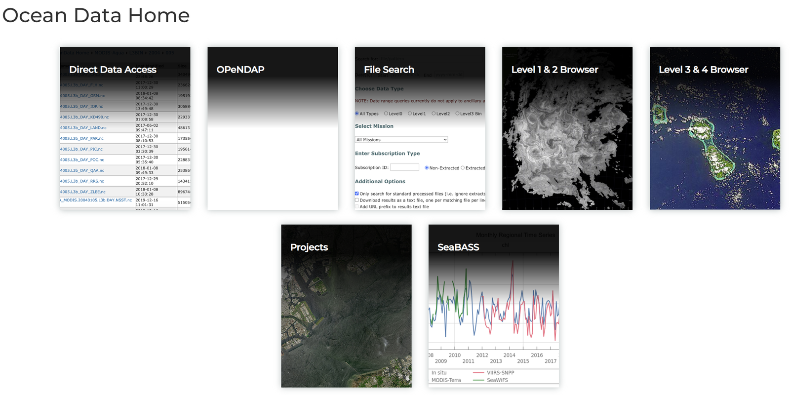{ loading=lazy }
      <figcaption>NASA Ocean Color data site</figcaption>
    </figure>
2. Click `Level 3 & 4 Browser`.
    <figure markdown="span">
      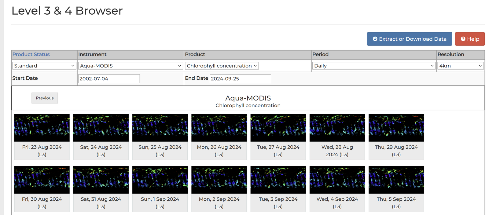{ loading=lazy }
      <figcaption>Level 3 & 4 Browser</figcaption>
    </figure>
3. Choose the product, period and resolution. The example uses Chl-a, monthly, 4 km. Then click the blue `Extract or download data` button at the top right.
    <figure markdown="span">
      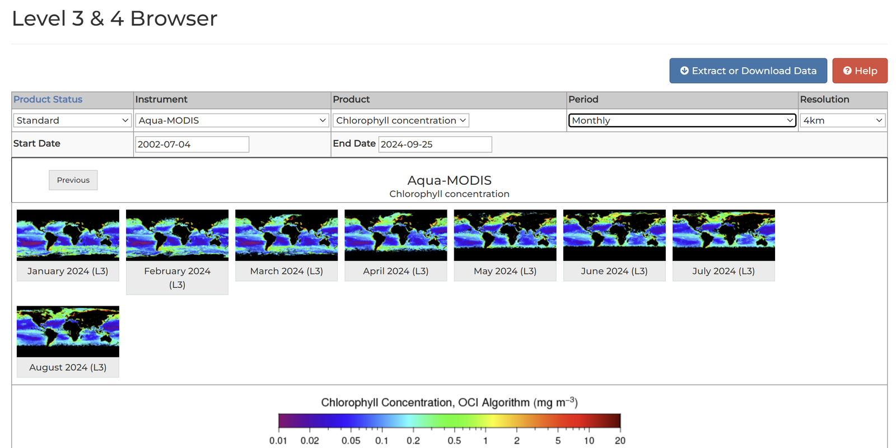{ loading=lazy }
      <figcaption>Selecting product, period and resolution</figcaption>
    </figure>
4. Under **Type** choose `Mapped`, and under **Data Retrieval Method** choose `Extract` rather than download. You can then select the region.
    <figure markdown="span">
      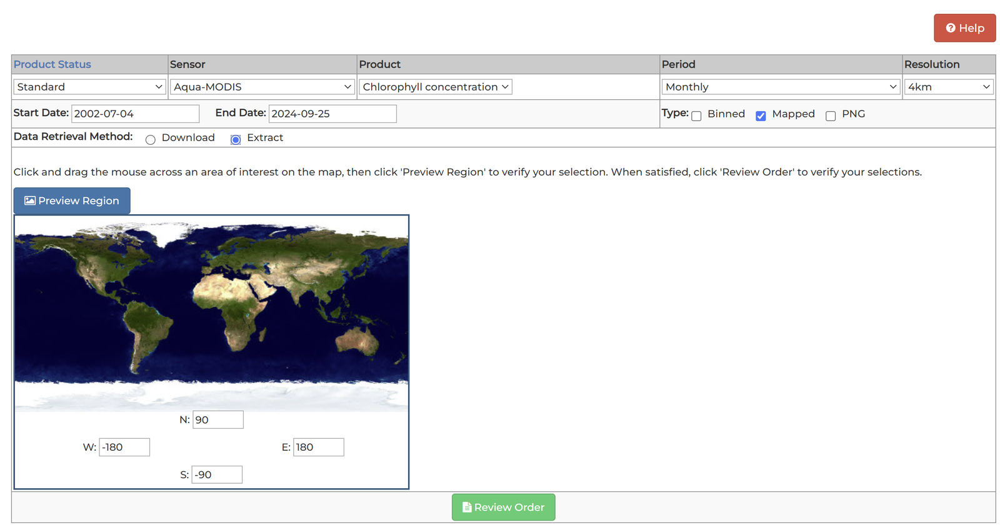{ loading=lazy }
      <figcaption>Type: Mapped, Data Retrieval Method: Extract</figcaption>
    </figure>
5. The example selects the East China Sea. Check the options and click `Extract` at the bottom.
    <figure markdown="span">
      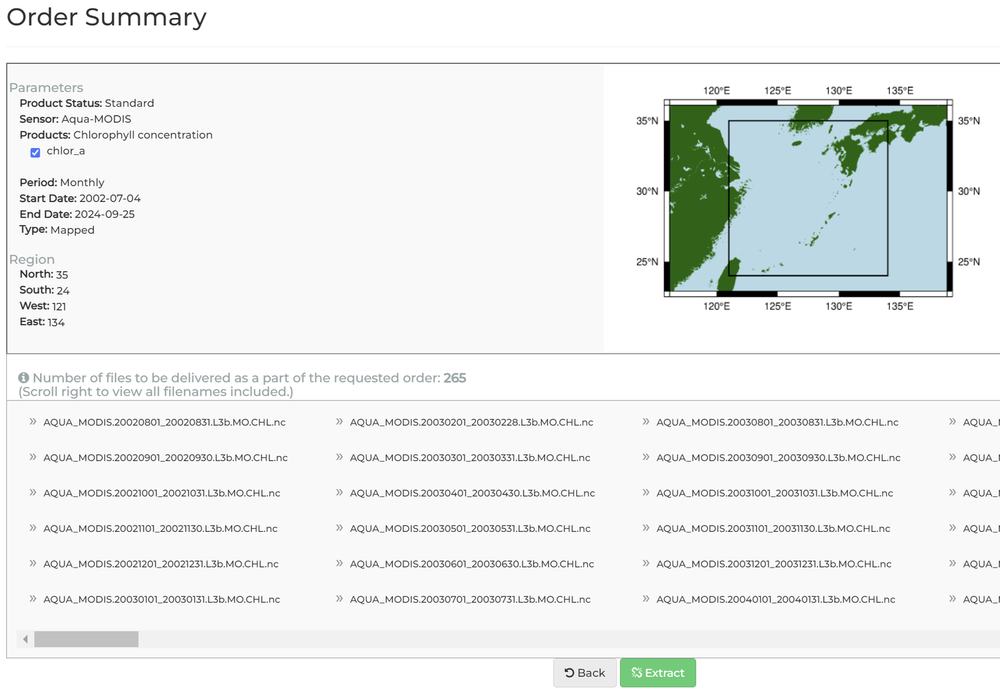{ loading=lazy }
      <figcaption>Selecting the East China Sea</figcaption>
    </figure>
6. The following screen appears. If you have an Earthdata account, follow the first link.
    <figure markdown="span">
      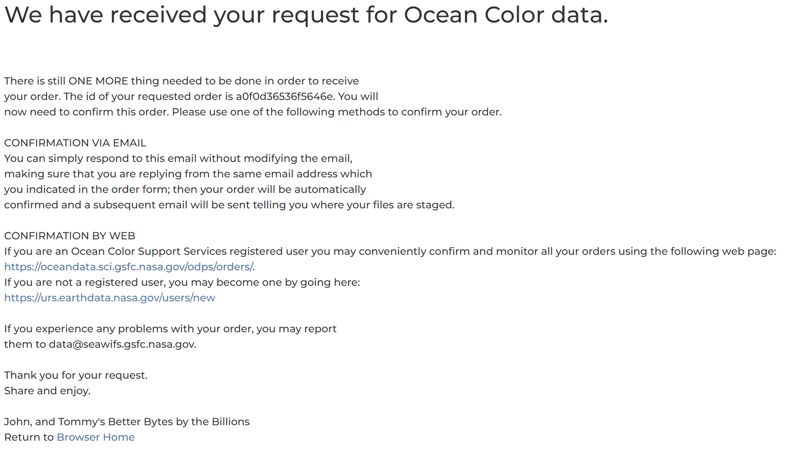{ loading=lazy }
      <figcaption>Order confirmation links</figcaption>
    </figure>
7. Click `Confirm` (not Cancel).
    <figure markdown="span">
      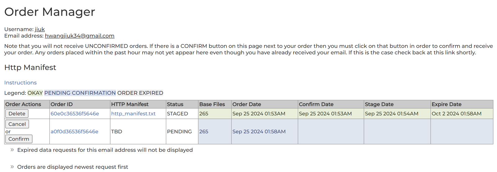{ loading=lazy }
      <figcaption>Confirm the order</figcaption>
    </figure>
8. A confirmation e-mail arrives as well.
    <figure markdown="span">
      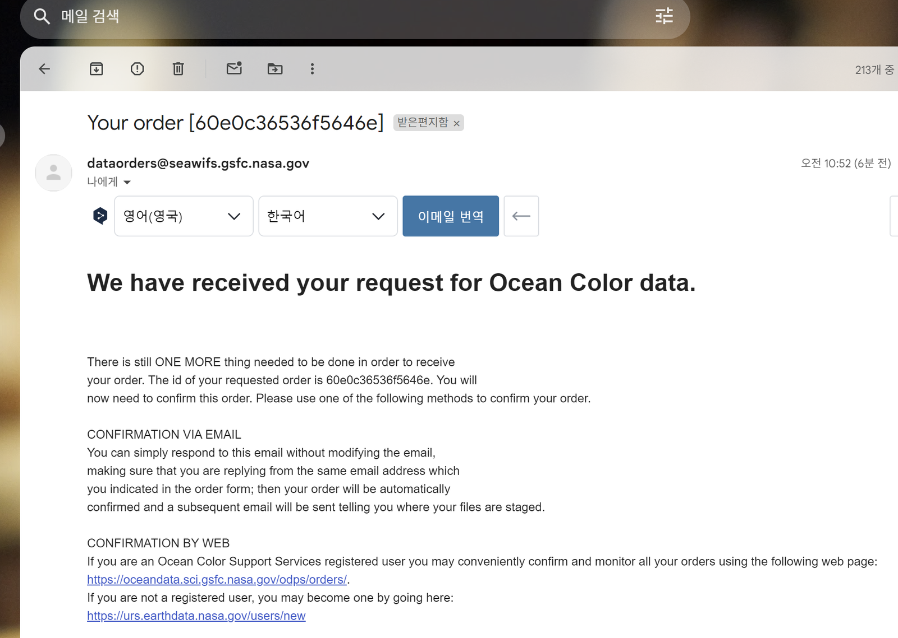{ loading=lazy }
      <figcaption>Confirmation e-mail</figcaption>
    </figure>
9. A short while after confirming, a second e-mail arrives. This one contains the download links.
    <figure markdown="span">
      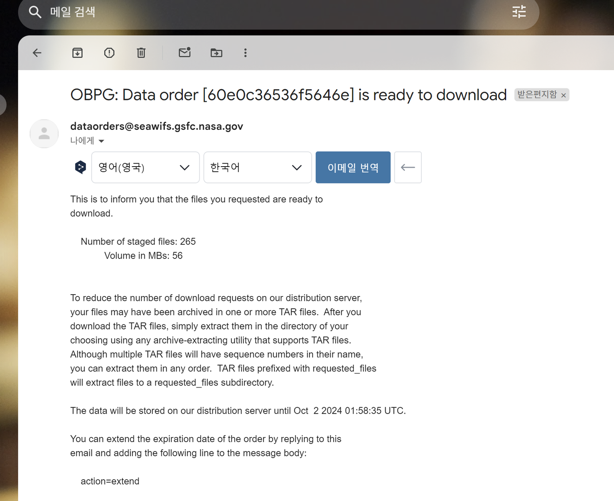{ loading=lazy }
      <figcaption>Download e-mail</figcaption>
    </figure>
    <figure markdown="span">
      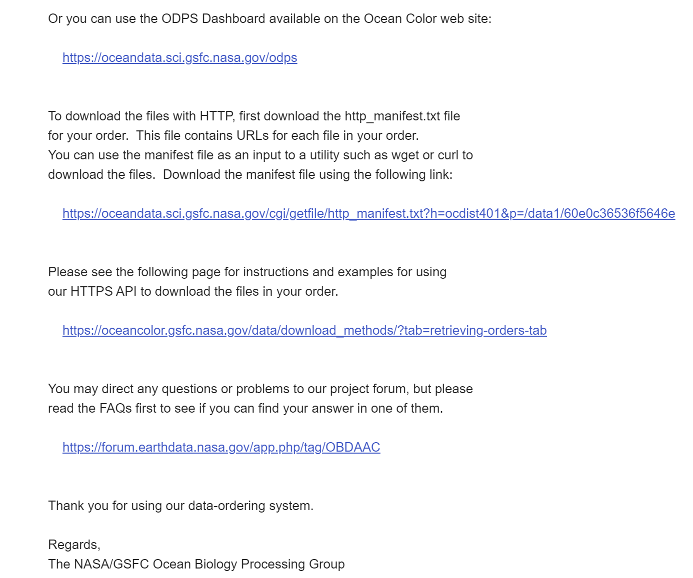{ loading=lazy }
      <figcaption>Download e-mail, links</figcaption>
    </figure>
10. Click the HTTP download link (the second hyperlink in the left image). A TXT file with the file URLs is downloaded.
    <figure markdown="span">
      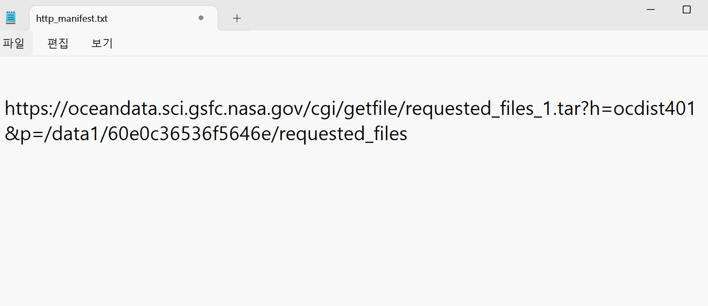{ loading=lazy }
      <figcaption>TXT file with download URLs</figcaption>
    </figure>
11. Paste a URL from the TXT file into the address bar of a browser such as Chrome. The data file is downloaded.
    <figure markdown="span">
      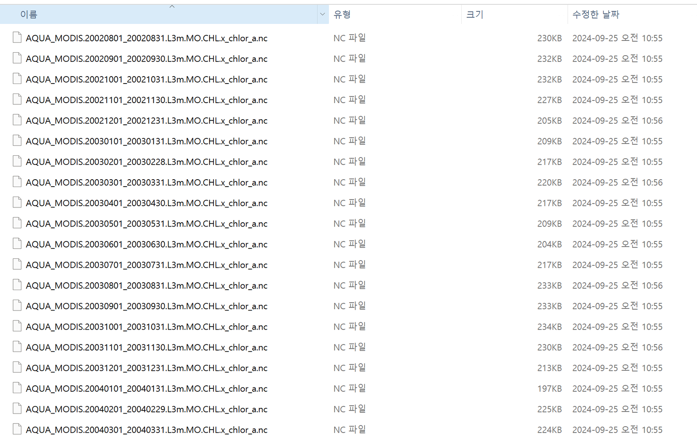{ loading=lazy }
      <figcaption>Downloaded data file</figcaption>
    </figure>
12. Example figure.
    <figure markdown="span">
      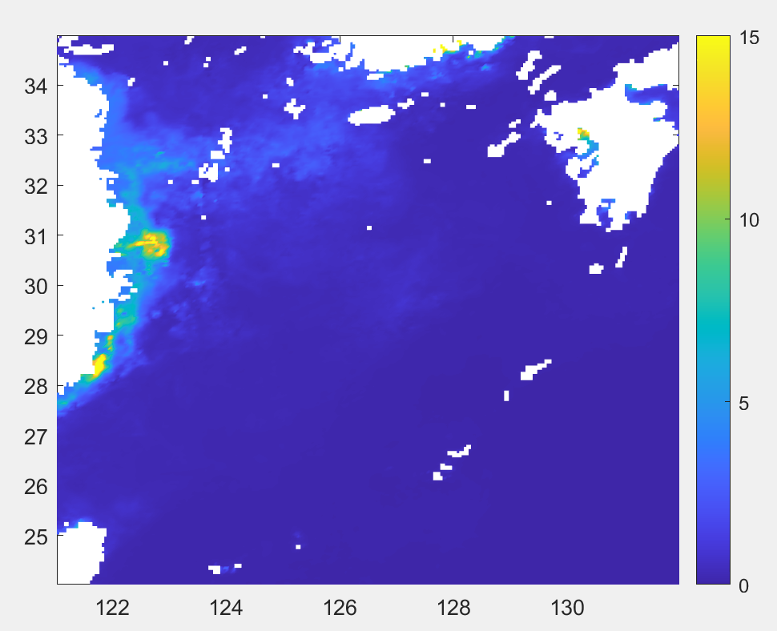{ loading=lazy }
      <figcaption>Example map of the extracted Chl-a</figcaption>
    </figure>
