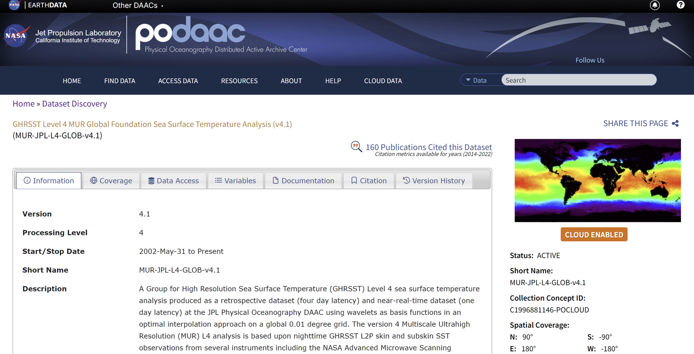
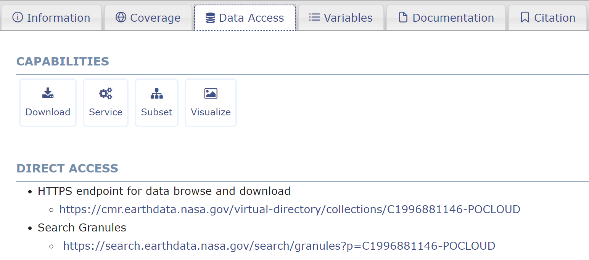
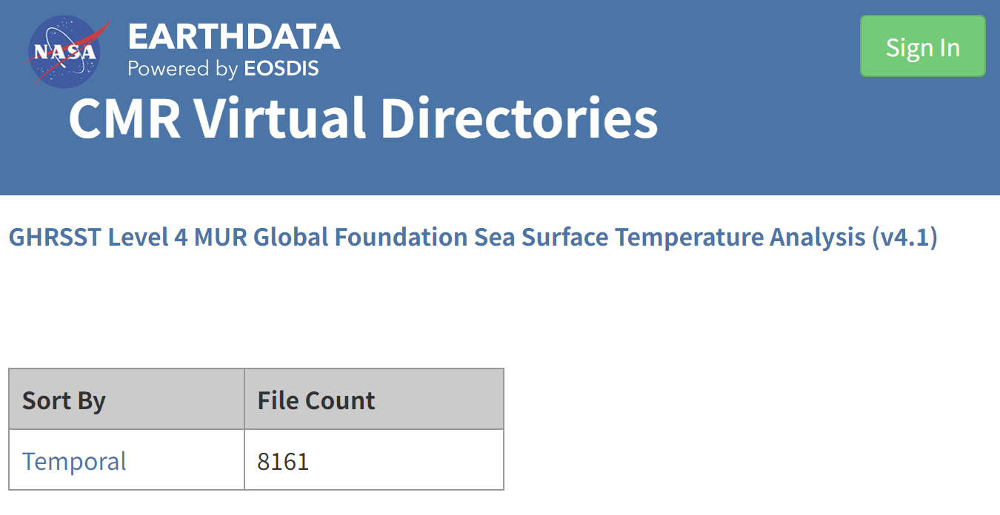
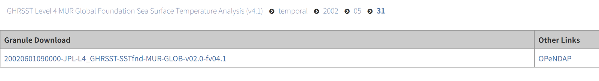
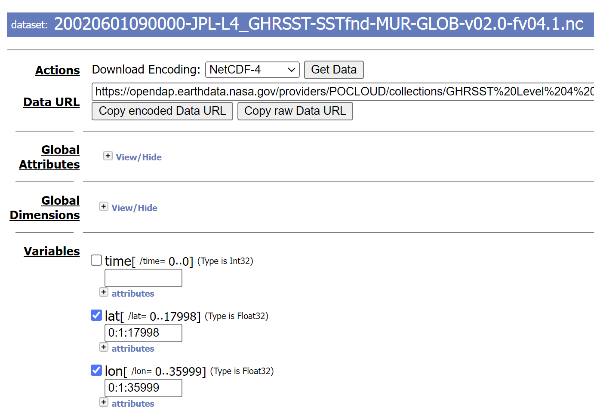
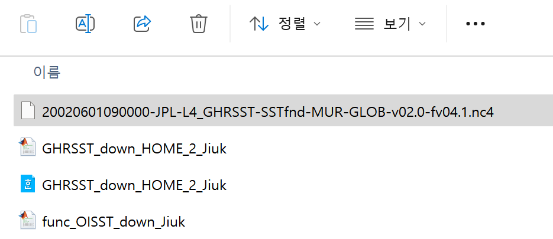
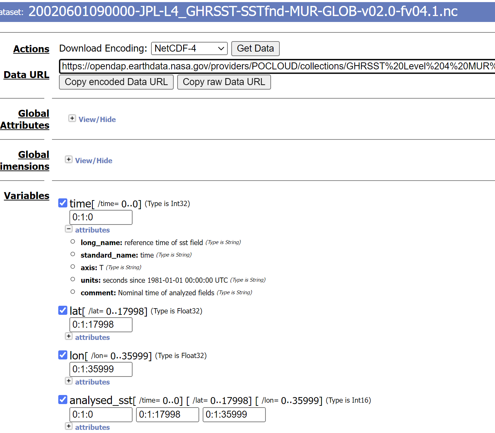
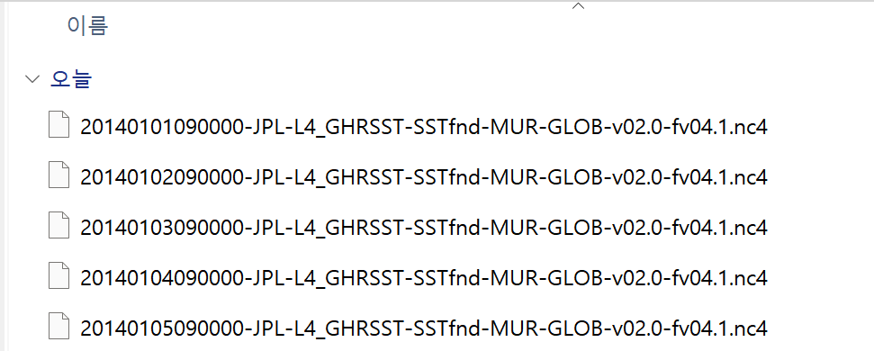

# :material-book-open-variant: PO.DAAC MATLAB 다운로드 매뉴얼 <span class="date">[2024.10.05]</span>

PO.DAAC 자료를 OPeNDAP을 통해 원하는 지역과 기간만 다운로드하는 MATLAB 스크립트 작성법입니다.
예시는 MUR SST v4.1이지만, 다른 PO.DAAC 자료에도 같은 방법을 쓸 수 있습니다.

!!! tip "GHRSST L4와 OISST라면"
    [SST Downloader](https://kr.mathworks.com/matlabcentral/fileexchange/173480-sst-downloader-ghrsst-l4-po-daac-and-oisst-subset-by-area-and-period)가
    이미 GHRSST L4 11종과 OISST v2를 토큰 방식으로 지원합니다. 이 매뉴얼은 그 외의 PO.DAAC 자료가 필요할 때 참고하세요.

## 1. 위경도 정보용 샘플 파일 받기

1. [PO.DAAC](https://podaac.jpl.nasa.gov/cloud-datasets)에서 원하는 product 페이지에 접속합니다.
    <figure markdown="span">
      { loading=lazy }
      <figcaption>PO.DAAC product 페이지</figcaption>
    </figure>
2. `Data Access`를 클릭합니다.
    <figure markdown="span">
      { loading=lazy }
      <figcaption>Data Access 탭</figcaption>
    </figure>
3. `DIRECT ACCESS`에서 `HTTPS Link`에 접속합니다.
    <figure markdown="span">
      { loading=lazy }
      <figcaption>DIRECT ACCESS: HTTPS 링크</figcaption>
    </figure>
4. 로그인한 뒤, 위경도 정보를 얻기 위해 샘플로 쓸 하루를 고릅니다.
    <figure markdown="span">
      { loading=lazy }
      <figcaption>샘플 날짜 선택</figcaption>
    </figure>
5. `Opendap`을 클릭하고 아래와 같이 옵션을 설정합니다.
    - Download Encoding: `NetCDF-4`
    - 변수 `lat`과 `lon` 추가
    <figure markdown="span">
      { loading=lazy }
      <figcaption>OPeNDAP 옵션: NetCDF-4, lat과 lon</figcaption>
    </figure>
6. `Get Data`를 클릭합니다.
7. MATLAB 작업 폴더를 새로 만들고 nc 파일을 옮깁니다(파일 이름은 바꿔도 됩니다).
    <figure markdown="span">
      { loading=lazy }
      <figcaption>MATLAB 작업 폴더에 옮긴 샘플 nc 파일</figcaption>
    </figure>

## 2. 격자를 읽고 원하는 영역의 인덱스 찾기

```matlab title="Read lon and lat from the sample file"
%% read 'lon', 'lat' data from NC file
clc; clear;

fnm = 'sample_lonlat_20020601_MUR_41.nc4';
ncdisp(fnm)

lon = ncread(fnm, 'lon');
lat = ncread(fnm, 'lat');
```

```matlab title="Find the index range of the target region"
Spatial_area = [24, 35, 121, 132];

idlat(1) = findnearpoint(lat, Spatial_area(1));
idlat(2) = findnearpoint(lat, Spatial_area(2));
idlon(1) = findnearpoint(lon, Spatial_area(3));
idlon(2) = findnearpoint(lon, Spatial_area(4));

function id = findnearpoint(base, target)
% find nearest point of "target" from "base"
[~, id] = min(abs(base-target));
end
```

```matlab title="Prepare the period"
period = [2014, 1, 1; 2014, 1, 5];
period2 = datetime(period);
period3 = period2(1):days(1):period2(2);
```

## 3. 다운로드 URL 만들기

웹사이트로 돌아가 필요한 변수(time과 원하는 자료 변수)를 추가하고 `Copy Raw Data Link`를 클릭합니다.

<figure markdown="span">
  { loading=lazy }
  <figcaption>OPeNDAP: Copy Raw Data Link</figcaption>
</figure>

MUR의 링크는 다음과 같은 형태입니다.

```text
https://opendap.earthdata.nasa.gov/providers/POCLOUD/collections/GHRSST Level 4 MUR Global Foundation Sea Surface Temperature Analysis (v4.1)/granules/20020601090000-JPL-L4_GHRSST-SSTfnd-MUR-GLOB-v02.0-fv04.1.dap.nc4?dap4.ce=/time[0:1:0];/lat[0:1:17998];/lon[0:1:35999];/analysed_sst[0:1:0][0:1:17998][0:1:35999]
```

이 링크를 네 부분으로 나눕니다. 반복문에서 바뀌는 부분은 **2**(날짜)와 **4**(인덱스 범위)입니다.

1. `https://opendap.earthdata.nasa.gov/providers/POCLOUD/collections/GHRSST Level 4 MUR Global Foundation Sea Surface Temperature Analysis (v4.1)/granules/`
2. **`20020601`**
3. `090000-JPL-L4_GHRSST-SSTfnd-MUR-GLOB-v02.0-fv04.1.dap.nc4?dap4.ce=`
4. **`/time[0:1:0];/lat[0:1:17998];/lon[0:1:35999];/analysed_sst[0:1:0][0:1:17998][0:1:35999]`**

## 4. 다운로드

```matlab title="Download each day through the browser"
%% load data with URL

% If the downloaded file has the SAME NAME, INCREASE the value of lag_time
lag_time = 3; % seconds between download each files

for loop = 1:length(period3)
    period4 = period3(loop); period5 = datevec(period4); period5 = period5(1:3);
    period6 = sprintf("%d%02.0f%02.0f", period5);

    url1 = "https://opendap.earthdata.nasa.gov/providers/POCLOUD/collections/" + ...
        "GHRSST%20Level%204%20MUR%20Global%20Foundation%20Sea%20Surface%20Temperature%20Analysis%20(v4.1)" + ...
        "/granules/";

    url2 = period6;

    url3 = "090000-JPL-L4_GHRSST-SSTfnd-MUR-GLOB-v02.0-fv04.1.dap.nc4?dap4.ce=";

    url4 = sprintf("/time[0:1:0];/lat[%d:1:%d];/lon[%d:1:%d];/analysed_sst[0:1:0][%d:1:%d][%d:1:%d]", ...
        idlat(1)-1, idlat(2)-1, idlon(1)-1, idlon(2)-1, ...
        idlat(1)-1, idlat(2)-1, idlon(1)-1, idlon(2)-1);

    url5 = strcat(url1, url2, url3, url4);
    web(url5)

    pause(lag_time);
end
```

이제 하루에 한 파일씩 자료가 자동으로 다운로드됩니다.

<figure markdown="span">
  { loading=lazy }
  <figcaption>하루 단위로 자동 다운로드된 파일들</figcaption>
</figure>
