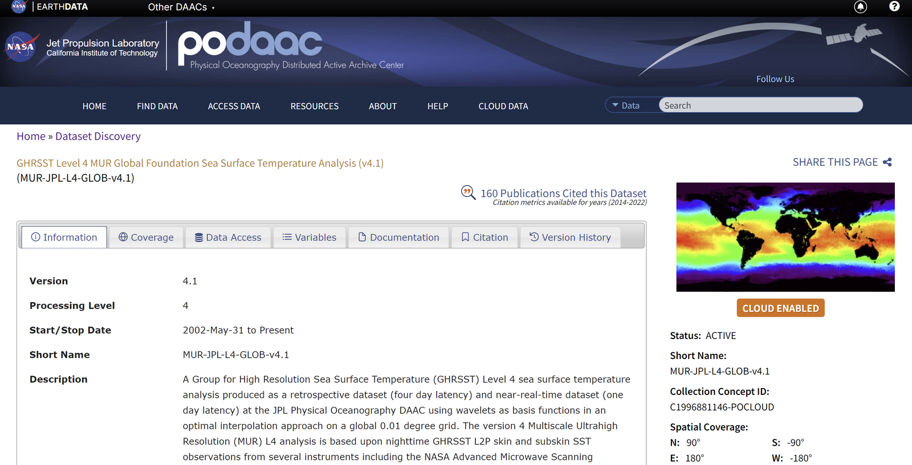
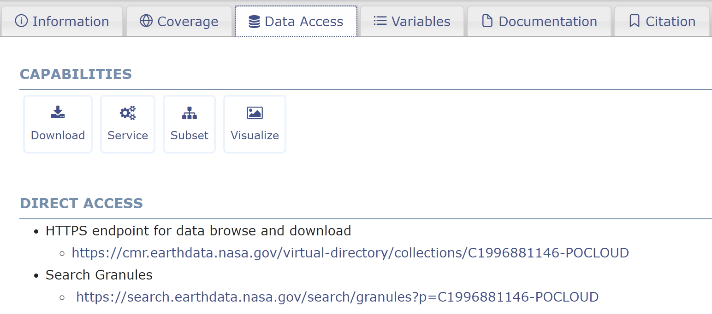
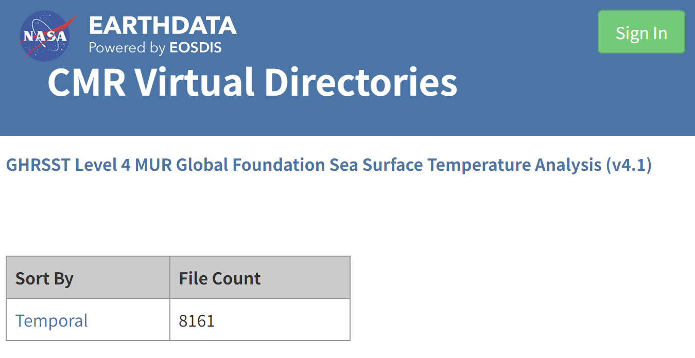
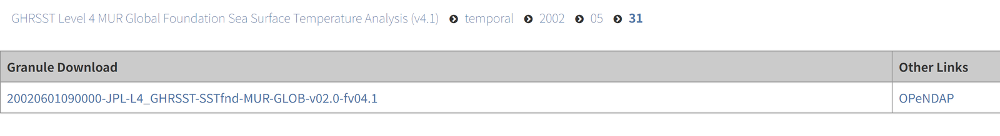
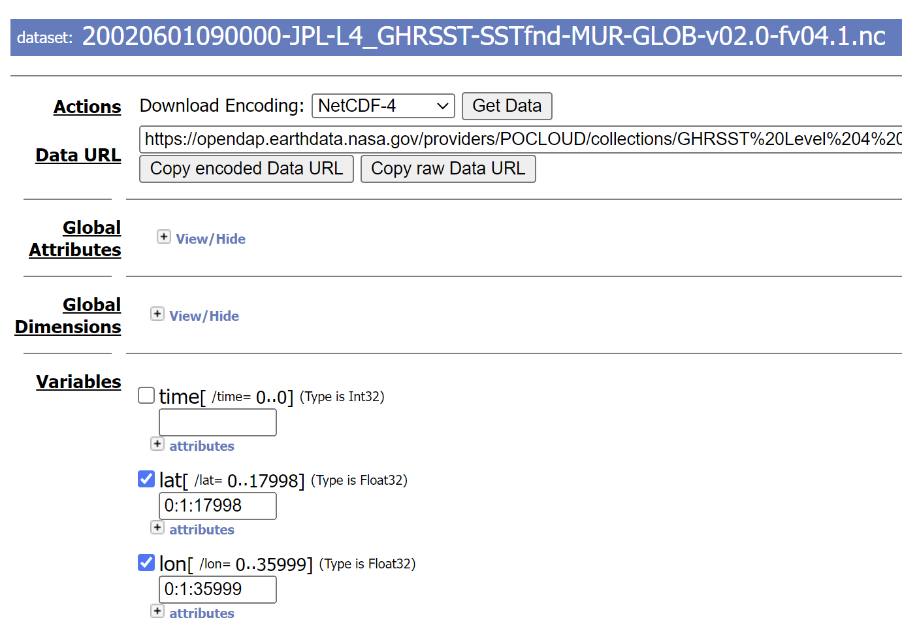
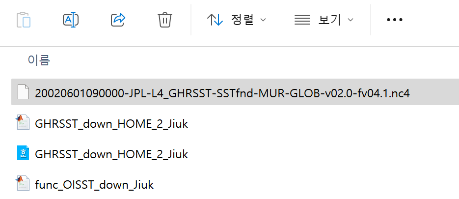
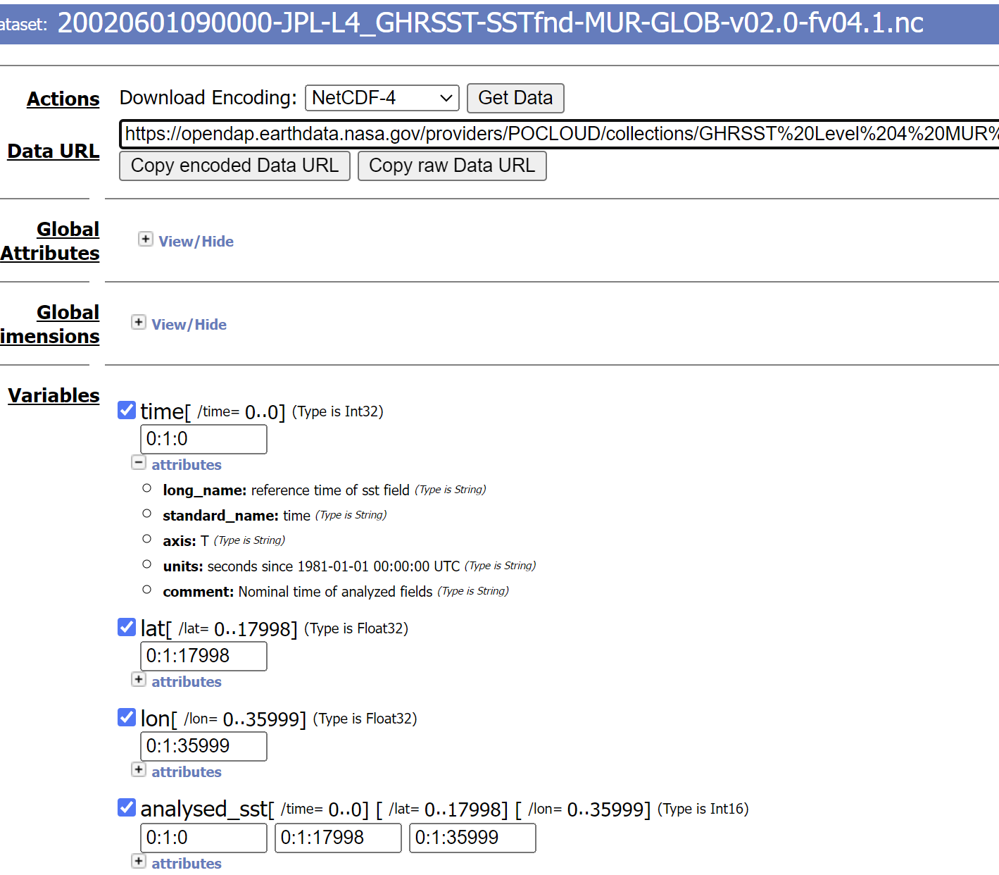
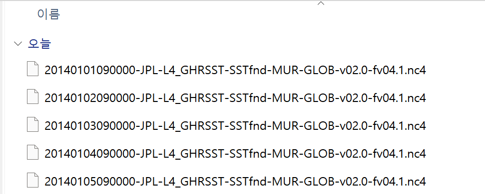

# :material-book-open-variant: PO.DAAC MATLAB Download Manual <span class="date">[2024.10.05]</span>

How to write a MATLAB script that downloads PO.DAAC data for a specific area and period through OPeNDAP.
The example uses MUR SST v4.1, but the same steps apply to other PO.DAAC products.

!!! tip "For GHRSST L4 and OISST"
    The [SST Downloader](https://kr.mathworks.com/matlabcentral/fileexchange/173480-sst-downloader-ghrsst-l4-po-daac-and-oisst-subset-by-area-and-period)
    already supports 11 GHRSST L4 datasets and OISST v2 with token-based download. Use this manual for other PO.DAAC products.

## 1. Get a sample file for longitude and latitude

1. Open the product page on [PO.DAAC](https://podaac.jpl.nasa.gov/cloud-datasets).
    <figure markdown="span">
      { loading=lazy }
      <figcaption>PO.DAAC product page</figcaption>
    </figure>
2. Click `Data Access`.
    <figure markdown="span">
      { loading=lazy }
      <figcaption>Data Access tab</figcaption>
    </figure>
3. Go to `DIRECT ACCESS` and open the `HTTPS Link`.
    <figure markdown="span">
      { loading=lazy }
      <figcaption>DIRECT ACCESS: HTTPS link</figcaption>
    </figure>
4. Sign in, then choose a sample day to get the longitude and latitude information.
    <figure markdown="span">
      { loading=lazy }
      <figcaption>Choosing a sample day</figcaption>
    </figure>
5. Click `Opendap` and set the options:
    - Download Encoding: `NetCDF-4`
    - Add the variables `lat` and `lon`
    <figure markdown="span">
      { loading=lazy }
      <figcaption>OPeNDAP options: NetCDF-4, lat and lon</figcaption>
    </figure>
6. Click `Get Data`.
7. Make a new folder for the MATLAB workspace and move the nc file into it (you can rename the file).
    <figure markdown="span">
      { loading=lazy }
      <figcaption>Sample nc file in the MATLAB workspace folder</figcaption>
    </figure>

## 2. Read the grid and find the indices of your region

```matlab title="Read lon and lat from the sample file"
%% read 'lon', 'lat' data from NC file
clc; clear;

fnm = 'sample_lonlat_20020601_MUR_41.nc4';
ncdisp(fnm)

lon = ncread(fnm, 'lon');
lat = ncread(fnm, 'lat');
```

```matlab title="Find the index range of the target region"
Spatial_area = [24, 35, 121, 132];

idlat(1) = findnearpoint(lat, Spatial_area(1));
idlat(2) = findnearpoint(lat, Spatial_area(2));
idlon(1) = findnearpoint(lon, Spatial_area(3));
idlon(2) = findnearpoint(lon, Spatial_area(4));

function id = findnearpoint(base, target)
% find nearest point of "target" from "base"
[~, id] = min(abs(base-target));
end
```

```matlab title="Prepare the period"
period = [2014, 1, 1; 2014, 1, 5];
period2 = datetime(period);
period3 = period2(1):days(1):period2(2);
```

## 3. Build the download URL

Back on the website, add the variables you need (time and the data variables) and click `Copy Raw Data Link`.

<figure markdown="span">
  { loading=lazy }
  <figcaption>OPeNDAP: Copy Raw Data Link</figcaption>
</figure>
A MUR link looks like this:

```text
https://opendap.earthdata.nasa.gov/providers/POCLOUD/collections/GHRSST Level 4 MUR Global Foundation Sea Surface Temperature Analysis (v4.1)/granules/20020601090000-JPL-L4_GHRSST-SSTfnd-MUR-GLOB-v02.0-fv04.1.dap.nc4?dap4.ce=/time[0:1:0];/lat[0:1:17998];/lon[0:1:35999];/analysed_sst[0:1:0][0:1:17998][0:1:35999]
```

Split it into four parts. Parts **2** (date) and **4** (index ranges) change in the loop.

1. `https://opendap.earthdata.nasa.gov/providers/POCLOUD/collections/GHRSST Level 4 MUR Global Foundation Sea Surface Temperature Analysis (v4.1)/granules/`
2. **`20020601`**
3. `090000-JPL-L4_GHRSST-SSTfnd-MUR-GLOB-v02.0-fv04.1.dap.nc4?dap4.ce=`
4. **`/time[0:1:0];/lat[0:1:17998];/lon[0:1:35999];/analysed_sst[0:1:0][0:1:17998][0:1:35999]`**

## 4. Download

```matlab title="Download each day through the browser"
%% load data with URL

% If the downloaded file has the SAME NAME, INCREASE the value of lag_time
lag_time = 3; % seconds between download each files

for loop = 1:length(period3)
    period4 = period3(loop); period5 = datevec(period4); period5 = period5(1:3);
    period6 = sprintf("%d%02.0f%02.0f", period5);

    url1 = "https://opendap.earthdata.nasa.gov/providers/POCLOUD/collections/" + ...
        "GHRSST%20Level%204%20MUR%20Global%20Foundation%20Sea%20Surface%20Temperature%20Analysis%20(v4.1)" + ...
        "/granules/";

    url2 = period6;

    url3 = "090000-JPL-L4_GHRSST-SSTfnd-MUR-GLOB-v02.0-fv04.1.dap.nc4?dap4.ce=";

    url4 = sprintf("/time[0:1:0];/lat[%d:1:%d];/lon[%d:1:%d];/analysed_sst[0:1:0][%d:1:%d][%d:1:%d]", ...
        idlat(1)-1, idlat(2)-1, idlon(1)-1, idlon(2)-1, ...
        idlat(1)-1, idlat(2)-1, idlon(1)-1, idlon(2)-1);

    url5 = strcat(url1, url2, url3, url4);
    web(url5)

    pause(lag_time);
end
```

The files are then downloaded automatically, one per day.

<figure markdown="span">
  { loading=lazy }
  <figcaption>Files downloaded automatically, one per day</figcaption>
</figure>
