# :material-radar: SAR (Synthetic-Aperture Radar) <span class="date">[2024.11.13]</span>

Sentinel-1, ERS, ALOS 등 합성개구레이더(SAR)의 해면 영상 자료와 다운로드 경로(ASF, Copernicus Data Space), MATLAB 도구를 정리했습니다.

## SAR란

<figure markdown="span">
  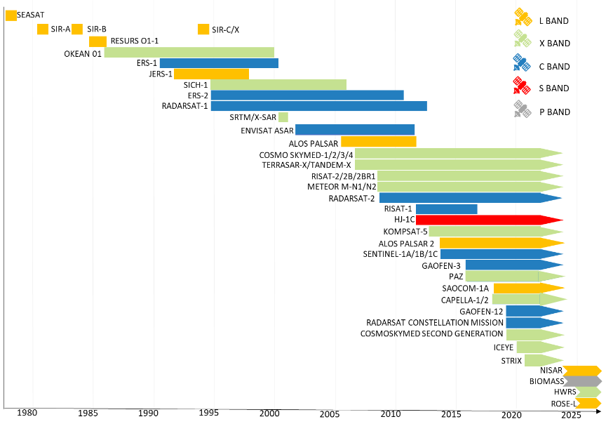{ loading=lazy }
  <figcaption>합성개구레이더의 원리</figcaption>
</figure>
<figure markdown="span">
  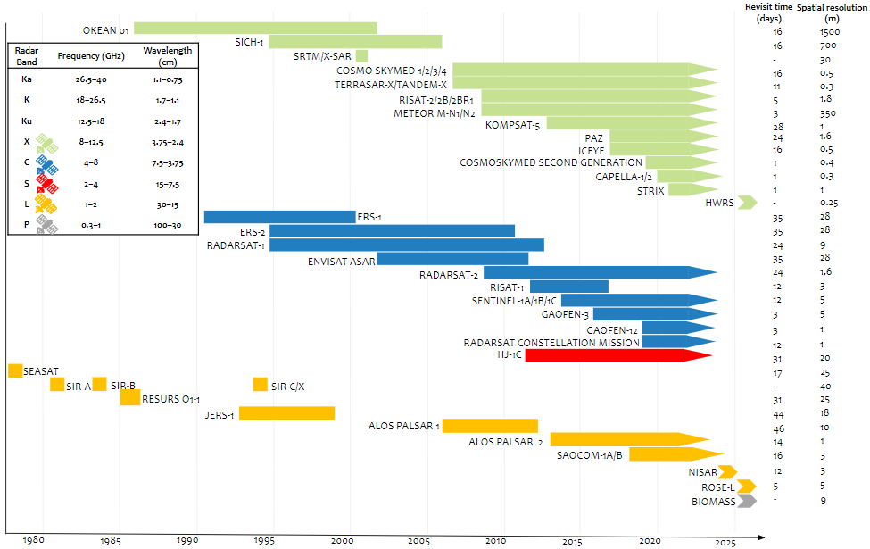{ loading=lazy }
  <figcaption>SAR 관측 기하</figcaption>
</figure>

- [:octicons-link-external-24: SAR: Synthetic Aperture Radar (Detektia)](https://detektia.com/en/sar-synthetic-aperture-radar/)
- [:octicons-link-external-24: What is SAR? (NASA Earthdata)](https://www.earthdata.nasa.gov/learn/backgrounders/what-is-sar)
- [:octicons-link-external-24: Atlas of Internal Waves](https://www.internalwaveatlas.com/)

## Sentinel-1이란

**Sentinel-1** is the first of the [Copernicus Programme](https://en.wikipedia.org/wiki/Copernicus_Programme) satellite constellations conducted by the [European Space Agency](https://en.wikipedia.org/wiki/European_Space_Agency). The mission was originally composed of a constellation of two satellites, Sentinel-1A and Sentinel-1B, which shared the same orbital plane. Sentinel-1A was launched on 3 April 2014, and Sentinel-1B on 25 April 2016. ([Wikipedia](https://en.wikipedia.org/wiki/Sentinel-1))

- [:octicons-link-external-24: Sentinel-1 (SentiWiki)](https://sentiwiki.copernicus.eu/web/sentinel-1)
- [:octicons-link-external-24: Sentinel-1 SAR 자료 개요 (SentiWiki)](https://sentiwiki.copernicus.eu/web/s1-products#S1Products-SARProductsOverviewS1-Products-SAR-Products-Overview)
- [:octicons-link-external-24: Sentinel-1 at ASF DAAC](https://asf.alaska.edu/datasets/daac/sentinel-1/)

<figure markdown="span">
  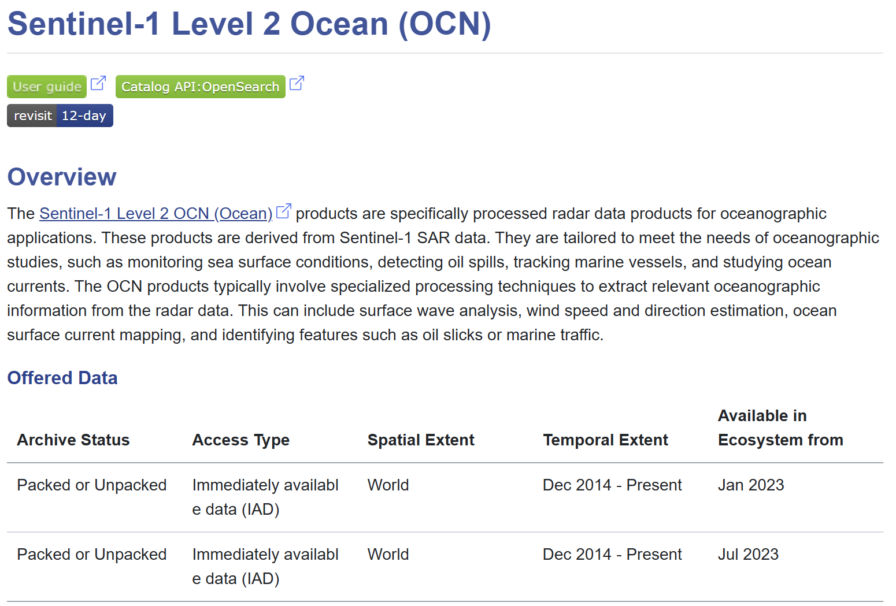{ loading=lazy }
  <figcaption>Sentinel-1 관측 모드</figcaption>
</figure>
<figure markdown="span">
  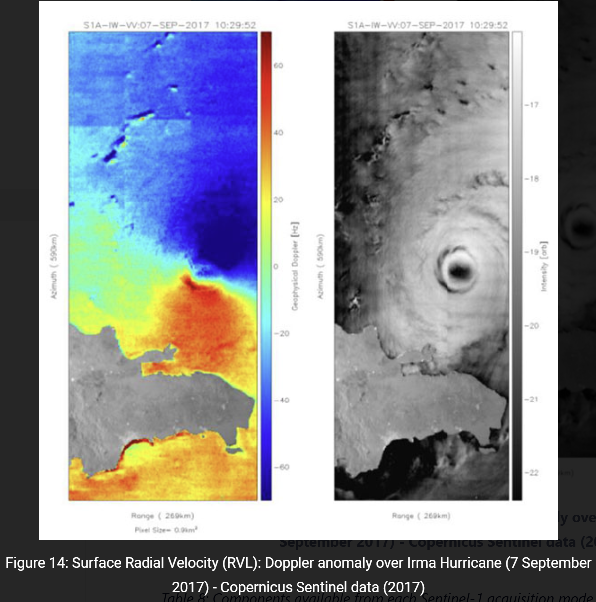{ loading=lazy }
  <figcaption>Sentinel-1 자료 종류</figcaption>
</figure>

평소에는 저해상도로 넓은 영역을 관측하다가, 관심 영역에서는 고해상도로 좁은 영역을 관측할 수 있습니다. 장점은 날씨와 무관하게 관측할 수 있다는 점이고, 단점은 해석이 어렵다는 점입니다. 무엇보다 해양에 대한 관측이 충분치 않습니다(연안 관측은 있으나 외해 관측은 적습니다).

## MATLAB 도구

- [:octicons-mark-github-16: oceanremotesensing/MATLAB_SAR](https://github.com/oceanremotesensing/MATLAB_SAR)
- [:octicons-link-external-24: SAR Processor (File Exchange)](https://kr.mathworks.com/matlabcentral/fileexchange/45672-sar-processor)
- [:octicons-link-external-24: SAR Signal Processing with MATLAB Algorithms, Reloaded (File Exchange)](https://kr.mathworks.com/matlabcentral/fileexchange/112395-sar-signal-processing-with-matlab-algorithms-reloaded)

## ASF에서 다운로드 (ERS, Sentinel-1, ALOS)

- [:octicons-download-24: ASF Data Search (Vertex), Sentinel-1 OCN 예시](https://search.asf.alaska.edu/#/?dataset=SENTINEL-1&maxResults=5000&zoom=6.692&center=129.640,26.401&resultsLoaded=true&productTypes=OCN)

GRD_HS, GRD_HD는 Vertex에서 미리보기가 되지만 OCN은 미리보기가 되지 않습니다. OCN은 다운받은 후에 확인할 수 있습니다. 아래는 OCN 자료의 예시입니다(위치는 동중국해, 일본 큐슈 남서쪽 해역).

<figure markdown="span">
  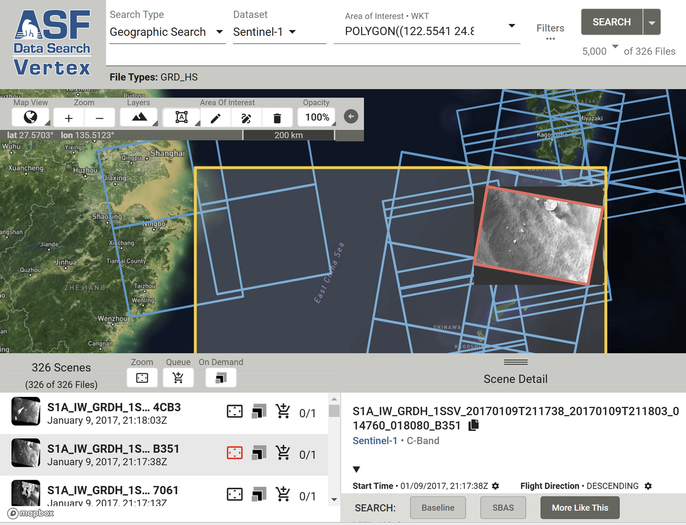{ loading=lazy }
  <figcaption>ASF Vertex의 GRD_HS 미리보기</figcaption>
</figure>
<figure markdown="span">
  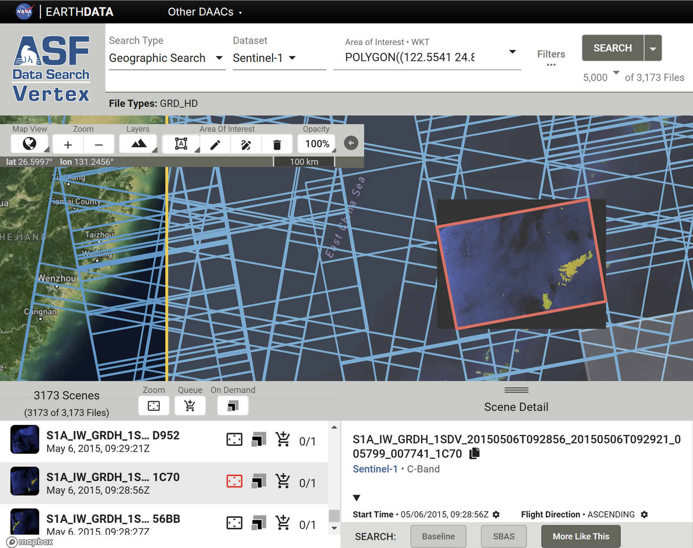{ loading=lazy }
  <figcaption>ASF Vertex의 GRD_HD 미리보기</figcaption>
</figure>
<figure markdown="span">
  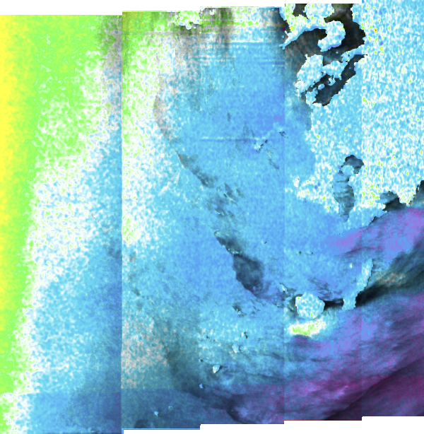{ loading=lazy }
  <figcaption>OCN quick-look: 시선 속도(RVL)</figcaption>
</figure>
<figure markdown="span">
  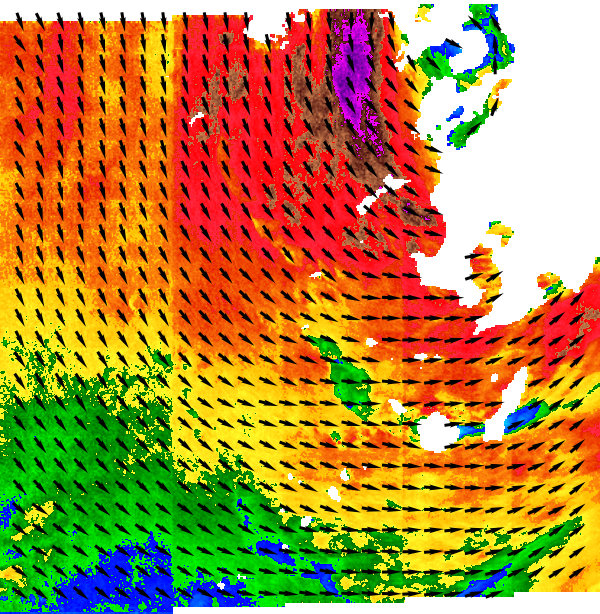{ loading=lazy }
  <figcaption>OCN quick-look: 해상풍(OWI)</figcaption>
</figure>

같은 방식으로 일본의 ALOS 자료도 받을 수 있습니다. 아래 예시는 동중국해이며, 사진에서 제주도가 보입니다.

<figure markdown="span">
  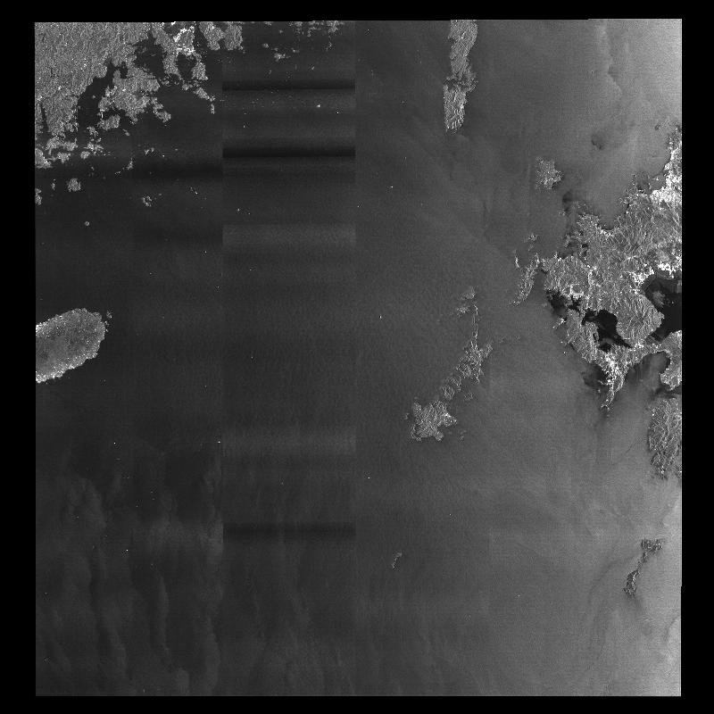{ loading=lazy }
  <figcaption>동중국해의 ALOS PALSAR 영상 (EALPSRS269422950)</figcaption>
</figure>

### ASF에서 여러 scene 한 번에 받기

1. `Export API`를 선택합니다.
    <figure markdown="span">
      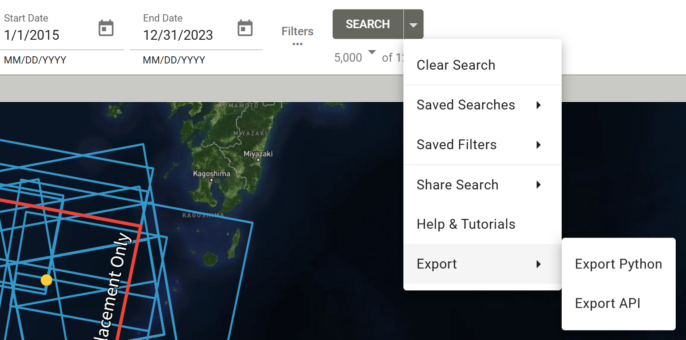{ loading=lazy }
      <figcaption>ASF Vertex: Export API</figcaption>
    </figure>
2. `Download Results`를 클릭합니다.
    <figure markdown="span">
      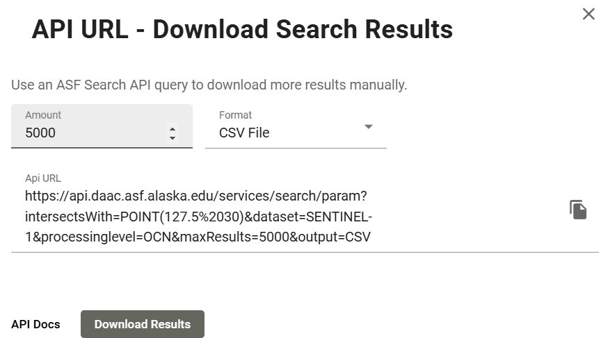{ loading=lazy }
      <figcaption>ASF Vertex: Download Results</figcaption>
    </figure>
3. CSV 파일을 열어 보면 아래와 같습니다. 이 중 `URL` 항목의 정보가 필요합니다.
    <figure markdown="span">
      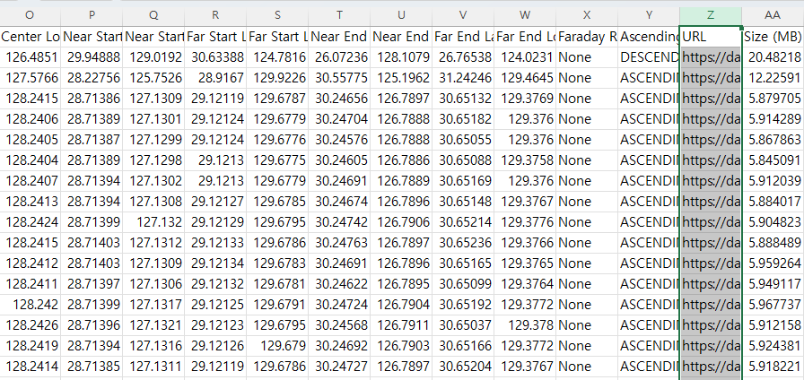{ loading=lazy }
      <figcaption>ASF에서 내보낸 CSV의 URL 열</figcaption>
    </figure>
4. 아래 MATLAB 코드를 실행합니다. 실행 전에 Earthdata 사이트에 로그인되어 있어야 합니다. 개인적으로는 `for`문에서 `i=1`만 두고 시험 삼아 먼저 실행해 보기를 권합니다. 그러면 Earthdata 사이트가 자동으로 뜨면서 로그인을 요구하므로 그 페이지에서 로그인하면 되고, 다운로드 속도도 확인할 수 있습니다. 속도가 너무 느리면 `lag_time` 값을 늘리세요.

    ```matlab title="Open each ASF URL for download"
    clc; clear; close all;

    % A file containing the data URL of the SAR satellite data downloaded
    % from the Alaska Satellite Facility (ASF) must be prepared

    read_xls; % read information about "URL" address in excel

    % Choose the appropriate value for your Internet speed environment
    lag_time = 1; % seconds between download each files.

    % Before executing the code, you must log in to the earthdata site in advance.
    % EARTHDATA Homepage : https://urs.earthdata.nasa.gov/
    for i=1:length(URL)
        web(URL(i))
        pause(lag_time);
    end
    ```

5. 코드를 실행하면 아래와 같이 압축 파일이 다운로드됩니다.
    <figure markdown="span">
      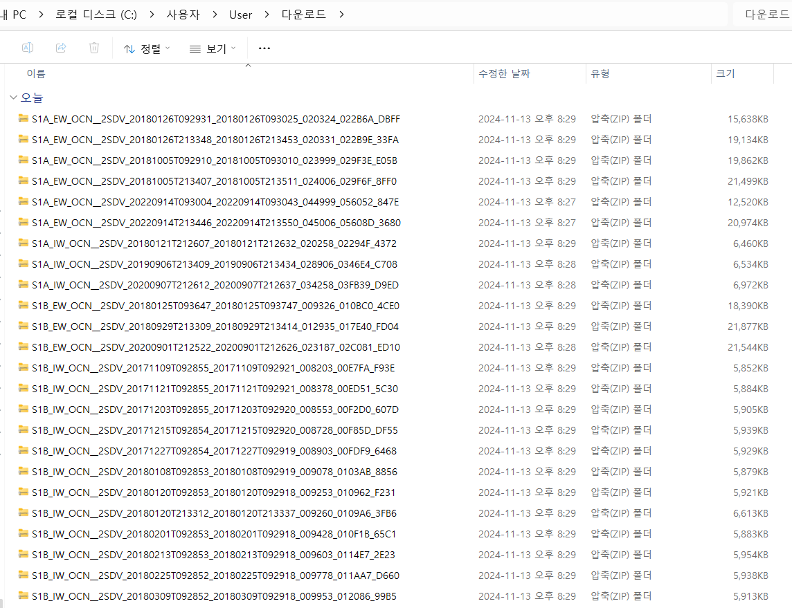{ loading=lazy }
      <figcaption>다운로드된 zip 파일들</figcaption>
    </figure>
6. 압축을 하나씩 풀기는 번거로우므로 MATLAB 코드를 사용합니다.

    ```matlab title="Unzip all downloaded scenes"
    clc; clear; close all;
    fn = "D:\MATLAB_JU\RawData\SAR_Kuro"; % 압축파일 저장된 폴더
    fn2 = dir(sprintf("%s\\*.zip",fn));

    for i=1:height(fn2)
        fpath = sprintf("%s\\%s", fn2(i).folder, fn2(i).name);
        unzip(fpath); % 현재 폴더에 압축해제됨.
    end
    ```

7. 시각화 예시입니다.
    <figure markdown="span">
      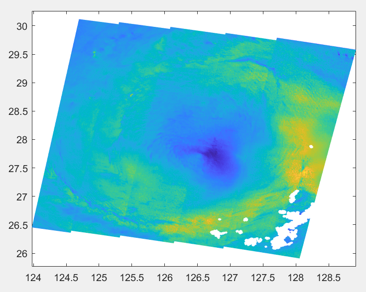{ loading=lazy }
      <figcaption>Sentinel-1 OCN 풍속을 pcolor로 그린 결과</figcaption>
    </figure>

    ```matlab title="Plot OCN wind speed"
    clc; clear; close all;


    fnm = "C:\Users\User\OneDrive\문서\MATLAB\2024_Kuro" + ...
        "\khanun_SAR\S1A_EW_OCN__2SDV_20230804T213456_20230804T213559_049731_05FAEB_00F4.SAFE" + ...
        "\measurement\s1a-ew-ocn-vv-20230804t213456-20230804t213559-049731-05FAEB-001.nc";

    wind = ncread(fnm, 'owiWindSpeed');
    lon = ncread(fnm, 'owiLon');
    lat = ncread(fnm, 'owiLat');

    figure
    pcolor(lon, lat, wind); shading interp
    ```

## ERS SAR 자료 다운로드

- [:octicons-link-external-24: ERS SAR raw data extraction and image formation (MATLAB Radar Toolbox)](https://kr.mathworks.com/help/radar/ug/ers-sar-raw-data-extraction-and-image-formation.html)

## Copernicus Data Space에서 Sentinel-1 다운로드

1. [Copernicus Data Space Ecosystem](https://dataspace.copernicus.eu/)에 접속해 회원가입합니다.
2. 우측 상단의 연두색 `Copernicus Browser` 버튼을 클릭합니다.
    <figure markdown="span">
      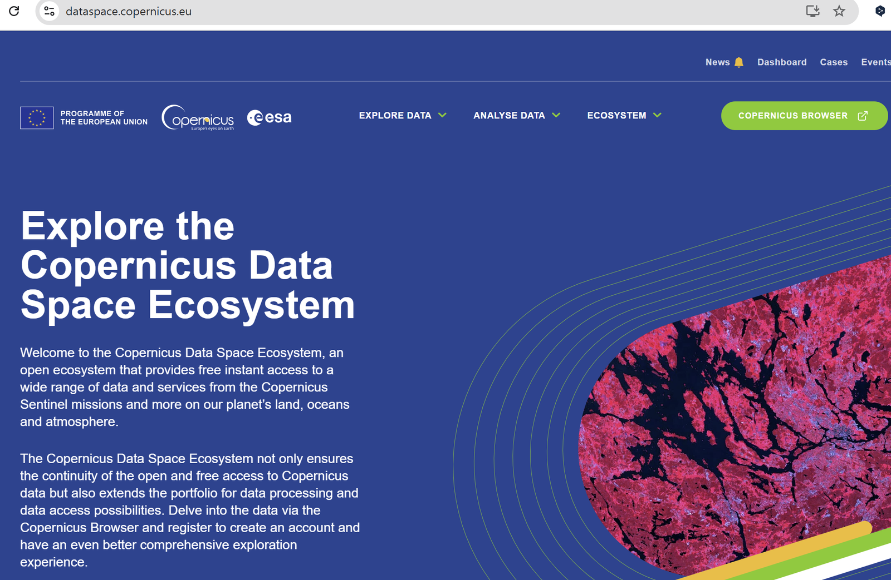{ loading=lazy }
      <figcaption>Copernicus Data Space: Copernicus Browser 버튼</figcaption>
    </figure>
    <figure markdown="span">
      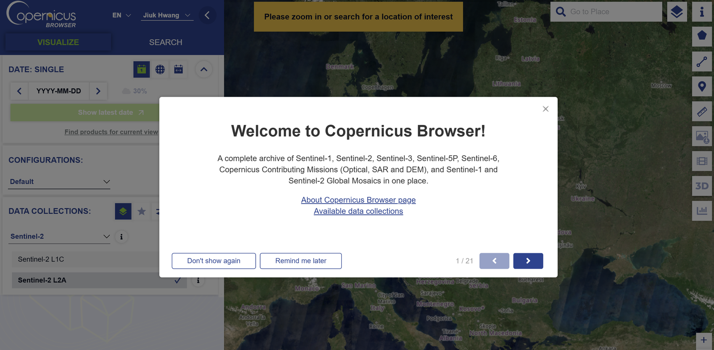{ loading=lazy }
      <figcaption>Copernicus Browser 화면</figcaption>
    </figure>
3. `SEARCH` 창에서 원하는 위성과 자료를 선택한 뒤 맨 아래의 연두색 `Search` 버튼을 클릭합니다. 수업 과제에서는 Level-1 GRD > IW > VV+VH 또는 HH+HV 설정으로 자료를 받았습니다.
    <figure markdown="span">
      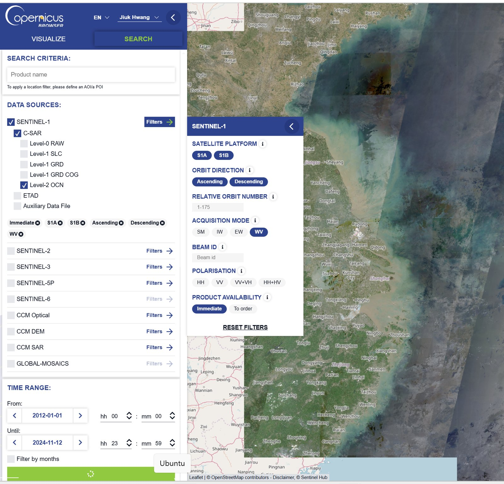{ loading=lazy }
      <figcaption>Copernicus Browser: 검색 설정</figcaption>
    </figure>
4. 특정 시점의 자료를 다운로드할 수 있습니다.
    <figure markdown="span">
      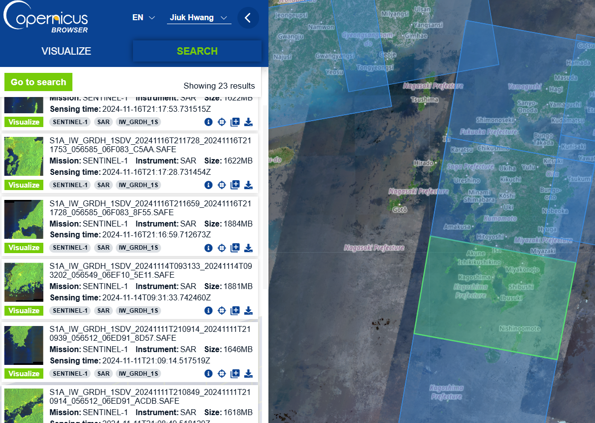{ loading=lazy }
      <figcaption>Copernicus Browser: 검색 결과</figcaption>
    </figure>
    <figure markdown="span">
      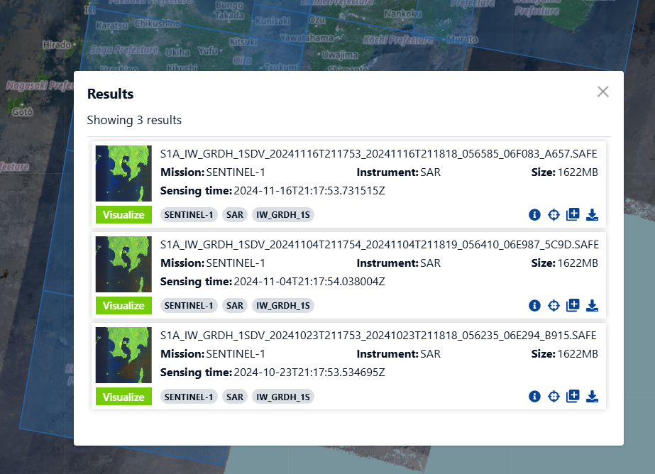{ loading=lazy }
      <figcaption>Copernicus Browser: 다운로드</figcaption>
    </figure>
5. 장기간, 넓은 영역의 여러 자료는 [data workspace](https://dataspace.copernicus.eu/analyse/data-workspace)에서 한 번에 받을 수 있습니다.

### Sentinel-6A 고도계 (PO.DAAC)

- [:octicons-link-external-24: Sentinel-6A MF Jason-CS L3 P4 Altimeter HR NTC Ocean Surface Topography, F08](https://podaac.jpl.nasa.gov/dataset/JASON_CS_S6A_L3_ALT_HR_OST_NTC_F08)
- [:octicons-link-external-24: Sentinel-6A MF Jason-CS L3 P4 Altimeter LR NTC Ocean Surface Topography, F08](https://podaac.jpl.nasa.gov/dataset/JASON_CS_S6A_L3_ALT_LR_OST_NTC_F08)

## Sentinel-1 기반 해상 상태 (Ifremer)

??? note "확인 필요"
    Notion 페이지의 "SAR Sentinel-1 ESA mission sea state Ifremer processor" 항목은 읽을 수 없는 외부 임베드였습니다. 원래 링크를 직접 복원해야 합니다.

## 관련 링크

- [CEDA catalogue: SAR](https://catalogue.ceda.ac.uk/?q=sar&sort_by=relevance&results_per_page=20)
- [foss4g.tistory.com: Sentinel-1 글 1](https://foss4g.tistory.com/1961)
- [foss4g.tistory.com: Sentinel-1 글 2](https://foss4g.tistory.com/2053)
- [Sentinel-1 L2 OCN (CREODIAS)](https://creodias.eu/eodata/sentinel-1/sentinel-1-l2-ocn/)
