# :material-radar: SAR (Synthetic-Aperture Radar) <span class="date">[2024.11.13]</span>

Synthetic-aperture radar imagery of the sea surface from Sentinel-1, ERS and ALOS, with download routes (ASF, Copernicus Data Space) and MATLAB tools.

## About SAR

<figure markdown="span">
  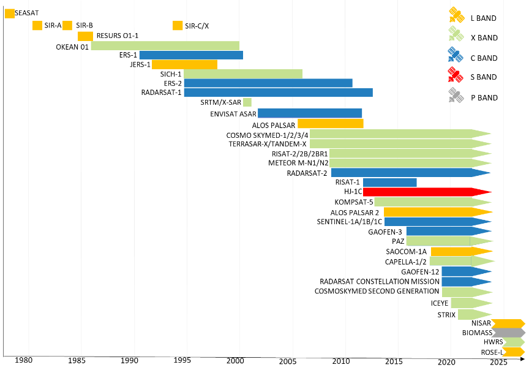{ loading=lazy }
  <figcaption>Timeline of spaceborne SAR missions by radar band (1978-2025)</figcaption>
</figure>
<figure markdown="span">
  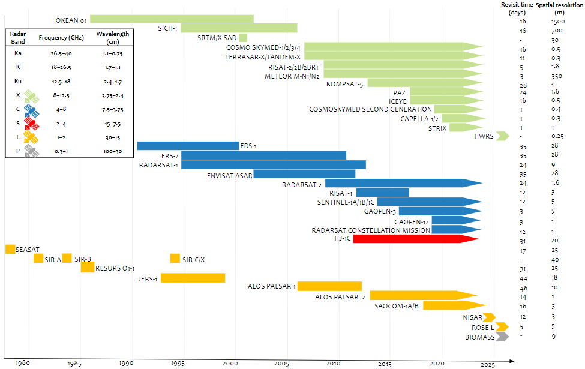{ loading=lazy }
  <figcaption>SAR missions grouped by radar band, with band frequencies, revisit times, and spatial resolutions</figcaption>
</figure>

- [:octicons-link-external-24: SAR: Synthetic Aperture Radar (Detektia)](https://detektia.com/en/sar-synthetic-aperture-radar/)
- [:octicons-link-external-24: What is SAR? (NASA Earthdata)](https://www.earthdata.nasa.gov/learn/backgrounders/what-is-sar)
- [:octicons-link-external-24: Atlas of Internal Waves](https://www.internalwaveatlas.com/)

## About Sentinel-1

**Sentinel-1** is the first of the [Copernicus Programme](https://en.wikipedia.org/wiki/Copernicus_Programme) satellite constellations conducted by the [European Space Agency](https://en.wikipedia.org/wiki/European_Space_Agency). The mission was originally composed of a constellation of two satellites, Sentinel-1A and Sentinel-1B, which shared the same orbital plane. Sentinel-1A was launched on 3 April 2014, and Sentinel-1B on 25 April 2016. ([Wikipedia](https://en.wikipedia.org/wiki/Sentinel-1))

- [:octicons-link-external-24: Sentinel-1 (SentiWiki)](https://sentiwiki.copernicus.eu/web/sentinel-1)
- [:octicons-link-external-24: Sentinel-1 SAR products overview (SentiWiki)](https://sentiwiki.copernicus.eu/web/s1-products#S1Products-SARProductsOverviewS1-Products-SAR-Products-Overview)
- [:octicons-link-external-24: Sentinel-1 at ASF DAAC](https://asf.alaska.edu/datasets/daac/sentinel-1/)

<figure markdown="span">
  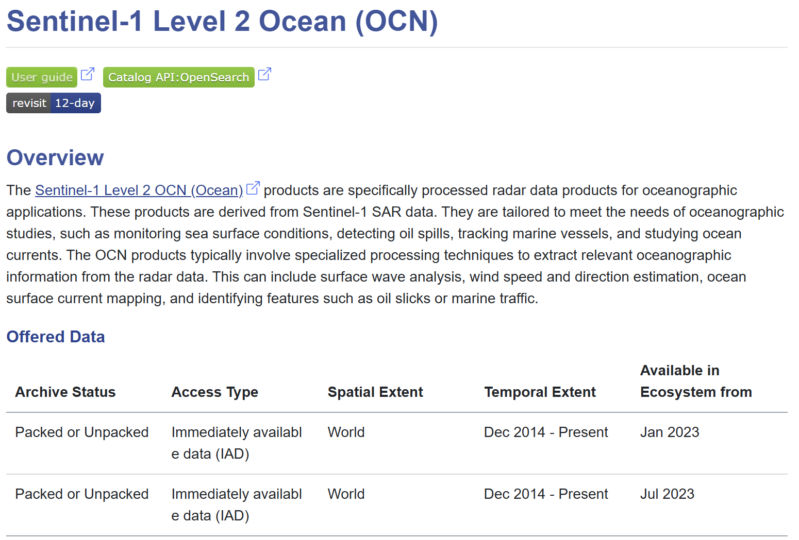{ loading=lazy }
  <figcaption>Sentinel-1 Level 2 Ocean (OCN) product page on the Copernicus Data Space</figcaption>
</figure>
<figure markdown="span">
  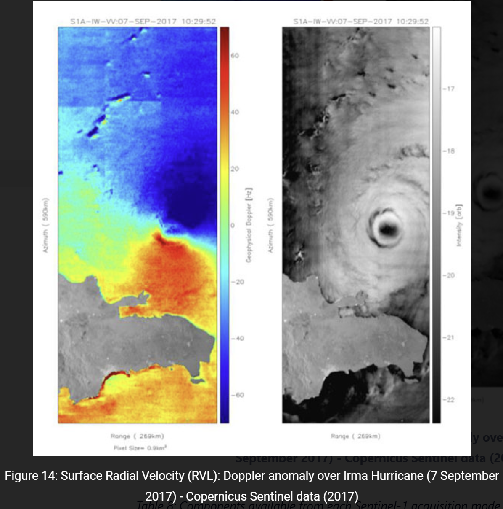{ loading=lazy }
  <figcaption>Sentinel-1 OCN example: radial velocity (RVL) Doppler anomaly over Hurricane Irma, 7 September 2017 (ESA documentation)</figcaption>
</figure>

Sentinel-1 normally observes wide areas at low resolution and switches to high-resolution, narrow-swath modes over regions of interest. Its strength is that it is weather-independent; its weaknesses are that interpretation is difficult and, above all, that coverage of the ocean is limited (coastal acquisitions exist, but open-sea acquisitions are few).

## MATLAB tools

- [:octicons-mark-github-16: oceanremotesensing/MATLAB_SAR](https://github.com/oceanremotesensing/MATLAB_SAR)
- [:octicons-link-external-24: SAR Processor (File Exchange)](https://kr.mathworks.com/matlabcentral/fileexchange/45672-sar-processor)
- [:octicons-link-external-24: SAR Signal Processing with MATLAB Algorithms, Reloaded (File Exchange)](https://kr.mathworks.com/matlabcentral/fileexchange/112395-sar-signal-processing-with-matlab-algorithms-reloaded)

## Download from ASF (ERS, Sentinel-1, ALOS)

- [:octicons-download-24: ASF Data Search (Vertex), Sentinel-1 OCN example](https://search.asf.alaska.edu/#/?dataset=SENTINEL-1&maxResults=5000&zoom=6.692&center=129.640,26.401&resultsLoaded=true&productTypes=OCN)

GRD_HS and GRD_HD products can be previewed in Vertex, but OCN products cannot; OCN can only be checked after download. The example below shows OCN data for the East China Sea, southwest of Kyushu.

<figure markdown="span">
  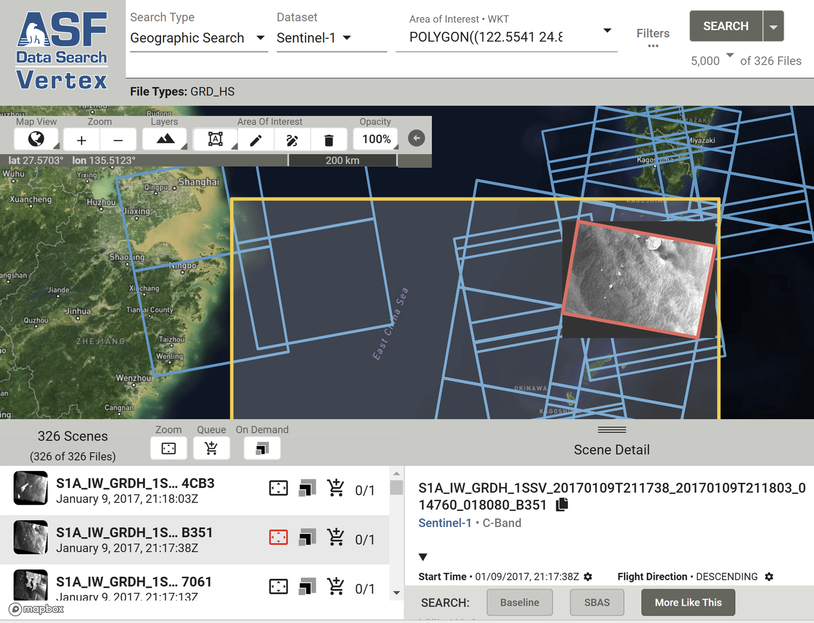{ loading=lazy }
  <figcaption>GRD_HS preview in ASF Vertex</figcaption>
</figure>
<figure markdown="span">
  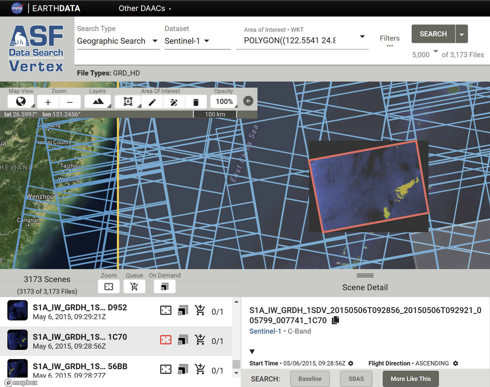{ loading=lazy }
  <figcaption>GRD_HD preview in ASF Vertex</figcaption>
</figure>
<figure markdown="span">
  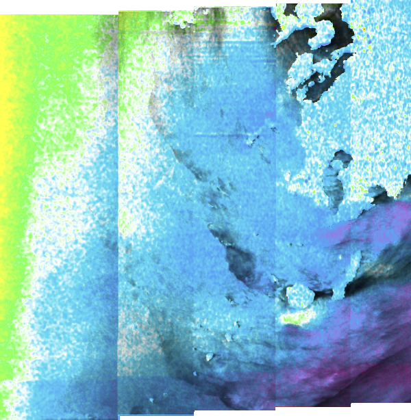{ loading=lazy }
  <figcaption>OCN quick-look: radial velocity (RVL)</figcaption>
</figure>
<figure markdown="span">
  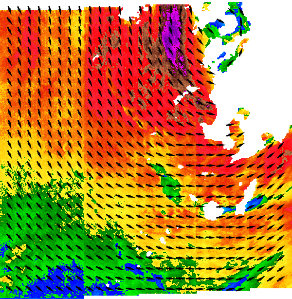{ loading=lazy }
  <figcaption>OCN quick-look: ocean wind (OWI)</figcaption>
</figure>

ALOS data from Japan can be downloaded the same way. The example below covers the East China Sea; Jeju Island is visible.

<figure markdown="span">
  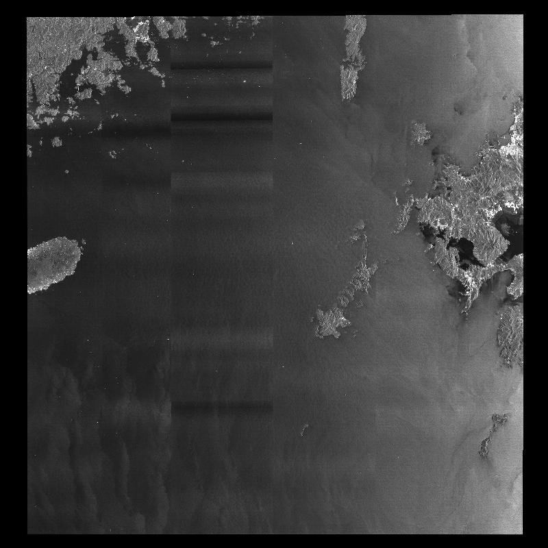{ loading=lazy }
  <figcaption>ALOS PALSAR scene over the East China Sea (EALPSRS269422950)</figcaption>
</figure>

### Downloading many scenes from ASF

1. Select `Export API`.
    <figure markdown="span">
      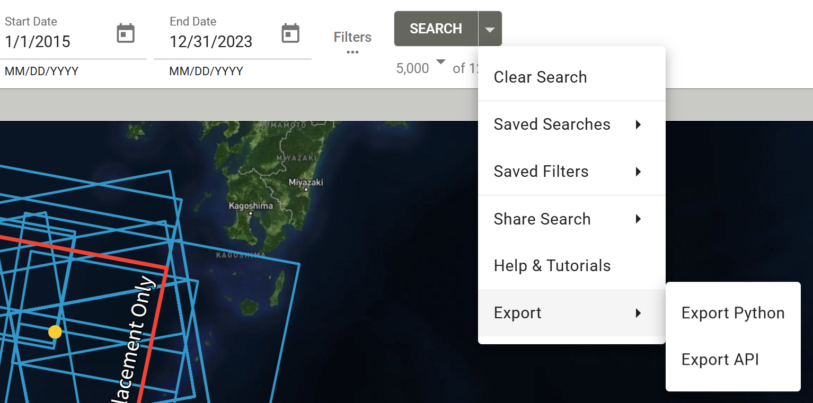{ loading=lazy }
      <figcaption>ASF Vertex: Export API</figcaption>
    </figure>
2. Click `Download Results`.
    <figure markdown="span">
      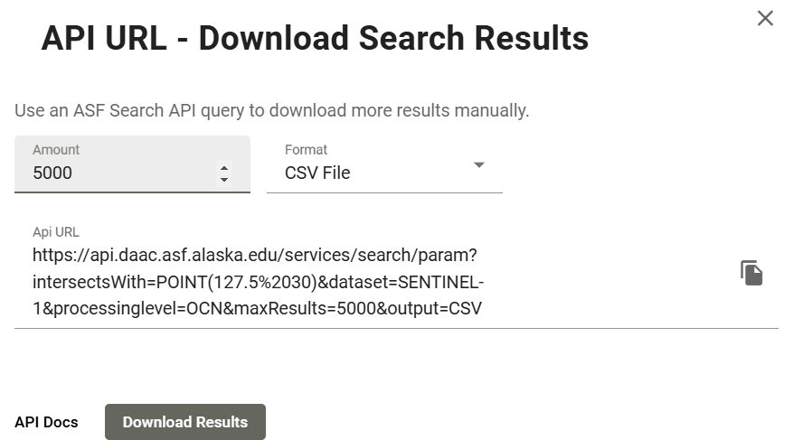{ loading=lazy }
      <figcaption>ASF Vertex: Download Results</figcaption>
    </figure>
3. Open the CSV. The `URL` column is what you need.
    <figure markdown="span">
      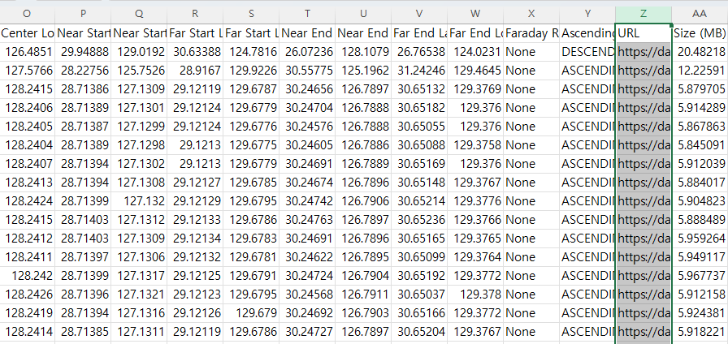{ loading=lazy }
      <figcaption>CSV exported from ASF with the URL column</figcaption>
    </figure>
4. Run the MATLAB download loop below. You must be logged in to Earthdata before running it. It is a good idea to run the loop with `i=1` only as a test: the Earthdata login page opens automatically, you log in there, and you can also check the download speed. If downloads are slow, increase `lag_time`.

    ```matlab title="Open each ASF URL for download"
    clc; clear; close all;

    % A file containing the data URL of the SAR satellite data downloaded
    % from the Alaska Satellite Facility (ASF) must be prepared

    read_xls; % read information about "URL" address in excel

    % Choose the appropriate value for your Internet speed environment
    lag_time = 1; % seconds between download each files.

    % Before executing the code, you must log in to the earthdata site in advance.
    % EARTHDATA Homepage : https://urs.earthdata.nasa.gov/
    for i=1:length(URL)
        web(URL(i))
        pause(lag_time);
    end
    ```

5. The zip files are downloaded as shown.
    <figure markdown="span">
      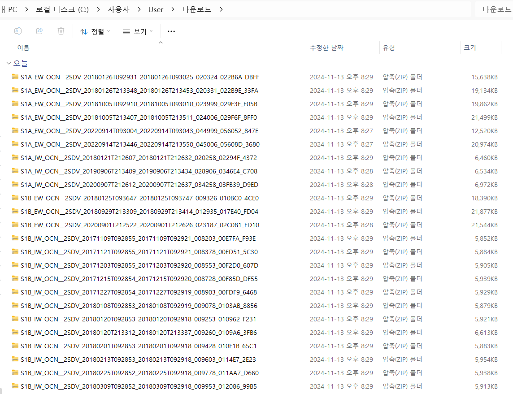{ loading=lazy }
      <figcaption>Downloaded zip files</figcaption>
    </figure>
6. Unzipping by hand is tedious, so use MATLAB.

    ```matlab title="Unzip all downloaded scenes"
    clc; clear; close all;
    fn = "D:\MATLAB_JU\RawData\SAR_Kuro"; % folder with the zip files
    fn2 = dir(sprintf("%s\\*.zip",fn));

    for i=1:height(fn2)
        fpath = sprintf("%s\\%s", fn2(i).folder, fn2(i).name);
        unzip(fpath); % extracted into the current folder
    end
    ```

7. Visualization example.
    <figure markdown="span">
      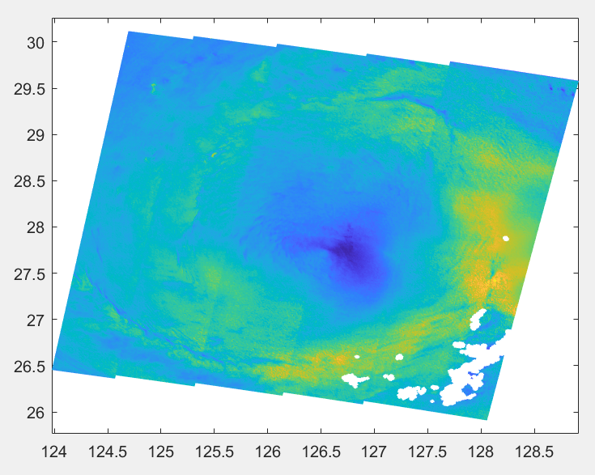{ loading=lazy }
      <figcaption>Sentinel-1 OCN wind speed plotted with pcolor</figcaption>
    </figure>

    ```matlab title="Plot OCN wind speed"
    clc; clear; close all;

    fnm = "C:\Users\User\OneDrive\문서\MATLAB\2024_Kuro" + ...
        "\khanun_SAR\S1A_EW_OCN__2SDV_20230804T213456_20230804T213559_049731_05FAEB_00F4.SAFE" + ...
        "\measurement\s1a-ew-ocn-vv-20230804t213456-20230804t213559-049731-05FAEB-001.nc";

    wind = ncread(fnm, 'owiWindSpeed');
    lon = ncread(fnm, 'owiLon');
    lat = ncread(fnm, 'owiLat');

    figure
    pcolor(lon, lat, wind); shading interp
    ```

## Download ERS SAR data

- [:octicons-link-external-24: ERS SAR raw data extraction and image formation (MATLAB Radar Toolbox)](https://kr.mathworks.com/help/radar/ug/ers-sar-raw-data-extraction-and-image-formation.html)

## Download Sentinel-1 from Copernicus Data Space

1. Open the [Copernicus Data Space Ecosystem](https://dataspace.copernicus.eu/) and register.
2. Click the green `Copernicus Browser` button at the top right.
    <figure markdown="span">
      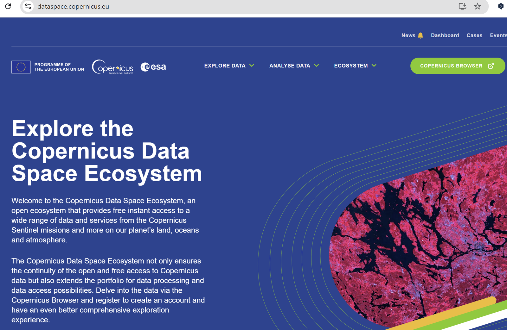{ loading=lazy }
      <figcaption>Copernicus Data Space: Copernicus Browser button</figcaption>
    </figure>
    <figure markdown="span">
      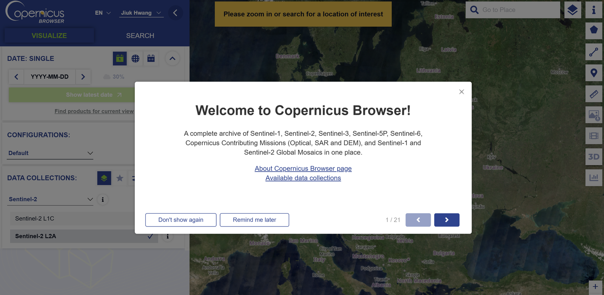{ loading=lazy }
      <figcaption>Copernicus Browser</figcaption>
    </figure>
3. In the `SEARCH` panel choose the satellite and product, then click the green `Search` button at the bottom. For a class assignment, Level-1 GRD > IW > VV+VH or HH+HV was used.
    <figure markdown="span">
      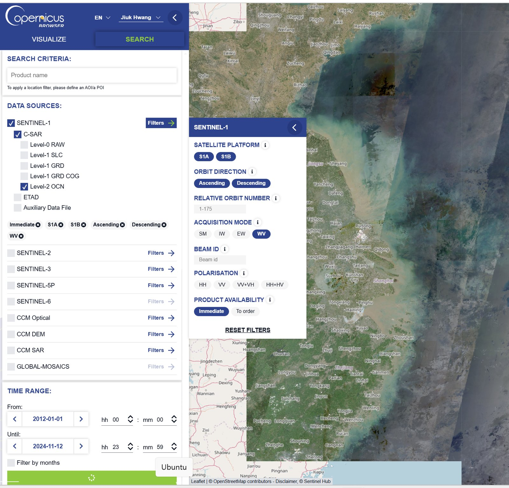{ loading=lazy }
      <figcaption>Copernicus Browser: search settings</figcaption>
    </figure>
4. Data for a specific date can be downloaded.
    <figure markdown="span">
      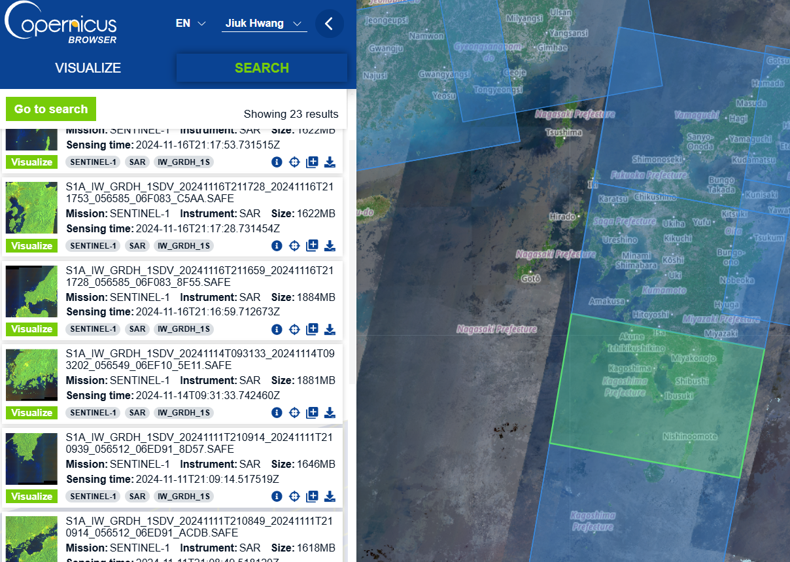{ loading=lazy }
      <figcaption>Copernicus Browser: search results</figcaption>
    </figure>
    <figure markdown="span">
      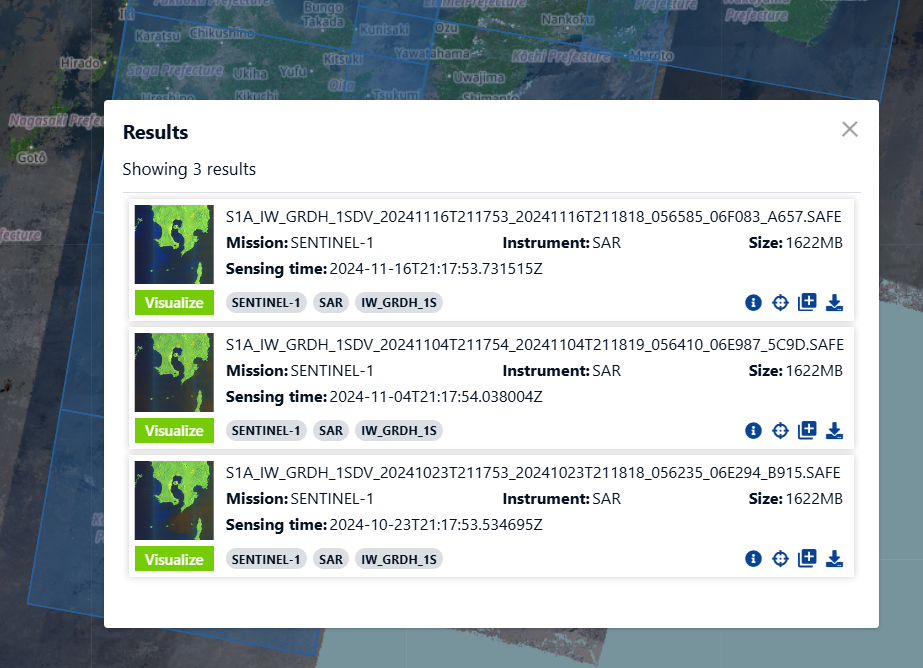{ loading=lazy }
      <figcaption>Copernicus Browser: download</figcaption>
    </figure>
5. Many scenes over a long period and a wide area can be downloaded at once from the [data workspace](https://dataspace.copernicus.eu/analyse/data-workspace).

### Sentinel-6A altimetry (PO.DAAC)

- [:octicons-link-external-24: Sentinel-6A MF Jason-CS L3 P4 Altimeter HR NTC Ocean Surface Topography, F08](https://podaac.jpl.nasa.gov/dataset/JASON_CS_S6A_L3_ALT_HR_OST_NTC_F08)
- [:octicons-link-external-24: Sentinel-6A MF Jason-CS L3 P4 Altimeter LR NTC Ocean Surface Topography, F08](https://podaac.jpl.nasa.gov/dataset/JASON_CS_S6A_L3_ALT_LR_OST_NTC_F08)

## Sea state from Sentinel-1 (Ifremer)

- [:octicons-mark-github-16: umr-lops/sarwaveifrproc](https://github.com/umr-lops/sarwaveifrproc): processor that generates Level-2 WAV sea-state products from Sentinel-1 SAR (UMR LOPS)

## Related links

- [CEDA catalogue: SAR](https://catalogue.ceda.ac.uk/?q=sar&sort_by=relevance&results_per_page=20)
- [foss4g.tistory.com: Sentinel-1 note 1](https://foss4g.tistory.com/1961)
- [foss4g.tistory.com: Sentinel-1 note 2](https://foss4g.tistory.com/2053)
- [Sentinel-1 L2 OCN (CREODIAS)](https://creodias.eu/eodata/sentinel-1/sentinel-1-l2-ocn/)
