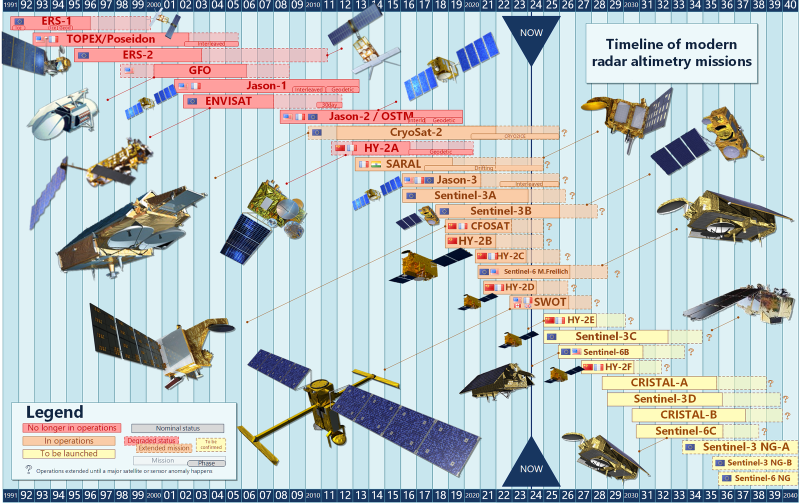
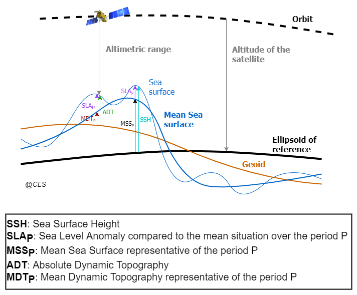
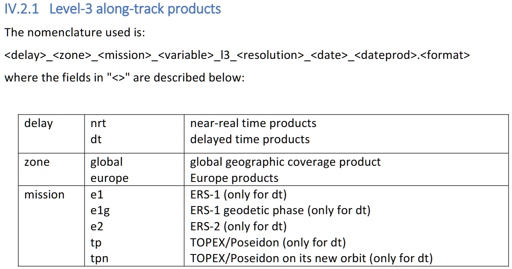
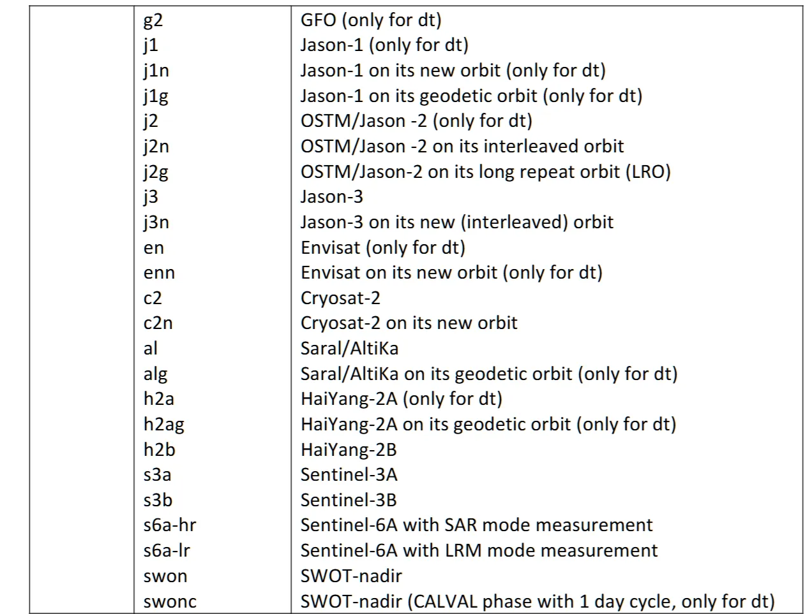
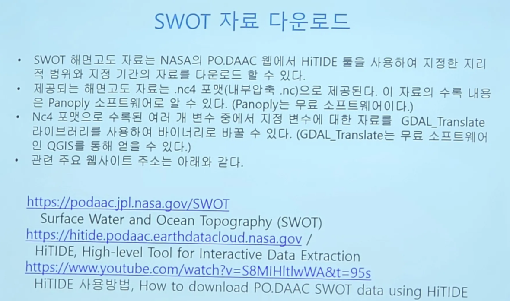

# :material-waves-arrow-up: Sea Surface Height & Altimeter [2025.01.08]

위성 고도계 기반 해수면 높이(SSH) 자료입니다. CMEMS, C3S, AVISO에서 배포하는 격자 자료와 along-track 자료를 정리했습니다.

<figure markdown="span">
  { loading=lazy }
  <figcaption>해수면 높이의 구성 요소 (출처: AVISO)</figcaption>
</figure>
<figure markdown="span">
  { loading=lazy }
  <figcaption>고도계에서 사용하는 여러 해수면 높이의 정의 (출처: DUACS/CLS FAQ)</figcaption>
</figure>

## CMEMS 격자 자료 (L4)

-   **Two-Satellite (Climate)** · 0.25° · 1993-01-01 – 2024-11-19

    ---

    기후 연구용으로 안정적인 두 위성 기반 자료. 기간은 2025.08.14 확인 기준

    [:octicons-link-external-24: SEALEVEL_GLO_PHY_CLIMATE_L4_MY_008_057](https://data.marine.copernicus.eu/product/SEALEVEL_GLO_PHY_CLIMATE_L4_MY_008_057/description)

-   **All-Satellite, Multi-Year** · 0.125° · 1993-01-01 – 2024-11-19

    ---

    모든 고도계 위성을 합성한 지연 모드 SSH. 기간은 2025.08.14 확인 기준

    [:octicons-link-external-24: SEALEVEL_GLO_PHY_L4_MY_008_047](https://data.marine.copernicus.eu/product/SEALEVEL_GLO_PHY_L4_MY_008_047/description)

-   **All-Satellite, NRT** · 0.125°, 0.25° · 2022-10-04 – present

    ---

    준실시간 다중 위성 SSH. 기간은 2025.08.14 확인 기준

    [:octicons-link-external-24: SEALEVEL_GLO_PHY_L4_NRT_008_046](https://data.marine.copernicus.eu/product/SEALEVEL_GLO_PHY_L4_NRT_008_046/description)

??? info "Multi-Year 자료의 이전 구분"
    2024.12.26 확인 당시에는 MY(1993 ~ 2023-06-07)와 MYINT(Multi-Year Interim, 2023-06-08 ~ 2023-12-31)로 나뉘어 있었습니다.
    현재는 1993-01-01 ~ 2024-11-19 기간이 하나의 자료로 제공됩니다.

## CMEMS along-track 자료 (L3)

**SEALEVEL_GLO_PHY_L3_MY_008_062** · 7 × 7 km (1 Hz) · daily · 1993-01-01 – 2024-04-11 (2025.01.08 확인)

1993~2012년 평균을 기준으로 계산한 along-track 해수면 이상(SLA)으로, 1 Hz(약 7 km) 간격의 지연 모드 자료입니다.
DUACS 다중 위성 처리 시스템이 가용한 모든 고도계 위성(Sentinel-6A, Jason-3, Sentinel-3A/B, Saral/AltiKa, Cryosat-2, Jason-1/2, Topex/Poseidon, ERS-1/2, Envisat, Geosat Follow-On, HY-2A/B 등)의 자료를 처리합니다.

- [:octicons-link-external-24: SEALEVEL_GLO_PHY_L3_MY_008_062](https://data.marine.copernicus.eu/product/SEALEVEL_GLO_PHY_L3_MY_008_062/description)
- [:octicons-book-24: Product User Manual (CMEMS-SL-PUM-008-032-068)](https://documentation.marine.copernicus.eu/PUM/CMEMS-SL-PUM-008-032-068.pdf)

??? info "변수"

    | 변수 | 단위 | 설명 |
    |---|---|---|
    | `sla_unfiltered` | m | 필터링·서브샘플링하지 않은 해수면 이상. DAC, ocean tide, LWE 보정 적용 |
    | `sla_filtered` | m | 필터링한 해수면 이상(서브샘플링 없음). DAC, ocean tide, LWE 보정 적용 |
    | `mdt` | m | 평균 역학 지형 (지오이드 기준 해수면 높이) |
    | `dac` | m | 동적 대기 보정 |
    | `ocean_tide` | m | 해양 조석 모델 |
    | `internal_tide` | m | 내부 조석 신호: M2, K1, O1, S2 coherent 모드 |
    | `lwe` | m | 장파장 오차 |
    | `time` | | 관측 시각 |
    | `longitude`, `latitude` | degrees | 관측 위치 (반복 궤도의 이론적 위치) |
    | `flag` | 0, 1 | 자료 출처 |
    | `cycle`, `track` | | 관측이 속한 cycle과 track |

??? info "Level-3 along-track 자료 목록"
    <figure markdown="span">
      { loading=lazy }
      <figcaption>Level-3 along-track 자료 (CMEMS PUM)</figcaption>
    </figure>
    <figure markdown="span">
      { loading=lazy }
      <figcaption>Level-3 along-track 자료 (계속, CMEMS PUM)</figcaption>
    </figure>

## AVISO

- [:octicons-link-external-24: AVISO+ 전 지구 해수면 높이 자료](https://www.aviso.altimetry.fr/en/data/products/sea-surface-height-products/global.html)

[Copernicus Marine Service (CMEMS)](http://marine.copernicus.eu/)는 Ssalto/Duacs 격자 **allsat** 자료와 along-track 해수면 이상, 절대 역학 지형, 지형류를 전 지구와 지역 해역에 대해 지연 모드와 준실시간으로 처리·배포합니다.
[Copernicus Climate Change Service (C3S)](https://climate.copernicus.eu/)는 Ssalto/Duacs 지연 모드 **twosat** 자료를 전 지구, 지중해, 흑해에 대해 처리·배포합니다.

??? info "Along-track L2P 다운로드 (Sentinel-3, Sentinel-6A)"
    Sentinel-3과 Sentinel-6A(Jason-CS)의 L2P 자료는 EUMETSAT(EUMETCast)과 AVISO+에서 받을 수 있습니다.

    1. [AVISO+ 포털](http://www.aviso.altimetry.fr/en/en/data/data-access/registration-form.html)에서 회원가입 후 라이선스에 동의하고, "Sea Level Anomalies Along-track Level-2+ (L2P) Sentinel-3&6" 자료를 선택합니다. 로그인 정보가 이메일로 옵니다.
    2. 가입 후에는 개인 [MY AVISO+](https://www.aviso.altimetry.fr/no_cache/en/my-aviso-plus.html) 계정의 product page에서 접근할 수 있습니다(인증 FTP, 온라인 자료).
    3. Sentinel-3 아카이브 자료는 [AVISO+ CNES Data Center](https://aviso-data-center.cnes.fr/)에서 가입 후 다운로드합니다.
    4. NRT/STC 자료는 EUMETCast와 Data Store(S3, S6)에서, S6·S3 NTC 자료는 Data Centre에서 제공합니다.

## Climate Data Store

- [:octicons-link-external-24: Sea level gridded data from satellite observations (CDS)](https://cds.climate.copernicus.eu/datasets/satellite-sea-level-global?tab=overview)

## SWOT

- [:octicons-link-external-24: SWOT 미션 (AVISO)](https://www.aviso.altimetry.fr/en/missions/current-missions/swot.html)

<figure markdown="span">
  { loading=lazy }
  <figcaption>2024.11.07 추계 해양학회 강용균 박사님 구두발표 슬라이드</figcaption>
</figure>
