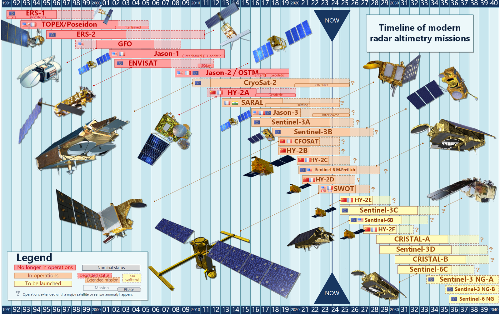
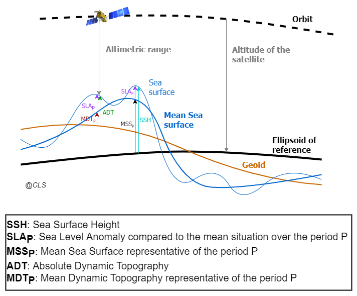
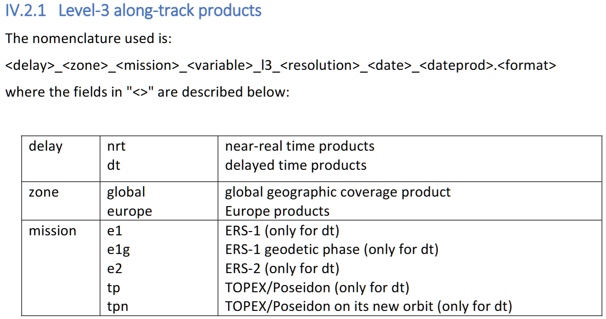
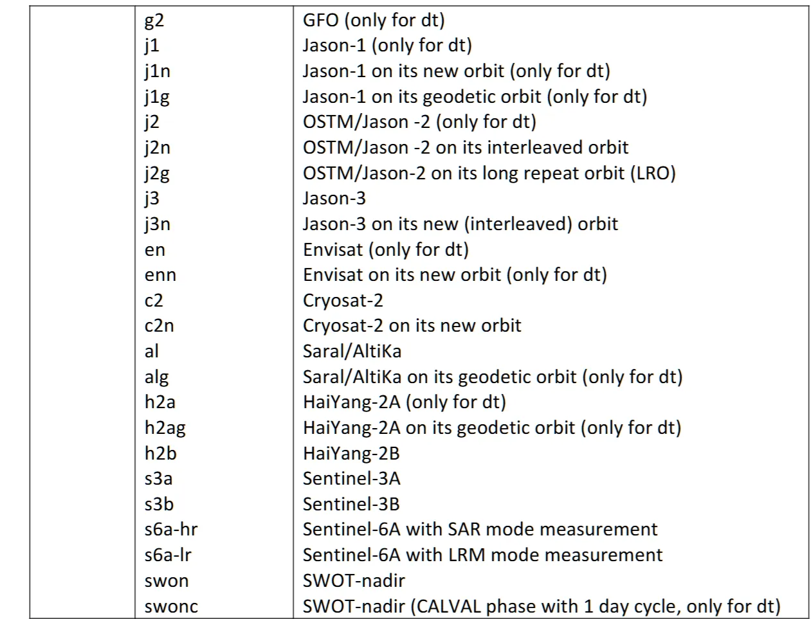
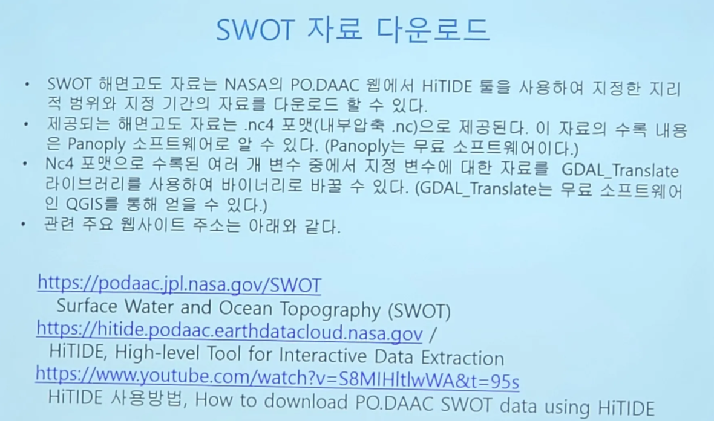

# :material-waves-arrow-up: Sea Surface Height & Altimeter [2025.01.08]

Gridded and along-track sea surface height (SSH) products from satellite altimetry, distributed by CMEMS, C3S and AVISO.

<figure markdown="span">
  { loading=lazy }
  <figcaption>Components of sea surface height (source: AVISO)</figcaption>
</figure>
<figure markdown="span">
  { loading=lazy }
  <figcaption>Sea surface heights used in altimetry (source: DUACS/CLS FAQ)</figcaption>
</figure>

## CMEMS gridded products (L4)

-   **Two-Satellite (Climate)** · 0.25° · 1993-01-01 – 2024-11-19

    ---

    Stable two-satellite series for climate studies. Dates retrieved on 2025.08.14

    [:octicons-link-external-24: SEALEVEL_GLO_PHY_CLIMATE_L4_MY_008_057](https://data.marine.copernicus.eu/product/SEALEVEL_GLO_PHY_CLIMATE_L4_MY_008_057/description)

-   **All-Satellite, Multi-Year** · 0.125° · 1993-01-01 – 2024-11-19

    ---

    Multimission altimeter SSH in delayed time. Dates retrieved on 2025.08.14

    [:octicons-link-external-24: SEALEVEL_GLO_PHY_L4_MY_008_047](https://data.marine.copernicus.eu/product/SEALEVEL_GLO_PHY_L4_MY_008_047/description)

-   **All-Satellite, NRT** · 0.125° and 0.25° · 2022-10-04 – present

    ---

    Near-real-time multimission SSH. Dates retrieved on 2025.08.14

    [:octicons-link-external-24: SEALEVEL_GLO_PHY_L4_NRT_008_046](https://data.marine.copernicus.eu/product/SEALEVEL_GLO_PHY_L4_NRT_008_046/description)

??? info "Earlier split of the Multi-Year series"
    Until the 2024.12.26 retrieval the series was split into MY (1993 to 2023-06-07) and MYINT (Multi-Year Interim, 2023-06-08 to 2023-12-31).
    The current product covers 1993-01-01 to 2024-11-19 in one series.

## CMEMS along-track product (L3)

**SEALEVEL_GLO_PHY_L3_MY_008_062** · 7 × 7 km (1 Hz) · daily · 1993-01-01 – 2024-04-11 (retrieved 2025.01.08)

Along-track sea level anomalies (SLA) computed with respect to the 1993–2012 mean at a 1 Hz (about 7 km) sampling, for delayed-time applications.
Processed by the DUACS multimission system from all available altimeter missions (Sentinel-6A, Jason-3, Sentinel-3A/B, Saral/AltiKa, Cryosat-2, Jason-1/2, Topex/Poseidon, ERS-1/2, Envisat, Geosat Follow-On, HY-2A/B, and others).

- [:octicons-link-external-24: SEALEVEL_GLO_PHY_L3_MY_008_062](https://data.marine.copernicus.eu/product/SEALEVEL_GLO_PHY_L3_MY_008_062/description)
- [:octicons-book-24: Product User Manual (CMEMS-SL-PUM-008-032-068)](https://documentation.marine.copernicus.eu/PUM/CMEMS-SL-PUM-008-032-068.pdf)

??? info "Variables"

    | Variable | Unit | Description |
    |---|---|---|
    | `sla_unfiltered` | m | Sea level anomaly, not filtered, not subsampled, with DAC, ocean tide and LWE corrections applied |
    | `sla_filtered` | m | Sea level anomaly, filtered, not subsampled, with DAC, ocean tide and LWE corrections applied |
    | `mdt` | m | Mean dynamic topography (sea surface height above geoid) |
    | `dac` | m | Dynamic atmospheric correction |
    | `ocean_tide` | m | Ocean tide model |
    | `internal_tide` | m | Internal tide signal: coherent M2, K1, O1, S2 modes |
    | `lwe` | m | Long wavelength error |
    | `time` | | Time of measurement |
    | `longitude`, `latitude` | degrees | Theoretical position for repetitive orbits |
    | `flag` | 0, 1 | Data origin |
    | `cycle`, `track` | | Cycle and track the measurement belongs to |

??? info "Level-3 along-track products"
    <figure markdown="span">
      { loading=lazy }
      <figcaption>Level-3 along-track products (CMEMS PUM)</figcaption>
    </figure>
    <figure markdown="span">
      { loading=lazy }
      <figcaption>Level-3 along-track products, continued (CMEMS PUM)</figcaption>
    </figure>

## AVISO

- [:octicons-link-external-24: AVISO+ global sea surface height products](https://www.aviso.altimetry.fr/en/data/products/sea-surface-height-products/global.html)

The [Copernicus Marine Service (CMEMS)](http://marine.copernicus.eu/) processes and distributes the Ssalto/Duacs gridded **allsat** series and along-track sea level anomalies, absolute dynamic topographies and geostrophic velocities over the global ocean and regional seas, in delayed time and near real time.
The [Copernicus Climate Change Service (C3S)](https://climate.copernicus.eu/) processes and distributes the Ssalto/Duacs delayed-time **twosat** series over the global ocean, Mediterranean Sea and Black Sea.

??? info "Along-track L2P download (Sentinel-3, Sentinel-6A)"
    The Sentinel-3 and Sentinel-6A (Jason-CS) L2P products are available from EUMETSAT via EUMETCast and from AVISO+:

    1. Register on the [AVISO+ portal](http://www.aviso.altimetry.fr/en/en/data/data-access/registration-form.html), sign the license agreement and select the product "Sea Level Anomalies Along-track Level-2+ (L2P) Sentinel-3&6". A login and password arrive by e-mail.
    2. Once registered, access is given in your personal [MY AVISO+](https://www.aviso.altimetry.fr/no_cache/en/my-aviso-plus.html) account on the product page (authenticated FTP, online products).
    3. Archived Sentinel-3 products: register and download at the [AVISO+ CNES Data Center](https://aviso-data-center.cnes.fr/).
    4. NRT/STC products via EUMETCast and the Data Store (S3 and S6); S6 and S3 NTC products via the Data Centre.

## Climate Data Store

- [:octicons-link-external-24: Sea level gridded data from satellite observations (CDS)](https://cds.climate.copernicus.eu/datasets/satellite-sea-level-global?tab=overview)

## SWOT

- [:octicons-link-external-24: SWOT mission (AVISO)](https://www.aviso.altimetry.fr/en/missions/current-missions/swot.html)

<figure markdown="span">
  { loading=lazy }
  <figcaption>Slide from Dr. Yong-Kyun Kang's oral presentation, Korean Society of Oceanography autumn meeting, 2024.11.07</figcaption>
</figure>
