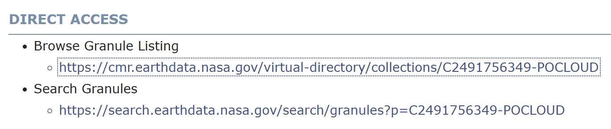
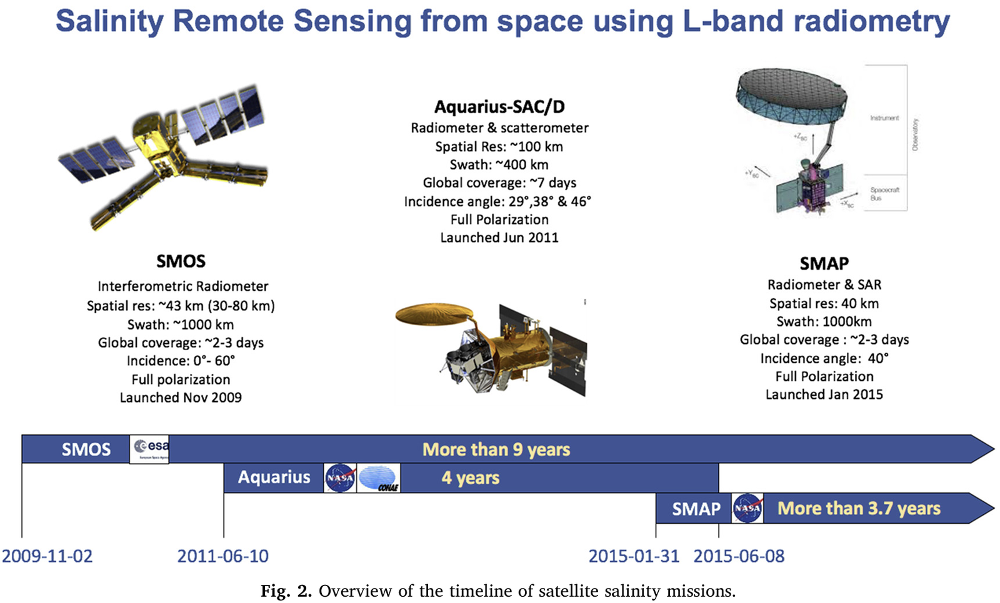
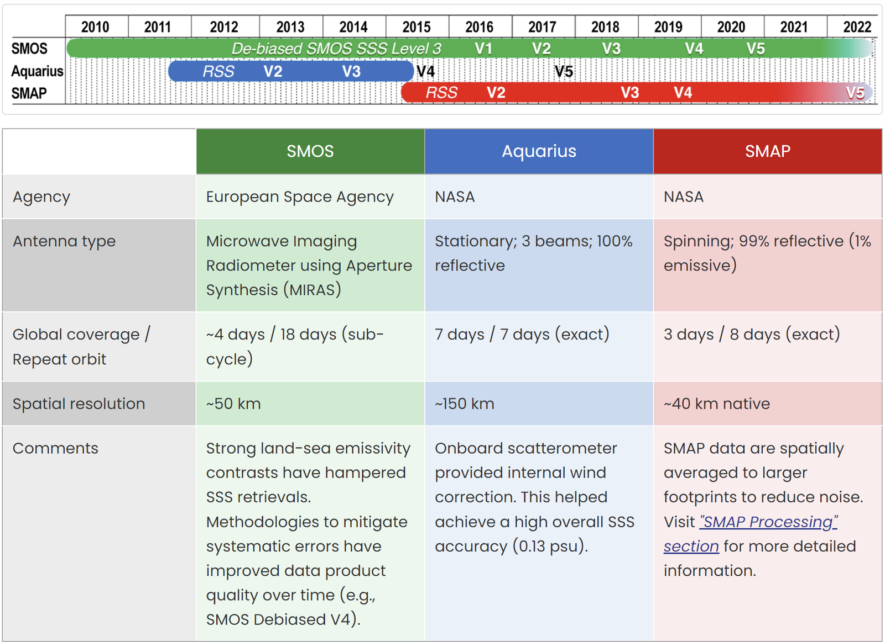
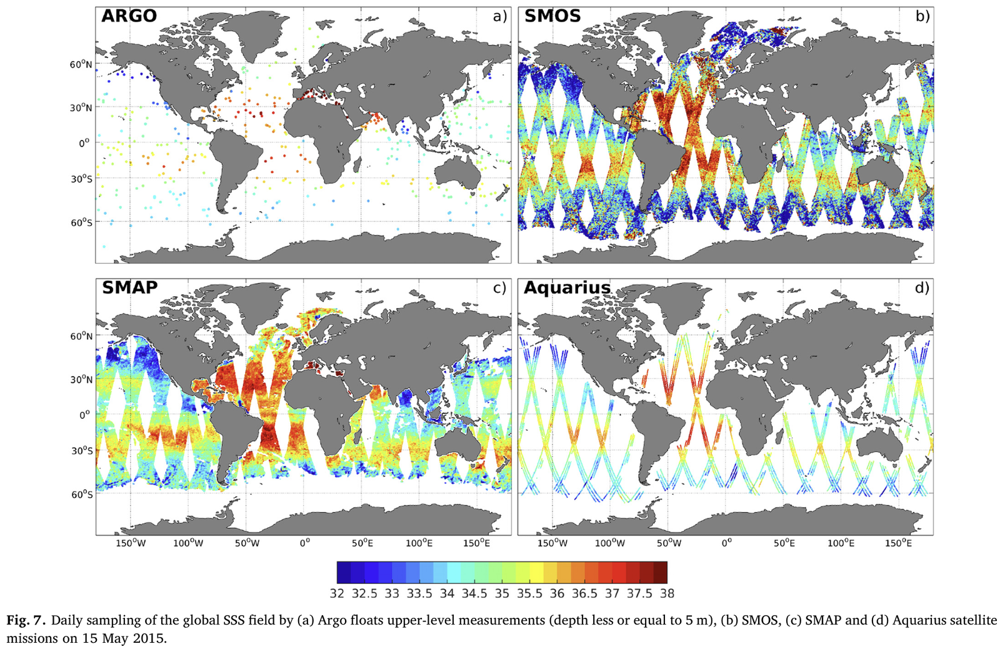
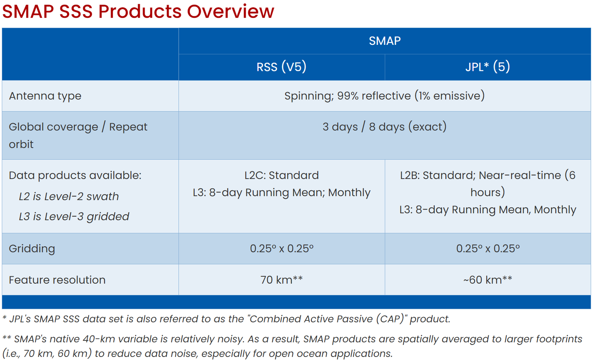

# :material-shaker-outline: Sea Surface Salinity <span class="date">[2024.11.26]</span>

SMOS, Aquarius, SMAP 위성의 표층 염분(SSS) 자료와 이를 합성한 다중 위성 자료, 그리고 RSS SMAP 파일을 내려받는 MATLAB 스크립트를 정리했습니다.

!!! tip "PO.DAAC의 SSS 자료 다운로드"
    자료를 받을 수 있는 PO.DAAC 링크는 아래 소개하는 product마다 다릅니다. PO.DAAC에서 원하는 자료가 있다면 `DIRECT ACCESS` > `Browse Granule Listing`에서 직접 받거나, [PO.DAAC MATLAB 다운로드 매뉴얼](podaac-manual.md)을 참고하세요.

    <figure markdown="span">
      { loading=lazy }
      <figcaption>PO.DAAC: DIRECT ACCESS > Browse Granule Listing</figcaption>
    </figure>

- [:octicons-link-external-24: Which salinity data are best for you? (NASA Salinity)](https://salinity.oceansciences.org/data-salinity-05.htm). 또는 아래의 CMEMS 다중 위성 합성 자료를 사용하셔도 됩니다.

## 위성 SSS 관측

<figure markdown="span">
  { loading=lazy }
  <figcaption>위성을 통한 표층 염분 관측 (출처: https://doi.org/10.1016/j.rse.2020.111769)</figcaption>
</figure>
<figure markdown="span">
  { loading=lazy }
  <figcaption>위성 SSS 미션 요약</figcaption>
</figure>
<figure markdown="span">
  { loading=lazy }
  <figcaption>위성 SSS 자료 비교</figcaption>
</figure>

!!! warning "우리나라 주변 해역 커버리지"
    SMOS는 우리나라 주변 해역을 커버하지 않으므로, 이 해역을 보려면 SMAP을 활용해야 합니다. Aquarius는 현재 운용되지 않으며, 현재 시기에 대해서는 SMAP 자료가 가용합니다.

## 합성 자료 (SMOS, Aquarius, SMAP)

<div class="grid cards" markdown>

-   **MULTIOBS_GLO_PHY_S_SURFACE_MYNRT_015_013** (CMEMS) · 0.125° · daily, monthly · 1993-01-01 – 2025-01-23

    ---

    전 지구, 89.94°S–89.94°N, 179.94°W–179.94°E

    [:octicons-link-external-24: Product page](https://data.marine.copernicus.eu/product/MULTIOBS_GLO_PHY_S_SURFACE_MYNRT_015_013/description)

-   **MULTIOBS_GLO_PHY_SSS_L4_MY_015_015** (CMEMS) · 0.25° · weekly · 2010-06-03 – 2025-01-02

    ---

    전 지구, 83.6°S–83.6°N. SMOS와 SMAP의 객관 분석

    [:octicons-link-external-24: Product page](https://data.marine.copernicus.eu/product/MULTIOBS_GLO_PHY_SSS_L4_MY_015_015/description)<br>
    [:octicons-book-24: Objective Analysis of SMOS and SMAP SSS (JTECH)](https://journals.ametsoc.org/view/journals/atot/38/3/JTECH-D-20-0093.1.xml)

-   **OISSS_L4_multimission_monthly_v2** (PO.DAAC) · 0.25° · monthly · 2011-08-01 – present

    ---

    Aquarius/SAC-D, SMAP, SMOS 세 위성을 최적 내삽(7일 decorrelation time scale)으로 합성한 L4 OISSS의 월평균

    [:octicons-link-external-24: OISSS_L4_multimission_monthly_v2](https://podaac.jpl.nasa.gov/dataset/OISSS_L4_multimission_monthly_v2)

</div>

## SMOS

<div class="grid cards" markdown>

-   **ESA SMOS**

    ---

    미션 페이지 및 자료 접근

    [:octicons-link-external-24: SMOS (ESA Earth Online)](https://earth.esa.int/eogateway/missions/smos)

-   **SMOS CATDS Qualified (L2Q) SSS** (CMEMS) · 0.25° · daily · 2010-01-12 – 2024-11-24

    ---

    전 지구, 83.6°S–83.6°N

    [:octicons-link-external-24: MULTIOBS_GLO_PHY_SSS_L3_MYNRT_015_014](https://data.marine.copernicus.eu/product/MULTIOBS_GLO_PHY_SSS_L3_MYNRT_015_014/description)

</div>

## Aquarius

Aquarius data are available from two locations. The archive of record for Aquarius archived data products is NASA's Physical Oceanography Distributed Active Archive Center (PO.DAAC), located at the Jet Propulsion Laboratory. In addition to the Level-1a orbital source data products which are updated daily, refined Level 2 orbital swath data and Level 3 gridded salinity and wind speed products (1 degree spatial resolution for daily, 7 day, monthly, seasonal, and annual time intervals) are updated monthly.

- [:octicons-link-external-24: Aquarius 미션 (PO.DAAC)](https://podaac.jpl.nasa.gov/Aquarius?tab=mission-objectives&sections=about%2Bdata)
- [:octicons-download-24: Aquarius SAC-D 자료 목록 (PO.DAAC)](https://podaac.jpl.nasa.gov/cloud-datasets?view=list&ids=Projects&values=AQUARIUS%20SAC-D)

## SMAP

<figure markdown="span">
  { loading=lazy }
  <figcaption>RSS와 JPL SMAP 자료의 차이</figcaption>
</figure>

### NASA JPL (PO.DAAC) 자료

사이트는 JPL이지만, RSS와 JPL product가 모두 제공됩니다.

=== "JPL"

    **JPL CAP 알고리즘**

    - L2 weekly V5.0
    - Gridded (L3) monthly V6.0
    - Gridded (L3) 8-day running mean V6.0

    [:octicons-link-external-24: SMAP_JPL_L2B_SSS_CAP_V5](https://podaac.jpl.nasa.gov/dataset/SMAP_JPL_L2B_SSS_CAP_V5)<br>
    [:octicons-link-external-24: SMAP_JPL_L3_SSS_CAP_MONTHLY_V5](https://podaac.jpl.nasa.gov/dataset/SMAP_JPL_L3_SSS_CAP_MONTHLY_V5)<br>
    [:octicons-link-external-24: SMAP_JPL_L3_SSS_CAP_8DAY-RUNNINGMEAN_V5](https://podaac.jpl.nasa.gov/dataset/SMAP_JPL_L3_SSS_CAP_8DAY-RUNNINGMEAN_V5)

=== "RSS"

    **Remote Sensing Systems**

    - L2 hourly V6.0
    - Gridded (L3) monthly V6.0
    - Gridded (L3) 8-day running mean V6.0

    [:octicons-link-external-24: SMAP_RSS_L2_SSS_V6](https://podaac.jpl.nasa.gov/dataset/SMAP_RSS_L2_SSS_V6)<br>
    [:octicons-link-external-24: SMAP_RSS_L3_SSS_SMI_MONTHLY_V6](https://podaac.jpl.nasa.gov/dataset/SMAP_RSS_L3_SSS_SMI_MONTHLY_V6)<br>
    [:octicons-link-external-24: SMAP_RSS_L3_SSS_SMI_8DAY-RUNNINGMEAN_V6](https://podaac.jpl.nasa.gov/dataset/SMAP_RSS_L3_SSS_SMI_8DAY-RUNNINGMEAN_V6)

검색 도구: [SMAP 미션 (PO.DAAC)](https://podaac.jpl.nasa.gov/Smap?tab=mission-objectives&sections=about%2Bdata) · [SMAP 자료 목록 (PO.DAAC)](https://podaac.jpl.nasa.gov/cloud-datasets?view=list&ids=Projects&values=SMAP)

### RSS 자료

- [:octicons-link-external-24: RSS SMAP salinity](https://www.remss.com/missions/smap/salinity/)

??? info "RSS 70 km 자료에 대하여"
    The Physical Oceanography Distributed Active Archive Center announced the availability of updated version 2.0 SMAP Sea Surface Salinity (SSS) data from Remote Sensing Systems ([RSS](http://www.remss.com/)) at a spatial resolution of 70 km.

    As is the case for the 40-km resolution product, the 70-km product is resampled onto a 0.25° fixed Earth grid using a **Backus-Gilbert type optimum interpolation (OI)**. In the case of the 70-km product, the target cell of the OI is a circular footprint with a diameter of 70 km. Compared to the 40-km product, the 70-km is spatially smoother and the random noise is reduced by 60%. For most oceanographic applications, it is recommended that the new 70-km product be used.

    Data sets comprising this release include the Level 2C orbital data and two Level 3 mapped salinity products: an 8-day running mean product based on the repeat orbit of the SMAP mission, along with a monthly average product. All products are in the netCDF4 file format, and the L3 products are CF/ACDD metadata standards compliant. The formats of the 40 km and 70 km products are the same.

## MATLAB으로 RSS SMAP SSS 다운로드 <span class="date">[2024.12.01]</span>

RSS SMAP V6.0 validated L3 파일(8-day running mean은 2015-04-01부터, monthly는 2015-04부터)을 RSS 서버에서 직접 내려받습니다. 기간과 저장 폴더를 설정한 뒤 필요한 섹션을 실행하세요.

??? example "MATLAB 스크립트"

    ```matlab title="Download RSS SMAP Salinity V6.0 Validated Dataset"
    %% Download RSS SMAP Salinity V6.0 Validated Dataset
    %   source : https://www.remss.com/missions/smap/salinity/
    %
    %   Written by Jiuk Hwang. 2024.12.01

    %% Gridded (L3) 8day Running
    %   Date Range : 2015.04.01 ~ Present
    clc; clear;
    dt = datetime(2015,4,1):caldays(1):datetime(2015,4,1);

    FigFolderNm = 'D:\MATLAB_JU\2024_RS_Assign6_SMAP';
    if ~exist(FigFolderNm, 'dir')
        mkdir(FigFolderNm);
    end

    for iyear = unique(year(dt))
        dtid = year(dt) == iyear;
        hamster = dt(dtid);
        for iday = 1:length(hamster)
            hamster2 = days(hamster(iday) - datetime(iyear, 1, 1) + 1);
            link = sprintf("https://data.remss.com/smap/SSS/V06.0/FINAL/L3/8day_running/%d/RSS_smap_SSS_L3_8day_running_2015_%03.0f_FNL_v06.0.nc", iyear, hamster2);

            websave(sprintf('%s\\%s.nc', FigFolderNm, string(hamster(iday))), link)
        end
    end

    %% Gridded (L3) Monthly
    %   Date Range : 2015.04 ~ Present
    clc; clear;
    dt = datetime(2015,4,1):calmonths(1):datetime(2015,4,1);

    FigFolderNm = 'D:\MATLAB_JU\2024_RS_Assign6_SMAP';
    if ~exist(FigFolderNm, 'dir')
        mkdir(FigFolderNm);
    end

    for iyear = unique(year(dt))
        dtid = year(dt) == iyear;
        hamster = dt(dtid);
        for iday = 1:length(hamster)
            hamster2 = datetime(hamster(iday), 'Format','uuuu_MM');
            link = sprintf("https://data.remss.com/smap/SSS/V06.0/FINAL/L3/monthly/%d/RSS_smap_SSS_L3_monthly_%s_FNL_v06.0.nc", iyear, string(hamster2));

            websave(sprintf('%s\\%s.nc', FigFolderNm, string(hamster2)), link)
        end
    end
    ```
