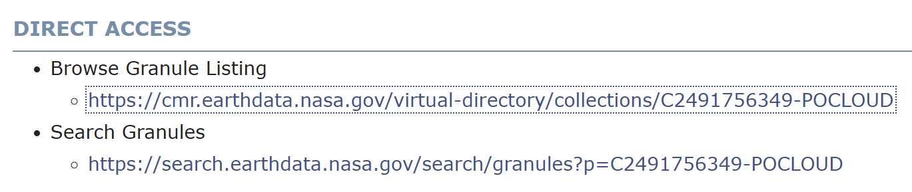
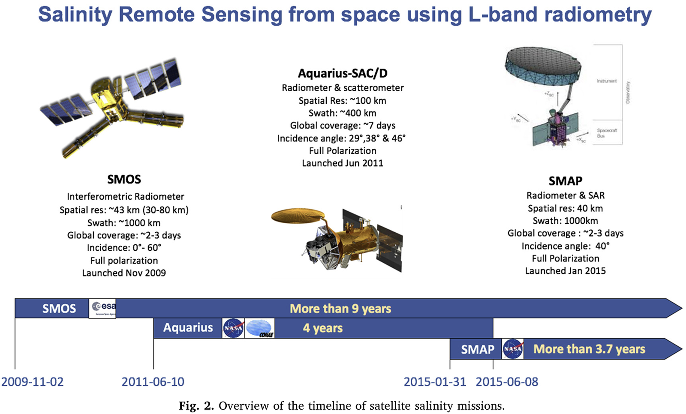
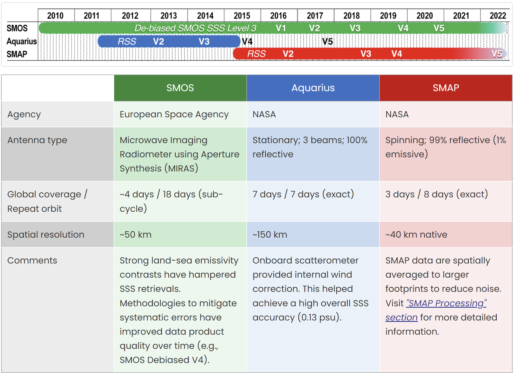
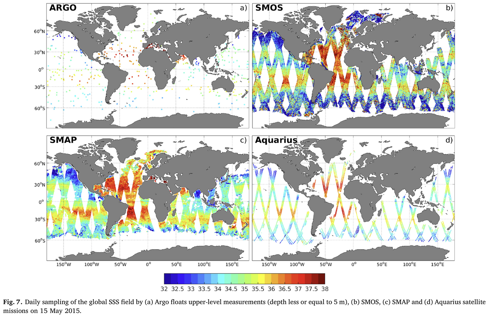
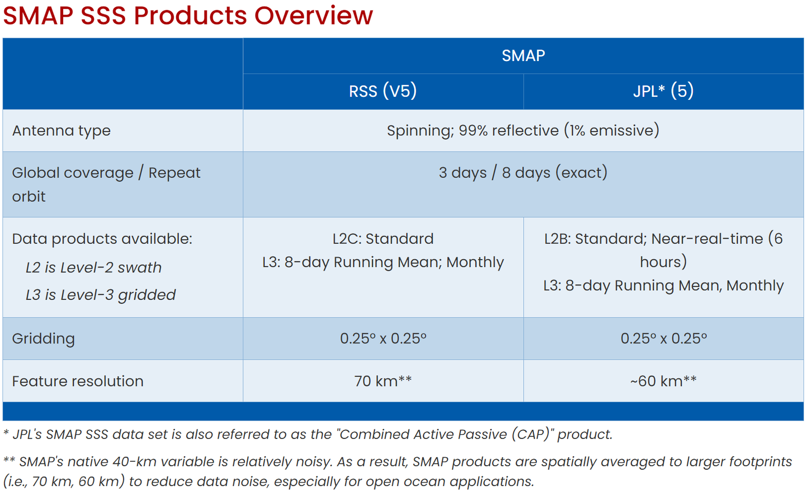

# :material-shaker-outline: Sea Surface Salinity <span class="date">[2024.11.26]</span>

Satellite sea surface salinity (SSS) from SMOS, Aquarius and SMAP, the combined multi-mission products, and a MATLAB script for downloading RSS SMAP files.

!!! tip "Downloading SSS products from PO.DAAC"
    The PO.DAAC link differs for each product listed below. For any PO.DAAC product, open `DIRECT ACCESS` > `Browse Granule Listing` and download the files there, or follow the [PO.DAAC MATLAB Download Manual](podaac-manual.md).

    <figure markdown="span">
      { loading=lazy }
      <figcaption>PO.DAAC: DIRECT ACCESS > Browse Granule Listing</figcaption>
    </figure>

- [:octicons-link-external-24: Which salinity data are best for you? (NASA Salinity)](https://salinity.oceansciences.org/data-salinity-05.htm), or use the multi-mission products from CMEMS listed below.

## Satellite SSS missions

<figure markdown="span">
  { loading=lazy }
  <figcaption>Sea surface salinity observation from satellites (source: https://doi.org/10.1016/j.rse.2020.111769)</figcaption>
</figure>
<figure markdown="span">
  { loading=lazy }
  <figcaption>Summary of satellite SSS missions</figcaption>
</figure>
<figure markdown="span">
  { loading=lazy }
  <figcaption>Comparison of satellite SSS products</figcaption>
</figure>

!!! warning "Coverage around Korea"
    SMOS does not cover the seas around Korea, so SMAP has to be used for this region. Aquarius is no longer operating; SMAP data are available for the current period.

## Combined products (SMOS, Aquarius, SMAP)

<div class="grid cards" markdown>

-   **MULTIOBS_GLO_PHY_S_SURFACE_MYNRT_015_013** (CMEMS) · 0.125° · daily, monthly · 1993-01-01 – 2025-01-23

    ---

    Global ocean, 89.94°S–89.94°N, 179.94°W–179.94°E

    [:octicons-link-external-24: Product page](https://data.marine.copernicus.eu/product/MULTIOBS_GLO_PHY_S_SURFACE_MYNRT_015_013/description)

-   **MULTIOBS_GLO_PHY_SSS_L4_MY_015_015** (CMEMS) · 0.25° · weekly · 2010-06-03 – 2025-01-02

    ---

    Global ocean, 83.6°S–83.6°N. Objective analysis of SMOS and SMAP

    [:octicons-link-external-24: Product page](https://data.marine.copernicus.eu/product/MULTIOBS_GLO_PHY_SSS_L4_MY_015_015/description)<br>
    [:octicons-book-24: Objective Analysis of SMOS and SMAP SSS (JTECH)](https://journals.ametsoc.org/view/journals/atot/38/3/JTECH-D-20-0093.1.xml)

-   **OISSS_L4_multimission_monthly_v2** (PO.DAAC) · 0.25° · monthly · 2011-08-01 – present

    ---

    Monthly mean of the Level 4 OISSS dataset using Aquarius/SAC-D, SMAP and SMOS, with optimal interpolation (7-day decorrelation time scale)

    [:octicons-link-external-24: OISSS_L4_multimission_monthly_v2](https://podaac.jpl.nasa.gov/dataset/OISSS_L4_multimission_monthly_v2)

</div>

## SMOS

<div class="grid cards" markdown>

-   **ESA SMOS**

    ---

    Mission page and data access

    [:octicons-link-external-24: SMOS (ESA Earth Online)](https://earth.esa.int/eogateway/missions/smos)

-   **SMOS CATDS Qualified (L2Q) SSS** (CMEMS) · 0.25° · daily · 2010-01-12 – 2024-11-24

    ---

    Global ocean, 83.6°S–83.6°N

    [:octicons-link-external-24: MULTIOBS_GLO_PHY_SSS_L3_MYNRT_015_014](https://data.marine.copernicus.eu/product/MULTIOBS_GLO_PHY_SSS_L3_MYNRT_015_014/description)

</div>

## Aquarius

Aquarius data are available from two locations. The archive of record for Aquarius archived data products is NASA's Physical Oceanography Distributed Active Archive Center (PO.DAAC), located at the Jet Propulsion Laboratory. In addition to the Level-1a orbital source data products which are updated daily, refined Level 2 orbital swath data and Level 3 gridded salinity and wind speed products (1 degree spatial resolution for daily, 7 day, monthly, seasonal, and annual time intervals) are updated monthly.

- [:octicons-link-external-24: Aquarius mission (PO.DAAC)](https://podaac.jpl.nasa.gov/Aquarius?tab=mission-objectives&sections=about%2Bdata)
- [:octicons-download-24: Aquarius SAC-D datasets (PO.DAAC)](https://podaac.jpl.nasa.gov/cloud-datasets?view=list&ids=Projects&values=AQUARIUS%20SAC-D)

## SMAP

<figure markdown="span">
  { loading=lazy }
  <figcaption>Differences between the RSS and JPL SMAP products</figcaption>
</figure>

### Data from NASA JPL (PO.DAAC)

The site is run by JPL, but both the RSS and the JPL products are distributed here.

=== "JPL"

    **JPL CAP algorithm**

    - L2 weekly V5.0
    - Gridded (L3) monthly V6.0
    - Gridded (L3) 8-day running mean V6.0

    [:octicons-link-external-24: SMAP_JPL_L2B_SSS_CAP_V5](https://podaac.jpl.nasa.gov/dataset/SMAP_JPL_L2B_SSS_CAP_V5)<br>
    [:octicons-link-external-24: SMAP_JPL_L3_SSS_CAP_MONTHLY_V5](https://podaac.jpl.nasa.gov/dataset/SMAP_JPL_L3_SSS_CAP_MONTHLY_V5)<br>
    [:octicons-link-external-24: SMAP_JPL_L3_SSS_CAP_8DAY-RUNNINGMEAN_V5](https://podaac.jpl.nasa.gov/dataset/SMAP_JPL_L3_SSS_CAP_8DAY-RUNNINGMEAN_V5)

=== "RSS"

    **Remote Sensing Systems**

    - L2 hourly V6.0
    - Gridded (L3) monthly V6.0
    - Gridded (L3) 8-day running mean V6.0

    [:octicons-link-external-24: SMAP_RSS_L2_SSS_V6](https://podaac.jpl.nasa.gov/dataset/SMAP_RSS_L2_SSS_V6)<br>
    [:octicons-link-external-24: SMAP_RSS_L3_SSS_SMI_MONTHLY_V6](https://podaac.jpl.nasa.gov/dataset/SMAP_RSS_L3_SSS_SMI_MONTHLY_V6)<br>
    [:octicons-link-external-24: SMAP_RSS_L3_SSS_SMI_8DAY-RUNNINGMEAN_V6](https://podaac.jpl.nasa.gov/dataset/SMAP_RSS_L3_SSS_SMI_8DAY-RUNNINGMEAN_V6)

Search tools: [SMAP mission (PO.DAAC)](https://podaac.jpl.nasa.gov/Smap?tab=mission-objectives&sections=about%2Bdata) · [SMAP datasets (PO.DAAC)](https://podaac.jpl.nasa.gov/cloud-datasets?view=list&ids=Projects&values=SMAP)

### Data from RSS

- [:octicons-link-external-24: RSS SMAP salinity](https://www.remss.com/missions/smap/salinity/)

??? info "About the RSS 70 km product"
    The Physical Oceanography Distributed Active Archive Center announced the availability of updated version 2.0 SMAP Sea Surface Salinity (SSS) data from Remote Sensing Systems ([RSS](http://www.remss.com/)) at a spatial resolution of 70 km.

    As is the case for the 40-km resolution product, the 70-km product is resampled onto a 0.25° fixed Earth grid using a **Backus-Gilbert type optimum interpolation (OI)**. In the case of the 70-km product, the target cell of the OI is a circular footprint with a diameter of 70 km. Compared to the 40-km product, the 70-km is spatially smoother and the random noise is reduced by 60%. For most oceanographic applications, it is recommended that the new 70-km product be used.

    Data sets comprising this release include the Level 2C orbital data and two Level 3 mapped salinity products: an 8-day running mean product based on the repeat orbit of the SMAP mission, along with a monthly average product. All products are in the netCDF4 file format, and the L3 products are CF/ACDD metadata standards compliant. The formats of the 40 km and 70 km products are the same.

## Download SMAP SSS from RSS with MATLAB <span class="date">[2024.12.01]</span>

Downloads the RSS SMAP V6.0 validated L3 files (8-day running mean from 2015-04-01, monthly from 2015-04) directly from the RSS server. Set the date range and the destination folder, then run the section you need.

??? example "MATLAB script"

    ```matlab title="Download RSS SMAP Salinity V6.0 Validated Dataset"
    %% Download RSS SMAP Salinity V6.0 Validated Dataset
    %   source : https://www.remss.com/missions/smap/salinity/
    %
    %   Written by Jiuk Hwang. 2024.12.01

    %% Gridded (L3) 8day Running
    %   Date Range : 2015.04.01 ~ Present
    clc; clear;
    dt = datetime(2015,4,1):caldays(1):datetime(2015,4,1);

    FigFolderNm = 'D:\MATLAB_JU\2024_RS_Assign6_SMAP';
    if ~exist(FigFolderNm, 'dir')
        mkdir(FigFolderNm);
    end

    for iyear = unique(year(dt))
        dtid = year(dt) == iyear;
        hamster = dt(dtid);
        for iday = 1:length(hamster)
            hamster2 = days(hamster(iday) - datetime(iyear, 1, 1) + 1);
            link = sprintf("https://data.remss.com/smap/SSS/V06.0/FINAL/L3/8day_running/%d/RSS_smap_SSS_L3_8day_running_2015_%03.0f_FNL_v06.0.nc", iyear, hamster2);

            websave(sprintf('%s\\%s.nc', FigFolderNm, string(hamster(iday))), link)
        end
    end

    %% Gridded (L3) Monthly
    %   Date Range : 2015.04 ~ Present
    clc; clear;
    dt = datetime(2015,4,1):calmonths(1):datetime(2015,4,1);

    FigFolderNm = 'D:\MATLAB_JU\2024_RS_Assign6_SMAP';
    if ~exist(FigFolderNm, 'dir')
        mkdir(FigFolderNm);
    end

    for iyear = unique(year(dt))
        dtid = year(dt) == iyear;
        hamster = dt(dtid);
        for iday = 1:length(hamster)
            hamster2 = datetime(hamster(iday), 'Format','uuuu_MM');
            link = sprintf("https://data.remss.com/smap/SSS/V06.0/FINAL/L3/monthly/%d/RSS_smap_SSS_L3_monthly_%s_FNL_v06.0.nc", iyear, string(hamster2));

            websave(sprintf('%s\\%s.nc', FigFolderNm, string(hamster2)), link)
        end
    end
    ```
