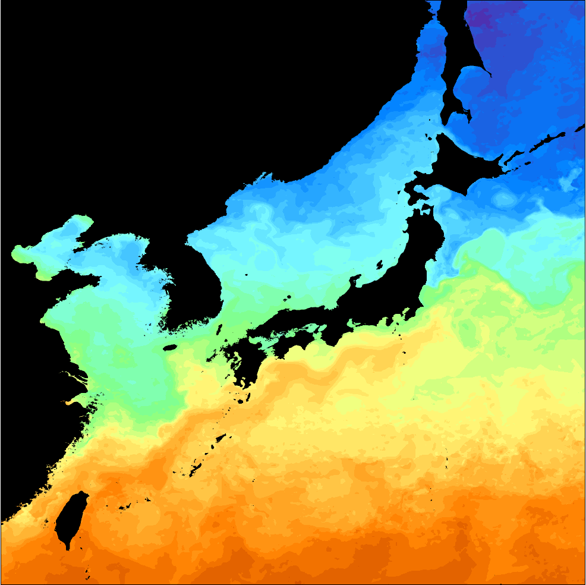

# :material-thermometer-water: Sea Surface Temperature [2026.10.29]

해양학 연구에 자주 활용되는 SST 자료는 **GHRSST**, **ERSST**, **HadISST**가 대표적입니다.
용도에 따라 고해상도 자료(GHRSST)와 장기 기후 자료(ERSST, HadISST) 중에서 고르면 됩니다.

??? info "GHRSST와 ERSST·HadISST의 차이"
    GHRSST는 프로젝트이자 데이터 포맷 표준화 조직으로, 그 안에 여러 기관이 GHRSST 포맷에 맞춰 생산한 여러 SST product가 포함됩니다.
    한편 ERSST는 NOAA가, HadISST는 Met Office Hadley Centre가 생산하는 단일 장기 재구성 SST 자료입니다.
    두 계열은 자료가 생산되는 목적 자체가 다르기 때문에, 용도에 맞게 선택하면 됩니다.

## 전 지구 자료

-   **GHRSST** · 고해상도

    ---

    여러 기관의 L2–L4 product (OSTIA, MUR 등). 상세한 지역 분석에 적합

    [:octicons-arrow-right-24: GHRSST 정리 및 자료 비교](ghrsst.md) 
    [:octicons-download-24: MATLAB 다운로드 코드 (GHRSST L4 11종, OISST)](https://kr.mathworks.com/matlabcentral/fileexchange/173480-sst-downloader-ghrsst-l4-po-daac-and-oisst-subset-by-area-and-period)

-   **OISST v2** · 0.25°, daily

    ---

    NOAA 최적내삽 SST. MATLAB 코드로 PSL에서 다운로드 가능

    [:octicons-link-external-24: NOAA PSL OISST v2 High Resolution](https://psl.noaa.gov/data/gridded/data.noaa.oisst.v2.highres.html)

-   **ERSST** · 저해상도, 장기

    ---

    NOAA 장기 재구성 SST. 기후 연구에 적합

    [:octicons-link-external-24: NOAA NCEI ERSST](https://www.ncei.noaa.gov/products/extended-reconstructed-sst)

-   **HadISST** · 저해상도, 장기

    ---

    Met Office Hadley Centre 장기 SST·해빙. 기후 연구에 적합

    [:octicons-link-external-24: Met Office Hadley Centre](https://www.metoffice.gov.uk/hadobs/hadisst/)

!!! tip "PO.DAAC에서 다른 SST 자료가 필요하다면"
    [PO.DAAC MATLAB 다운로드 매뉴얼](podaac-manual.md)을 참고하세요.

## 표면 온도 분석

**GISTEMP v4** (NASA GISS) · [Data.GISS: GISTEMP v4](https://data.giss.nasa.gov/gistemp/)

??? quote "About GISTEMP v4"
    The GISS Surface Temperature Analysis version 4 (GISTEMP v4) is an estimate of global surface temperature change.
    Graphs and tables are updated around the 10th of every month using current data files from **NOAA GHCN v4** (meteorological stations)
    and **ERSST v5** (ocean areas), combined as described in
    [Hansen et al. (2010)](https://www.giss.nasa.gov/pubs/abs/ha00510u.html) and
    [Lenssen et al. (2024)](https://www.giss.nasa.gov/pubs/abs/le07900t.html).
    These updated files incorporate reports for the previous month as well as late reports and corrections for earlier months.

## 지역: 한국

**KHOA SST** · L4, daily · **2020 – present**

우리나라 주변 실측 자료를 포함하여 만든 SST 합성장입니다.

- [:octicons-download-24: OPeNDAP Hyrax: /CONJUGATE/KHOA_SST/](https://nosc.go.kr/opendap/CONJUGATE/KHOA_SST/contents.html)
- [:octicons-link-external-24: 활용산출물 GIS 시스템](https://nosc.go.kr/nosc_gis/sst.do), 간단한 시각화와 다운로드

<figure markdown="span">
  { loading=lazy }
  <figcaption>KHOA SST L4 예시, 2025년 5월 4일</figcaption>
</figure>

??? info "입력 자료 구성"
    우리나라 인근 해역에 특화된 해수면온도 정보를 제공하기 위하여 **위성 5종**(GK2A AMI, NOAA-20 VIIRS, Terra MODIS, GCOM-W1 AMSR2, GPM GMI)과 **국가해양관측망**(조위관측소 46개소, 해양부이 31개소), **기상청 해양기상부이**(21개소), **국립수산과학원 어장정보**(117개소) 자료를 합성하여 1일 1회 생산되는 해양위성정보 활용산출물(L4)입니다.

    문서: [:octicons-file-24: Level 2 요약서 (KHOA SST)](../../assets/files/whole-ocean/satellite/sst/Level2요약서.pdf) · [:octicons-file-24: 해수면온도 ATBD (KHOA)](../../assets/files/whole-ocean/satellite/sst/해수면온도_ATBD.pdf)

## 검증용 현장 SST

iQuam(NOAA STAR의 현장 SST 품질 모니터링)은 현장 관측 페이지에 정리했습니다: [iQuam (In Situ → Other datasets)](../in-situ/others.md).
