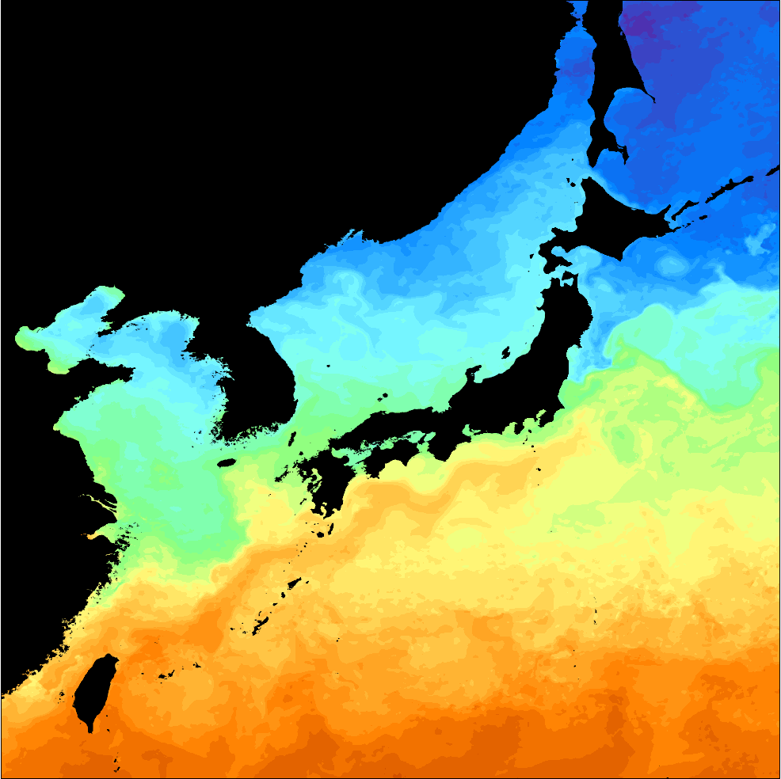

# :material-thermometer-water: Sea Surface Temperature [2026.10.29]

The SST datasets most used in oceanographic research are **GHRSST**, **ERSST** and **HadISST**.
Choose between high-resolution analyses (GHRSST) and long-term climate records (ERSST, HadISST) according to your purpose.

??? info "GHRSST versus ERSST and HadISST"
    GHRSST is a project and a data-format standard; it encompasses many SST products that different institutions produce in the GHRSST format.
    ERSST (NOAA) and HadISST (Met Office Hadley Centre) are single, long-term reconstructed SST datasets.
    The two families are produced for different purposes, so pick the one that fits your application.

## Global products

-   **GHRSST** · high resolution

    ---

    L2–L4 products from many institutions (OSTIA, MUR and others). Suited to detailed regional analysis

    [:octicons-arrow-right-24: GHRSST notes and product comparison](ghrsst.md) 
    [:octicons-download-24: MATLAB download script (11 GHRSST L4 datasets, OISST)](https://kr.mathworks.com/matlabcentral/fileexchange/173480-sst-downloader-ghrsst-l4-po-daac-and-oisst-subset-by-area-and-period)

-   **OISST v2** · 0.25°, daily

    ---

    NOAA optimum interpolation SST. Downloadable from PSL with the MATLAB script

    [:octicons-link-external-24: NOAA PSL OISST v2 High Resolution](https://psl.noaa.gov/data/gridded/data.noaa.oisst.v2.highres.html)

-   **ERSST** · low resolution, long term

    ---

    NOAA long-term reconstructed SST. Suited to climate studies

    [:octicons-link-external-24: NOAA NCEI ERSST](https://www.ncei.noaa.gov/products/extended-reconstructed-sst)

-   **HadISST** · low resolution, long term

    ---

    Met Office Hadley Centre long-term SST and sea ice. Suited to climate studies

    [:octicons-link-external-24: Met Office Hadley Centre](https://www.metoffice.gov.uk/hadobs/hadisst/)

!!! tip "Other SST products on PO.DAAC"
    See the [PO.DAAC MATLAB Download Manual](podaac-manual.md).

## Surface temperature analysis

**GISTEMP v4** (NASA GISS) · [Data.GISS: GISTEMP v4](https://data.giss.nasa.gov/gistemp/)

??? quote "About GISTEMP v4"
    The GISS Surface Temperature Analysis version 4 (GISTEMP v4) is an estimate of global surface temperature change.
    Graphs and tables are updated around the 10th of every month using current data files from **NOAA GHCN v4** (meteorological stations)
    and **ERSST v5** (ocean areas), combined as described in
    [Hansen et al. (2010)](https://www.giss.nasa.gov/pubs/abs/ha00510u.html) and
    [Lenssen et al. (2024)](https://www.giss.nasa.gov/pubs/abs/le07900t.html).
    These updated files incorporate reports for the previous month as well as late reports and corrections for earlier months.

## Regional: Korea

**KHOA SST** · L4, daily · **2020 – present**

A blended SST field for the seas around Korea that includes in situ observations.

- [:octicons-download-24: OPeNDAP Hyrax: /CONJUGATE/KHOA_SST/](https://nosc.go.kr/opendap/CONJUGATE/KHOA_SST/contents.html)
- [:octicons-link-external-24: KHOA product GIS system](https://nosc.go.kr/nosc_gis/sst.do), quick visualization and download

<figure markdown="span">
  { loading=lazy }
  <figcaption>KHOA SST L4 example, 4 May 2025</figcaption>
</figure>

??? info "Input data"
    An L4 ocean satellite product generated once a day by blending **five satellites** (GK2A AMI, NOAA-20 VIIRS, Terra MODIS, GCOM-W1 AMSR2, GPM GMI) with the **national ocean observing network** (46 tide stations, 31 ocean buoys), **KMA marine meteorological buoys** (21) and **NIFS fishing-ground information** (117 sites), to provide SST information specific to the seas around Korea.

    Documents: [:octicons-file-24: Level 2 summary (KHOA SST)](../../assets/files/whole-ocean/satellite/sst/Level2요약서.pdf) · [:octicons-file-24: SST ATBD (KHOA)](../../assets/files/whole-ocean/satellite/sst/해수면온도_ATBD.pdf)

## In situ SST for validation

iQuam (NOAA STAR in situ SST quality monitor) is described on the In Situ page: [iQuam (In Situ → Other datasets)](../in-situ/others.md).
